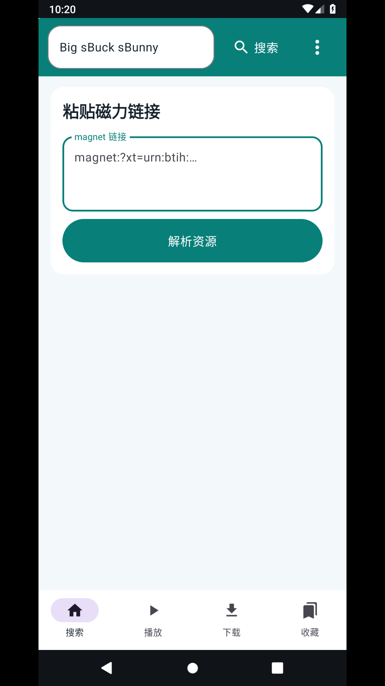

# FreeMangnetPlayer

FreeMangnetPlayer 是 Android 个人磁力搜索、解析、下载和播放应用。首页保留关键词搜索、搜索引擎配置、磁力链接解析，以及播放、下载、收藏列表。输入关键词后会进入独立搜索结果页；页面内可返回，Android 系统返回键也可返回首页。

**APK 下载：**[GitHub Releases](https://github.com/liao-zc/FreeMangnetPlayer/releases)

## 搜索引擎

内置引擎仅有以下 6 个：clg.im、mg.dobt.cc、BDFlixs、Pomo、MJf2020、HDZU。右上角菜单可切换引擎；菜单另有一个自定义引擎设置，可填写名称和搜索 URL。URL 可用 `%s` 作为关键词占位符；未填写占位符时应用会尝试自动填写网页搜索框。

搜索结果页列出扫描到的标题和 magnet，并提供“解析 / 播放”与“下载 / 缓存”。搜索站点没有可读 magnet 时会显示状态、重试、打开网站和返回入口。搜索抓取最多扫描 12 个同站详情页；验证码、站点改版、网络限制或详情页未包含 magnet 都会影响结果。

## 播放与列表

- 首页粘贴 magnet 后选择“解析资源”。取得种子元数据后可预览、下载或播放；应用会选择种子中的最大文件。
- 播放器提供 15 秒前进/后退和 0.5×、0.75×、1×、1.25×、1.5×、2×倍速。播放记录写入“播放”列表。
- 解析页可收藏资源；“下载”和“收藏”页提供重新打开及下载操作。
- 当前下载任务依赖应用任务页面存活，不承诺退出后的后台续传。记录和应用私有目录中的缓存会在清除数据或卸载时删除。

## 逐项验证记录

以下为当前代码对应的验证计划。推送后 GitHub Actions 会构建 APK，并在 Android 模拟器启动应用、检查可见控件、生成界面截图；播放器真实播放、下载完成和倍速 seek 需要可连接且含视频的在线种子，截图自动化不伪造此结果。

| 要求 | 当前实现 | 自动验证方式 / 结果 |
| --- | --- | --- |
| 只保留 6 个内置引擎及一个自定义项 | 搜索菜单固定显示指定 6 个引擎和自定义入口 | 模拟器 UI dump 检查 6 个引擎名称；截图 `03-engine-settings.png` |
| 修复首页白屏 | 启动时直接显示搜索首页；WebView 仅在用户开始搜索后创建 | 模拟器冷启动后检查搜索框、磁力链接输入与解析按钮、播放/下载/收藏入口可见；截图 `01-home-keyword.png` |
| 搜索结果独立页面和返回 | 搜索后切到“搜索结果”；页面按钮与系统返回键都回首页 | 模拟器 UI dump 检查结果页与返回控件；截图 `04-in-app-results.png`、`07-search-no-result.png` |
| 磁力解析入口 | 首页输入框验证 BTIH 格式并打开解析页 | 自动化检查首页输入框，并用 Android magnet 深链验证解析页入口；截图 `05-magnet-entry.png`、`06-torrent-progress.png`。虚构哈希不代表种子可用 |
| 播放、下载、收藏列表 | 底部四个入口均有独立列表；播放记录和收藏本地保存 | 模拟器逐一打开并检查列表标题；截图 `08-playback-list.png`、`09-download-list.png`、`10-favorites-list.png` |
| 倍速和前进/后退 | 播放器在可播放缓冲建立后提供 15 秒 seek 与 6 档倍速 | 源码实现检查；需可播放种子的实机操作验证，当前没有将虚构种子冒充播放成功 |
| 手机、平板、电视 | Android API 24+，Compose 响应式布局与可聚焦控件 | 当前自动化使用手机尺寸；平板和 Android TV 仍需对应设备实测 |

### 验证边界

当前会话没有可用的本机 Java、Android SDK 或 adb，因此我不能在本机声称构建或模拟器操作已通过。下方截图会由仓库 GitHub Actions 实际构建并运行模拟器后更新。用户提供的 magnet 字符串经过规范化后可以提取 BTIH，但仍需在线 tracker/DHT 与做种者才能取得文件列表；解析、播放及下载闭环尚未由有效在线种子验证。

## 实际界面截图

以下 PNG 是 Android 模拟器中的应用实际截图。搜索及磁力解析流程的示例关键词/哈希用于界面演示，不代表搜索结果或磁力种子可用。

## 构建

使用 Android Studio（JDK 17、Android SDK 35）打开项目，或执行 `gradlew.bat assembleDebug`。推送到 main 后会触发 APK 构建和模拟器截图工作流；GitHub Actions 通过后可在 Releases 页面下载 APK。

## 第三方依赖

应用使用 simple-torrent-android / FrostWire jlibtorrent、AndroidX 和 Media3；许可证与来源见 [第三方依赖说明](THIRD_PARTY_NOTICES.md)。
