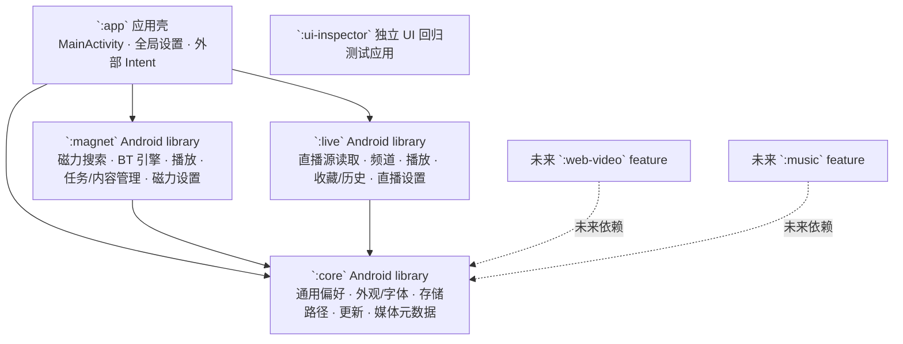

# OmniPlayer 架构

更新日期：2026-10-31

## Gradle 模块



`:app` 是组合根，提供首页、导航、外部 Magnet Intent 和设置页面。磁力与直播是独立的 Android library modules，分别拥有源代码、资源和 Android manifest。两个 feature 均只依赖共享的 `:core`，互相没有源码依赖；`SettingsActivity` 在 app 壳中组合两类设置，磁力播放器通过应用内组件名打开它，避免产生反向 Gradle 依赖。`:ui-inspector` 是独立的 UI 回归应用，由 CI 单独构建和运行，不是 `:app` 的 Gradle 依赖。

## 职责目录

| Gradle 模块 | 目录 | 责任 | 主要内容 |
|---|---|---|---|
| `:core` | `core/src/main/java/com/omniplayer/core/preferences` | 通用偏好和显示 | `SettingsStore`、字体、背景、目录选择 |
| `:core` | `.../media` | 共用媒体信息和格式能力 | 媒体事实、格式识别、大小展示 |
| `:core` | `.../update`、`.../navigation` | 应用更新和跨 feature 导航 | 断点续传、安装确认、返回应用壳 |
| `:magnet` | `magnet/src/main/java/com/omniplayer/magnet/search` | 关键词搜索和引擎设置 | 搜索 UI、网页结果桥、搜索引擎编辑 |
| `:magnet` | `.../engine` | 磁力解析和 BT 任务发现/下载 | Torrent、Peer、Tracker、分片读取、下载服务 |
| `:magnet` | `.../player` | 磁力资源的播放器和缓存覆盖 | Media3、LibVLC、缓存片段轨道 |
| `:magnet` | `.../library` | 下载、缓存、收藏与磁力历史 | 记录持久化、列表管理和已存资源队列 |
| `:magnet` | `.../settings` | 磁力专有设置 | 搜索引擎管理 Activity |
| `:live` | `live/src/main/java/com/omniplayer/live/source` | M3U/M3U8 源读取和解析 | 网络/本地播放列表、频道数据 |
| `:live` | `.../channels`、`.../player`、`.../settings` | 频道浏览、直播播放、直播专有设置 | 直播主页、全屏/PiP 播放器、源管理 |
| `:app` | `app/src/main/java/com/omniplayer/settings` | 全局设置界面 | 通用、磁力、直播和软件说明的入口 |

文件按职责目录收纳，同时保留现有 `com.omniplayer.magnet`、`com.omniplayer.live`、`com.omniplayer.core` 包名，避免无关公开组件改名和已有数据/调用路径变化。Android manifest、播放器布局和磁力图标归属对应 feature module。

## 扩展约束

未来的网站视频和音乐搜索分别作为 `:web-video`、`:music` Gradle library modules 接入，由 `:app` 组合。新 feature 可以依赖 `:core` 的显示、存储和更新能力，不应依赖 `:magnet` 或 `:live` 的业务实现。需要共享的新能力应先放在 `:core` 的稳定接口中；只有确认多个 feature 具有相同播放器行为后，再抽成独立的可复用播放器模块，避免空泛抽象和 feature 间循环依赖。

播放器数据读取仍由各 feature 的资源类型适配：磁力播放器只在整个文件已由 BT piece 校验且本地文件完整时走文件直读，部分文件继续走校验分片读取；直播播放器走网络流。共享设置、外观和媒体信息位于 `:core`。

## 构建与点检

```powershell
.\gradlew.bat :core:assembleDebug :magnet:assembleDebug :live:assembleDebug :app:assembleDebug assembleDebugAndroidTest
```

完整模拟器、instrumentation、受控 BT 与搜索回归由 `.github/workflows/library.yml` 执行；模块边界静态检查在 `scripts/architecture-smoke-check.py`。详细需求及本轮验收状态见 [requirements-checklist.md](requirements-checklist.md) 和 [report.md](report.md)。