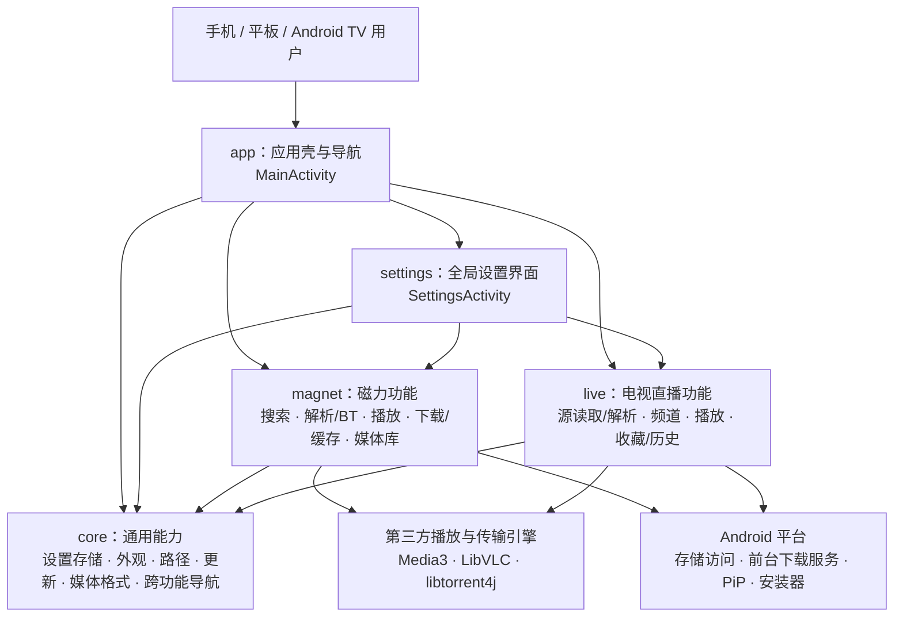

# OmniPlayer 架构说明

更新日期：2026-10-31

## 分层结构

## 代码归属

| 包 | 职责 | 主要入口/文件 |
|---|---|---|
| `com.omniplayer` | 应用首页、跨功能导航、外部 `magnet:` Intent | `MainActivity` |
| `com.omniplayer.core` | 两个业务共用的偏好存储、字体/背景、目录选择、更新、媒体格式和大小展示 | `SettingsStore`、`DisplaySettings`、`DirectoryPicker`、`AppUpdater`、`MediaFormats`、`ByteFormats` |
| `com.omniplayer.magnet` | 磁力搜索 UI 与 JS 桥、引擎配置、BT 任务与 Peer 管理、流式读取、播放器、下载缓存与媒体库 | `MagnetSearchUi`、`MagnetSearchBridge`、`TorrentTasks`、`TorrentFileDataSource`、`PlayerActivity`、`LibraryStore` |
| `com.omniplayer.live` | M3U/M3U8 地址或本地文件读取、频道解析/持久化、直播列表、直播源设置、播放器、直播收藏和历史 | `IptvPlaylistRepository`、`IptvStore`、`IptvActivity`、`IptvSettingsActivity`、`IptvPlayerActivity` |
| `com.omniplayer.settings` | 全局设置分类与软件说明/更新入口 | `SettingsActivity` |
| `com.masterwok.simpletorrentandroid` | 与 libtorrent JNI 会话交互的兼容层 | 本地保留的 session bridge 源码 |

## 依赖边界与数据

- 首页负责入口和跨功能导航；磁力搜索卡片/格式识别/磁力规范化/搜索桥接已移入 `magnet`；BT 通知和播放器返回首页通过 `core.AppNavigation` 路由，功能包不再直接导入首页 Activity。M3U 网络和本地文件读取在 `IptvPlaylistRepository`，M3U 解析与直播数据在 `IptvStore`。
- 通用外观设置由 `core.DisplaySettings` 读取，磁力与直播 UI 使用同一套字体/背景配置。通用偏好仍沿用原 SharedPreferences 名称和键，避免升级丢失设置。
- 磁力缓存、下载、收藏、播放队列与历史数据继续使用原本地存储格式；直播设置、收藏与观看历史仍由直播域单独存储。
- `AndroidManifest.xml` 指向分域后的 Activity、Service 和 Receiver 类名。应用 ID 保持 `com.freemangnetplayer`，用于覆盖安装时保留用户数据。
- 两种播放路径仍分别由 Media3/LibVLC 与 Media3 承担，Android 平台能力通过原 Activity、Service 和系统 Picker 接入。

## 当前模块化边界

本次建立的是同一 `:app` Gradle 模块内的清晰包边界和文件边界，没有更改 Gradle 模块图。首页仍负责 WebView 搜索会话的生命周期，并作为 `AppNavigation` 的返回目标；下一阶段可把该会话抽象为 `MagnetSearchCoordinator`，并在稳定后再拆成 Gradle feature modules。暂不拆 Gradle 模块是为了避免现有 Activity、Android Manifest、JNI/native 依赖和资源目录产生不必要的发布回归。

## 后续演进方向

1. 保持跨域只通过 `core` 的通用设置/格式接口和应用导航入口交互。
2. 给 BT 引擎、直播数据源和播放器分别增加明确的状态模型与可注入接口。
3. 在 UI 与数据行为回归稳定后，再把 `magnet`、`live` 提升为独立 Gradle library modules；届时由 app 壳组合两个 feature。
4. 不把文件列表解析、Peer 发现、收到校验分片和真实起播合并成一个“成功”状态；诊断报告应分别保留这些阶段。