# FreeMangnetPlayer v0.1.9 使用说明与真实测试报告

测试日期：2026-10-28。运行环境：GitHub Actions 上的 Android 35 手机模拟器，1080×2400。下面的图片均来自实际运行 APP 或 Chromium 浏览器后的截图，没有绘制播放画面或伪造下载进度。

**结论：空白页返回、解析页布局、进度条和真实文件列表已修复；可控在线种子的搜索→解析→边下边播→下载→收藏闭环通过。你提供的哪吒磁力已读取真实文件信息，但测试网络没有取得视频数据。六个引擎中五个完成结果一致性验证，dobt 仍无法完成搜索。因此本次不能标记“全部要求通过”。**

- [下载 FreeMangnetPlayer v0.1.9 APK](https://github.com/liao-zc/FreeMangnetPlayer/releases/download/v0.1.9/FreeMangnetPlayer-v0.1.9.apk)
- [下载离线 HTML 报告，截图已嵌入](https://github.com/liao-zc/FreeMangnetPlayer/releases/download/v0.1.9/FreeMangnetPlayer-v0.1.9-report.html)
- [下载正确命名的源码包](https://github.com/liao-zc/FreeMangnetPlayer/releases/download/v0.1.9/FreeMangnetPlayer-v0.1.9-source.zip)

## 1. 你的五项要求逐项结果

| 要求 | 实际改动和测试 | 结论 |
| --- | --- | --- |
| 搜索无结果不能白屏、必须能返回 | 隐藏搜索 WebView 移到屏幕外，避免盖住原生界面；查询有代次隔离和 40 秒上限。测试服务器真实返回无结果页面，检查顶部返回、重试、返回首页，点击后回到首页 | **通过**，见第 3 节两张实际截图 |
| 有效磁力可以解析 | 下载内核升级至 jlibtorrent 1.2.19.0；修复旧内核在新 Android 的权限错误、原生句柄失效、多文件分片数组索引；优先 TCP；无 tracker 的磁力可查询并校验元数据缓存。在线测试种子实际收到文件列表、播放和下载；用户哪吒链接只完成元数据读取 | **部分通过**，不能宣称两条用户资源均能播放，详见第 5、6 节 |
| 解析返回按钮不要挡住上方文字 | 使用系统安全区域，标题单独一行，54dp 返回按钮在标题下一行 | **通过**，实际解析进度和文件列表截图可见 |
| 读取过程用进度条，下方显示真实文件列表 | 元数据尚未取得时使用不定进度条；取得后显示真实已下载字节/总字节和百分比。列表来自 torrent 元数据的路径及大小 | **通过**，没有用假百分比表示元数据获取进度 |
| 六个引擎先浏览器搜索，再与 APP 对比 | 同一关键词“哪吒”，同一移动浏览器 User-Agent，分别提取搜索页和同站详情页的磁力，将 Hex/Base32 统一为 SHA-1 后比较完整集合 | **5/6 完成一致性验证**；dobt 浏览器与 APP 都无法完成有效搜索，不能算通过 |

## 2. 首页如何操作

打开 APP 后：首页包含关键词搜索框、搜索引擎菜单、磁力输入及解析入口，底部是“搜索 / 播放 / 下载 / 收藏”。没有导入、投屏或离线下载占位按钮。

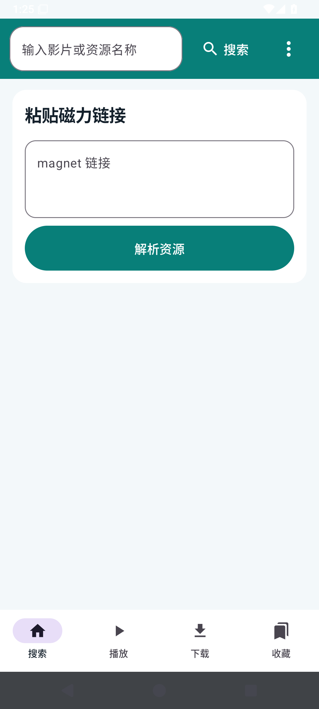

1. 在顶部输入资源关键词，点击“搜索”；结果进入独立页面。
2. 打开搜索框旁的引擎菜单，可选择指定六个引擎，或配置一个自定义引擎。自定义 URL 使用 `%s` 替换关键词；没有占位符时尝试填写网页表单。
3. 已有磁力时，在中部粘贴，点击“解析资源”。下面是实际在输入框粘贴用户原始链接的截图，包含 HTML 数字实体，APP 会清理实体及 Markdown 后缀。
4. 底部“播放”查看播放记录，“下载”查看实际任务记录，“收藏”查看多个已保存资源。下载依赖资源页面运行，离开页面会暂停，缓存保留；当前没有后台下载服务。


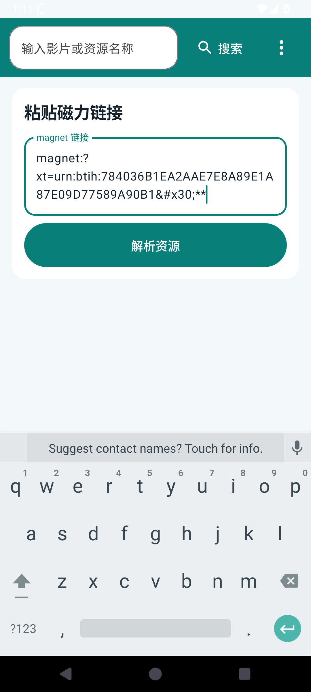

## 3. 搜索无结果与返回

搜索过程中，顶部返回及取消入口属于原生界面，不依赖网页成功加载。40 秒没有提取出 magnet 时，显示原因、重试、应用内查看网页和返回首页。网站 HTTP 错误会显示错误状态，不把 HTTP 403 等访问失败当作正常空结果。

测试使用真实 HTTP 页面 `No search results`，实际等待超时后点“返回首页”，重新检查磁力输入与解析按钮可见。

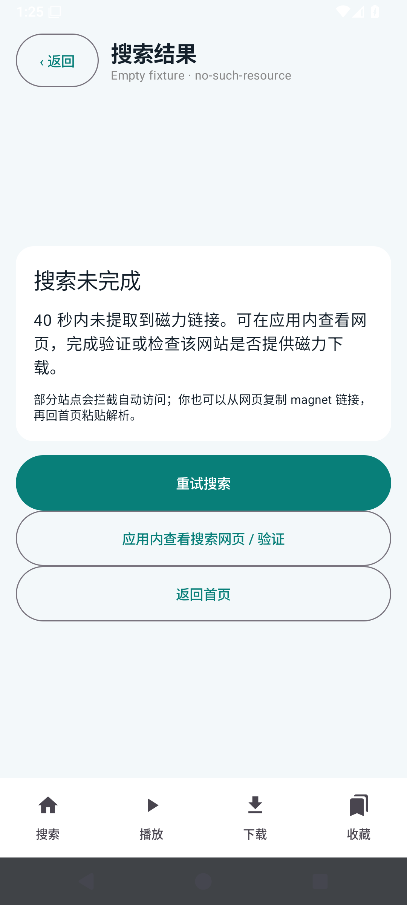


## 4. 六个引擎搜索“哪吒”的浏览器 / APP 对比

[原始对比 JSON](evidence/search-engines.json)。[独立对比工作流](https://github.com/liao-zc/FreeMangnetPlayer/actions/runs/40695955702)。表中的条数是去重后的磁力哈希数量；比较的是完整哈希集合，而不是仅比较数量。

| 引擎 | 浏览器结果 | APP 结果 | 对比结论 |
| --- | --- | --- | --- |
| clg.im（磁力狗） | 12 | 12 | **一致**；实际跳转至 clg63.top 并搜索 |
| mg.dobt.cc | 无可用搜索表单；最终为空文档 | 连接失败，无结果 | **未通过**；不能把两个 0 当作搜索成功 |
| www.bdflixs.com | 156 | 156 | **一致**，包含一条 Base32 磁力 |
| pomo.mom | 60 | 60 | **一致** |
| www.mjf2020.com | 0；网站明确提示没有资源 | 0 | **一致的空结果**，不代表找到了影视资源 |
| hdzu.org | 48；首次 HTTP 403，重试后 HTTP 200 | 48 | **一致**，访问状态变化保留在 JSON 的 http_attempts 中 |

### 磁力狗

浏览器与 APP 实际搜索同一个“哪吒”。资源结果的“解析 / 播放”会进入资源解析；“下载 / 缓存”建立任务。结果列表保留在 APP 内部，不跳到外部浏览器。

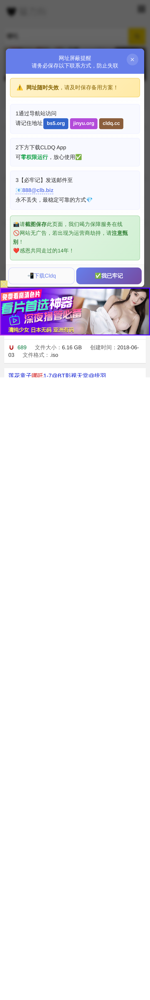
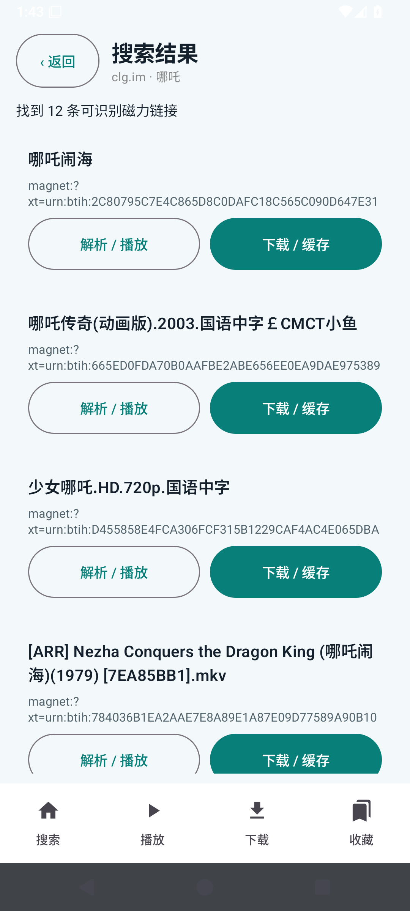

资源标题修复已在 APP 中单独重测：[运行记录](https://github.com/liao-zc/FreeMangnetPlayer/actions/runs/40698545407)，[原始标题及磁力 JSON](evidence/search-titles.json)。确认搜索结果标题显示真实资源名称，不再把 magnet URI 当标题。

### dobt：为什么还不能通过

该地址实际是 iframe 包装页，依赖外部 jQuery，并把搜索页面指向 `https://doc2.htmcdn.com:39988/`。浏览器测试最终得到空 HTML 文档，填写搜索框超时；APP 则报网站连接失败。本机对该代理端口直接请求也在 15 秒内超时。这些证据说明本轮测试无法访问其实际搜索服务，**不证明该站在所有用户网络上都不可用**。不能由修改 APP 保证第三方站点或网络端口持续可达。


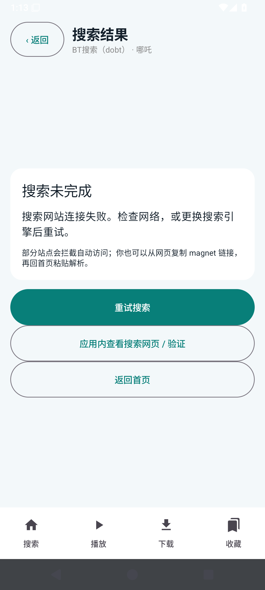

### BDFlixs

曾出现浏览器 155、APP 156 的差异。原因是旧测试脚本只识别 40 位十六进制 BTIH，遗漏了有效的 32 位 Base32 磁力。修正两边的哈希标准化后，真实重测得到 156 / 156，集合一致。搜索抓取器也去掉了整个卡片文字匹配，避免把分类、作者链接当作资源详情。


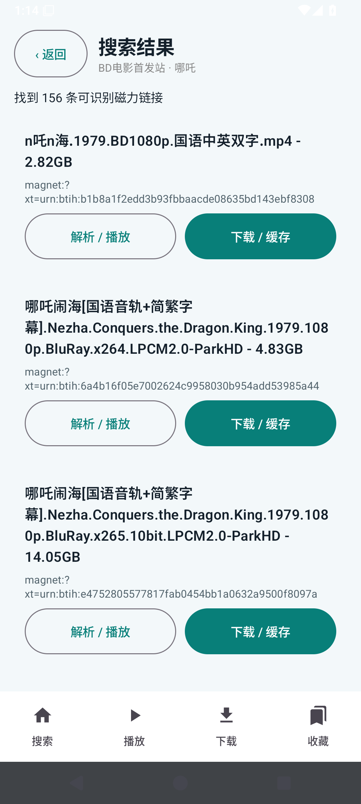

### Pomo


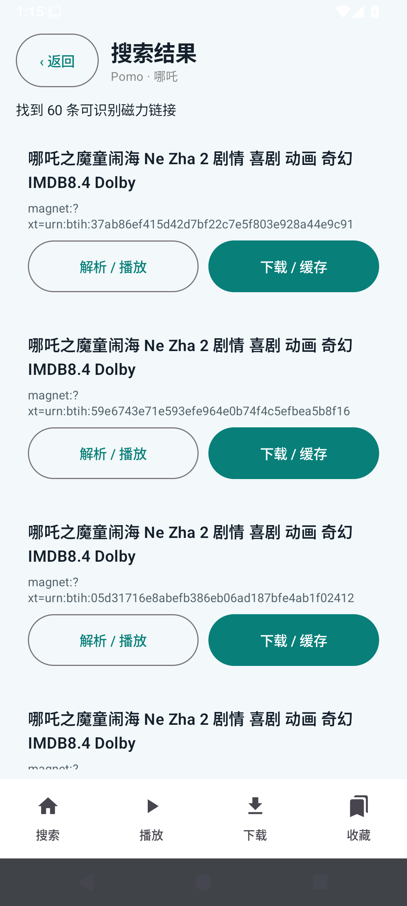

### 美剧粉：正常空结果


### 高清族

浏览器第一次被 HTTP 403 拒绝，第二次取得 HTTP 200 后读出 48 个磁力，和 APP 完整集合一致。重试过程没有被删除。


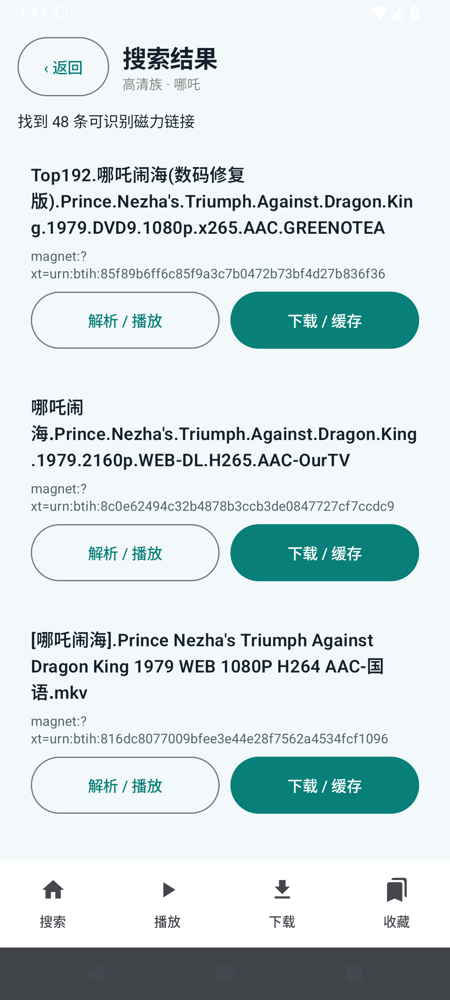

## 5. 真实在线种子的完整操作与测试

[功能证据 JSON](evidence/native-functional.json)。[运行记录](https://github.com/liao-zc/FreeMangnetPlayer/actions/runs/40695622711)。该工作流的 Android 测试步骤成功，最后自动提交截图时发生二进制文件 rebase 冲突，导致整体工作流显示失败；图片和数据已从 artifact 手动同步。现已取消并发自动提交截图，避免这类发布冲突。

素材：Blender 的 **Big Buck Bunny，CC BY**，来源 [W3C 公开视频](https://media.w3.org/2010/05/bunny/trailer.mp4)。测试脚本将其转换为真实 MP4，在测试服务器开启真正的 BitTorrent 种子及 tracker。APP 仅从搜索结果拿到 magnet，文件信息通过 P2P 获取。**这是下载内核和播放器的真实闭环测试，素材不是用户提供的哪吒电影。**

### 5.1 搜索并选择资源

通过自定义测试引擎搜索 Bunny，APP 原生结果页出现标题与磁力。点击“解析 / 播放”。此引擎只用于自动化测试，不属于 APP 的六个内置站点。

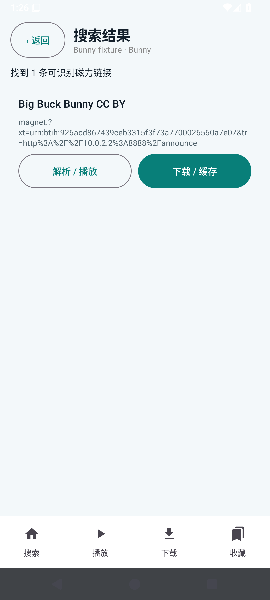

### 5.2 读取元数据并显示文件

解析页标题与返回按钮分行。读取中使用不定进度条；收到文件信息后显示真实文件列表 `BigBuckBunny-CCBY.mp4`，大小 1,612,714 字节。

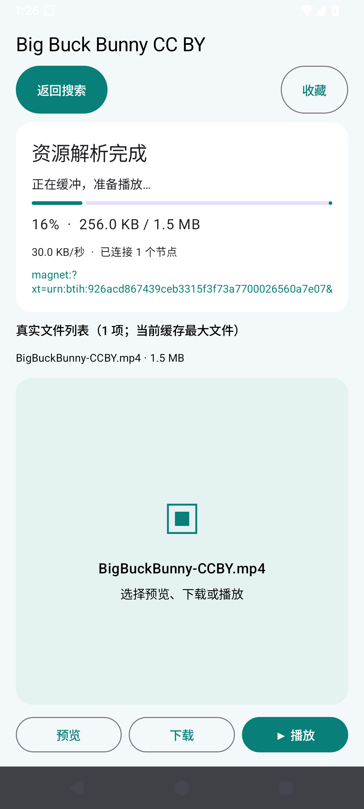
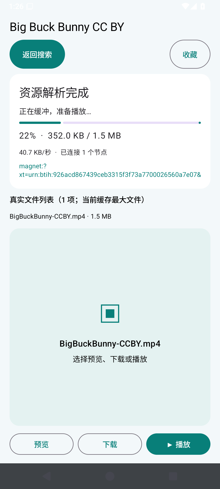

### 5.3 边下载边播放

点击“▶ 播放”。测试记录为：已下载 **655,360 / 1,612,714 字节**，连接 1 个节点，播放器 `playing=true`。实际截图同时出现 **40% 下载进度和真实动画画面**，证明没有等到下载完毕才开始播放。

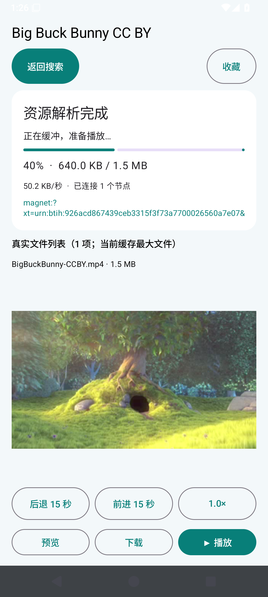

### 5.4 下载及缓存

点击“下载”，等到文件完成。APP 文件 SHA-256 与服务器原文件一致：

```text
0b3d4cff51f4e0962fc11e0abb704e459d3c932fa8e0ec2f47aae19e0ce655b0
```

这是对真实文件内容的校验，非仅检查按钮存在。缓存位于应用外部私有 Movies/FreeMangnetPlayer 目录。卸载或清除应用数据会删除记录及缓存。

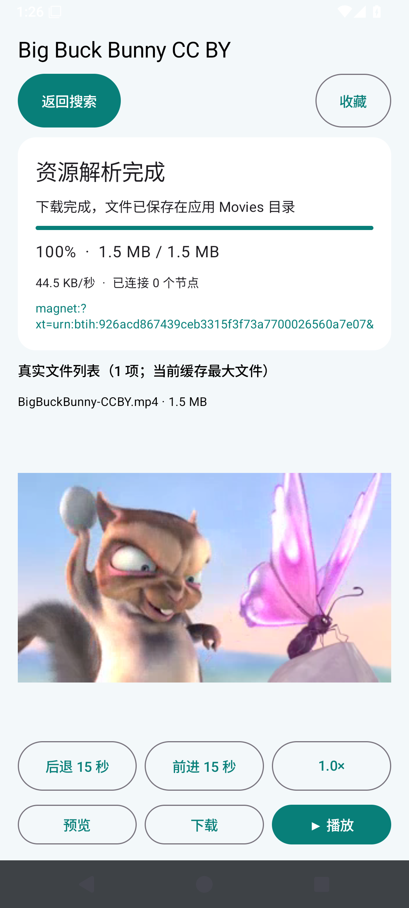

### 5.5 预览、播放、倍速与前进后退

资源页“预览”用于准备画面，“▶ 播放”开始或继续播放。画面下方有“后退 15 秒”“前进 15 秒”和倍速按钮，依次提供 0.5×、0.75×、1×、1.25×、1.5×、2×。

本轮实际播放成功，倍速从 1×切换到 1.25×；前进后位置增加超过 10 秒，后退后位置减少超过 8 秒，实际运行断言通过。没有把未加载播放器时的按钮检查当作 seek 成功。

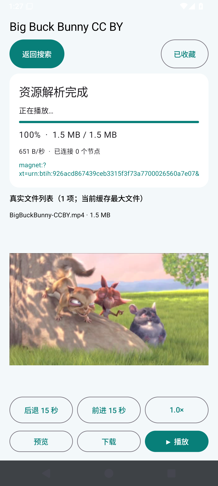
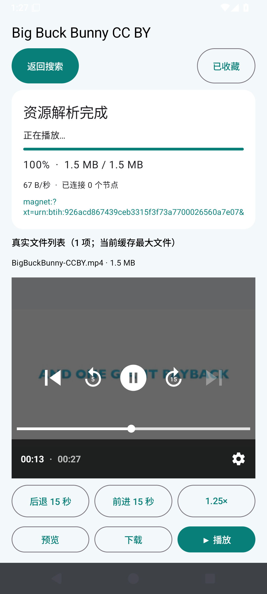

### 5.6 收藏并在下次打开后查看

在资源页点击“收藏”，回到首页打开“收藏”；强制停止并冷启动 APP 后再次打开收藏列表，仍能找到 Big Buck Bunny CC BY。多个资源按其来源分别保存。

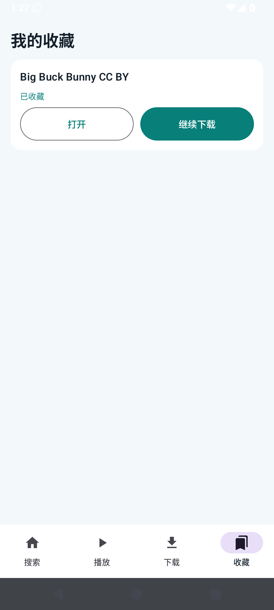

## 6. 用户给出的两条磁力：真实结果与未完成项

[通过真实输入框粘贴并解析的原始记录](evidence/user-resources.json)。[180 秒 / 条的运行记录](https://github.com/liao-zc/FreeMangnetPlayer/actions/runs/40693741635)。另在 TCP 修复后的功能工作流中重新尝试两条磁力，各等待 90 秒，结果相同。

| 链接 | 元数据 / 文件列表 | 节点与下载 | 播放结论 |
| --- | --- | --- | --- |
| 784036B1EA2AAE7E8A89E1A87E09D77589A90B10 | **成功**；哈希校验后得到 `[ARR] Nezha Conquers the Dragon King (哪吒闹海)(1979) [7EA85BB1].mkv`，537,348,214 字节 | 0 个节点，0 字节 | **未成功**，没有提供这部电影的播放截图 |
| b1b8a1f2edd3b93fbbaacde08635bd143ebf8308 | 测试时间内未取得元数据 | 0 个节点，0 字节 | **未成功**，45 秒后提示元数据超时，仍有返回按钮 |

第一条原始输入含 `&#x30;**`，已正确清理为以 `B10` 结尾的 40 位哈希，并非判定用户链接错误。无 tracker 的磁力可尝试在线 `.torrent` 缓存，下载后必须验证 infoHash 匹配；取得元数据并不等于取得视频，不能把文件名、收藏成功或 0% 进度说成播放成功。

这些测试只能说明 **测试网络中没有取得可传输数据的节点**。不能据此断言磁力本身无效或资源在全网没有做种者。要满足“这两条指定资源实际播放并展示电影画面”，仍需能发现并连接相关做种节点的网络或在线数据源；本轮未达到这一点。

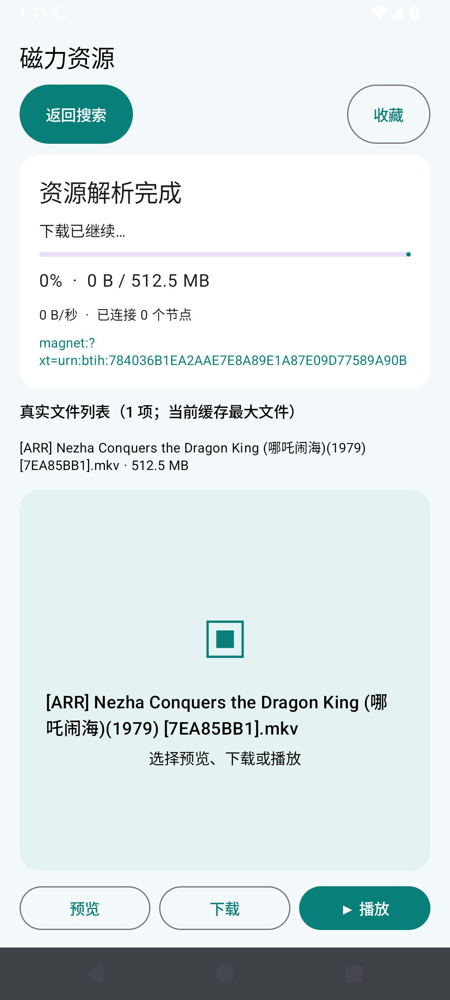
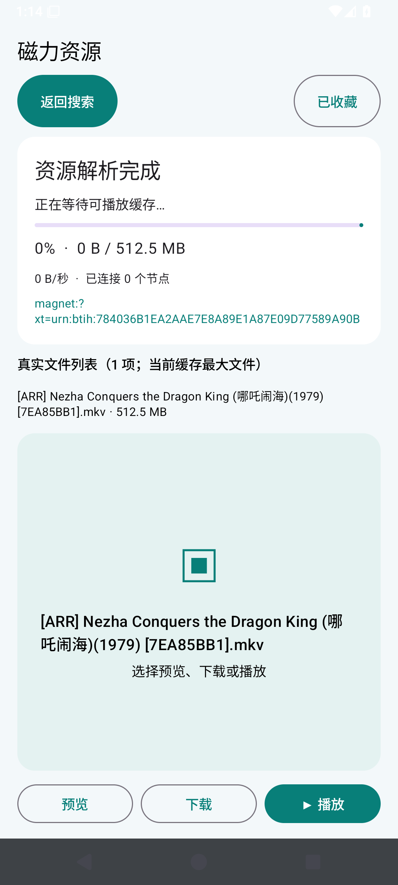
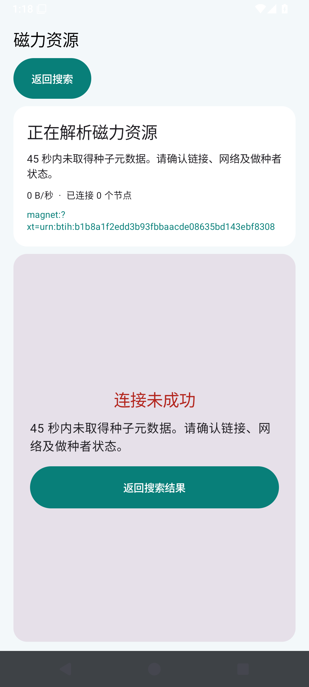

## 7. 文档与发布检查

README 和本报告使用 UTF-8。CI 对所有 Git 对象检查透明加密文件头，对文本源码检查 UTF-8，对 Markdown 检查相对图片路径与 PNG 格式，并调用 GitHub Markdown API 验证渲染。离线 HTML 报告将实际截图作为 base64 嵌入，下载后可直接打开。

本轮发现本机透明加密软件把 JavaScript 写入 Git 时变为密文，已经从经过校验的明文 Git 对象恢复，并新增构建前检查，防止此类文件进入 APK。截图提交冲突也已修复。

本报告不承诺第三方搜索站持续可达、不承诺无做种资源能下载。手机 API 35 的上述实测已完成；平板、Android TV 和旧 Android WebView 的实机兼容性仍需对应设备验证。
## 8. 最终完整复测与安装包核验

[最终完整工作流：成功](https://github.com/liao-zc/FreeMangnetPlayer/actions/runs/40698533089)，[最终原始记录](evidence/final-run.json)。这一轮再次通过无结果返回、真实边下边播、完整文件 SHA-256、倍速及前进/后退、收藏冷启动验证。六站再次得到 12/12、dobt 访问失败、156/156、60/60、0/0、48/48；两条用户磁力仍分别为“元数据成功但 0 节点 / 0 字节”和“元数据超时”。工作流成功不等于这两个外部限制已解决。

发布 APK 已实际下载核验：名称 FreeMangnetPlayer，大小 50,848,953 字节，包含 arm64-v8a、armeabi-v7a、x86、x86_64，内部搜索脚本为有效 UTF-8 明文。APK SHA-256：

```text
f2e597f780a06c9d0010e800a7aa4c30a43e357feb59a6160b63647a837d8058
```

**安装提示：已实际比较 v0.1.8 与 v0.1.9 的 APK 签名证书，两者不同，Android 不能直接覆盖安装。卸载旧包会删除收藏与缓存，先自行记录重要磁力信息，再卸载旧包安装本包。当前发布仍使用 CI 调试签名，尚未建立固定发行签名。**