# FreeMangnetPlayer v0.1.10 操作说明与功能优化报告

日期：2026-10-29。**本轮四项功能要求拆分为 22 项实际检查，22/22 通过。** [完整运行记录](https://github.com/liao-zc/FreeMangnetPlayer/actions/runs/40805567443)；APP 代码提交 `e40049aab4960fc87336b36fd26e4f4c9dc8c37e`。

测试在 Android 35 手机模拟器运行真实 APK，使用真实 BitTorrent 做种端、两个视频及一个许可文件。磁力元数据通过 P2P 获取，没有向 APP 注入 `.torrent` 文件或模拟下载进度。所有图片都是运行后的实际截图。

测试视频是 Blender《Big Buck Bunny》的 CC BY 3.0 片段，第二个文件是灰度版本，便于确认切换。**这些画面不作为用户“哪吒”磁力已播放成功的证据；该资源和六个公网搜索引擎没有在本轮重新测试，上一轮限制见[历史报告](archive-v0.1.9.md)。**

- [下载 APK](https://github.com/liao-zc/FreeMangnetPlayer/releases/download/v0.1.10/FreeMangnetPlayer-v0.1.10.apk)
- [下载离线报告，截图已嵌入](https://github.com/liao-zc/FreeMangnetPlayer/releases/download/v0.1.10/FreeMangnetPlayer-v0.1.10-report.html)
- [下载完整源码](https://github.com/liao-zc/FreeMangnetPlayer/releases/download/v0.1.10/FreeMangnetPlayer-v0.1.10-source.zip)
- [逐项原始验证 JSON](evidence/optimization-verification.json)

## 1. 四项要求的实现结果

| 要求 | 优化结果 | 验证范围 |
| --- | --- | --- |
| 边下边播、暂停/取消、清空及后台运行 | 服务持有任务，退出资源页面不会停止下载；只读取校验通过的分片；提供暂停、继续、取消及清空 | 未完成下载时真实起播，暂停和取消后计数停止；恢复后增长；HOME 与熄屏期间增长；清理后文件消失 |
| 多文件播放切换、优先已有文件 | 内置文件弹窗可切换视频；重新打开时复用已配置位置的文件并校验；完整本地文件不必等待其他下载任务让出名额 | 第二个视频的文件索引、实际播放和灰度画面；冷启动后从自定义下载目录播放 |
| 单选/多选、可修改下载和缓存地址、首播优化 | 文件优先级按选择更新；独立可写目录；缓存转下载实际迁移；优先请求视频头尾和读取/跳转位置附近的分片 | 实际单选和全选；两个非默认路径实写；三个文件 SHA-256 相同；未等完整下载就起播 |
| 个性化设置 | 首页设置入口，六个预设与一个自定义引擎、默认引擎、最大并发下载任务和最大缓存任务数量 | 设置页面实际操作与冷启动持久化；并发为一时排队；缓存上限为一时淘汰旧任务 |

**流畅度说明：**边下边播已经实现，但不能保证任何链路都不卡顿。测试种子故意限速约 16 KB/s，低于该片段的平均码率；第 2 视频切换后的截图会出现真实缓冲。报告不把“某一时刻开始播放”当作“全程持续流畅”的证明。节点供给不足时需要等待缓存。

## 2. 22 项点检结果

| 序号 | 点检项 | 实际判定 | 结果 |
| --- | --- | --- | --- |
| 1 | 设置存储目录与默认引擎 | 在设置页实际填写非默认下载/缓存地址，保存数量限制，选择 Pomo；首页菜单确认默认引擎 | 通过 |
| 2 | 单选文件 | 勾选集合仅含 Episode-01.mp4 | 通过 |
| 3 | 边下边播 | 播放器正在播放时，已下载字节小于视频总字节 | 通过 |
| 4 | 暂停下载 | 暂停稳定后两次读取已下载字节相等 | 通过 |
| 5 | 继续下载 | 恢复后真实下载字节重新增长 | 通过 |
| 6 | 取消正在下载的任务 | 取消已有数据且未完成的任务；取消后两次字节计数不再增长 | 通过 |
| 7 | 取消后重新打开续传 | 重新打开同一磁力继续下载，校验缓存并迁移到配置的下载目录 | 通过 |
| 8 | 退出页面与后台下载 | 返回搜索并按 HOME；下载字节增长，系统确认 DownloadService 为前台服务 | 通过 |
| 9 | 普通熄屏下载 | 熄屏十秒，真实下载字节仍增长 | 通过 |
| 10 | 多选下载 | 全选两个视频和许可文本，实际选择集合为三项 | 通过 |
| 11 | 播放器切换视频 | 通过内置文件选择弹窗切换 Episode-02.mp4，文件索引和播放状态确认 | 通过 |
| 12 | 最大下载数量 | 最大同时下载设为一，另一个真实磁力任务排队 | 通过 |
| 13 | 取消排队任务 | 排队任务取消后，计数保持不变 | 通过 |
| 14 | 实际多文件下载与内容校验 | 三个文件完成下载，逐个与做种端源文件比较 SHA-256 | 通过 |
| 15 | 倍速与前进/后退 | 第二个视频实际播放；倍速切换到 1.25，前进和后退十五秒的位置变化通过断言 | 通过 |
| 16 | 横屏与状态恢复 | 窗口切换为 1920×1080 再恢复竖屏；实际播放继续，倍速保留，返回按钮可见 | 通过 |
| 17 | 优先使用已有下载文件 | 完成下载后强制停止并重新打开 APP，从设置的下载目录重新校验和播放 | 通过 |
| 18 | 设置持久保存 | 冷启动后检查非默认下载与缓存地址仍在 | 通过 |
| 19 | 一键清空下载 | 停止任务、删除专属文件目录；系统目录存在性检查返回不存在 | 通过 |
| 20 | 清理后的真实下载列表 | 返回下载列表，确认显示真实的空任务状态 | 通过 |
| 21 | 一键清空缓存 | 缓存目录实际删除；界面显示清理完成 | 通过 |
| 22 | 最大缓存数量 | 缓存上限设为一；新增第二个缓存，先前未打开的缓存目录删除，新目录保留 | 通过 |

## 3. 首页与设置怎么用

首页保留搜索框、搜索引擎菜单、磁力解析入口、播放/下载/收藏列表。点击右上“设置”进入配置页。

在“下载目录”和“缓存目录”填应用有权写入的**绝对路径**，点击保存。目录真实创建和写入检查失败时会显示原因，不会只保存一个无效地址。也可点击列出的应用存储位置，使用对应卷中的 MyDownloads/MyCache 子目录。

本次实际选择 `.../files/CustomDownloads` 与 `.../files/CustomCache`，不是默认 Movies/Downloads 或 Movies/Cache。修改目录用于新任务；对已有缓存点击下载时，迁移到当时设置的下载目录。

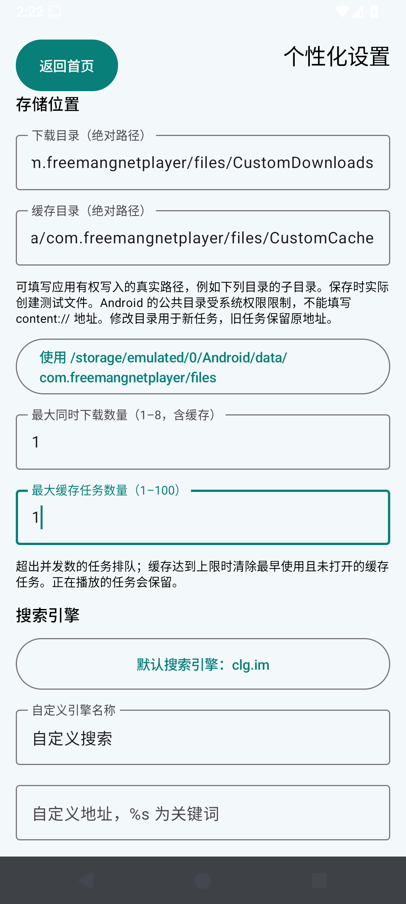

选择默认引擎，填写可选自定义地址（`%s` 代表关键词），点击“保存设置”。引擎保留 clg.im、mg.dobt.cc、bdflixs.com、pomo.mom、mjf2020.com、hdzu.org 和一个自定义项。保存后返回首页，三点菜单内确认默认引擎。

最大下载数量是**同时传输的任务数，包含缓存**，允许 1–8；超额排队。最大缓存数量是**缓存任务数**，允许 1–100；超额清理最早使用且未打开的缓存。不是按视频字节计算的容量上限。

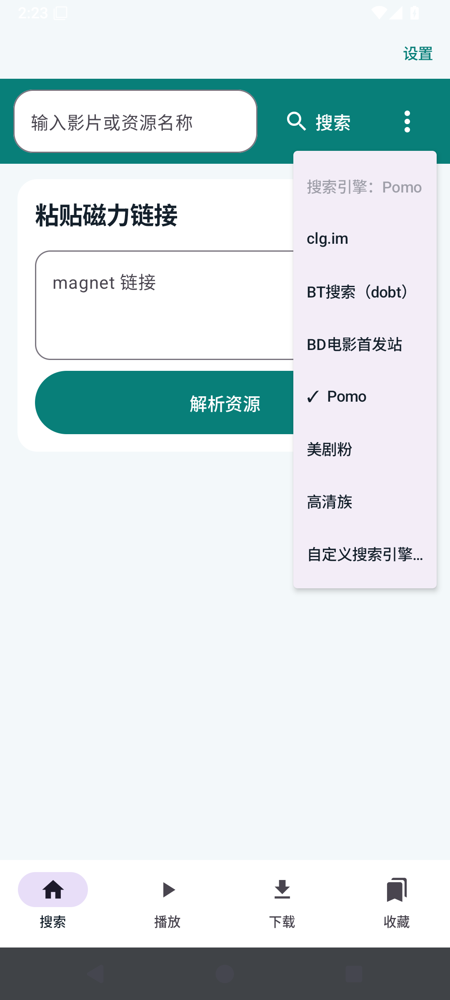

## 4. 解析、单选与多选下载

在首页粘贴磁力并解析，或从搜索结果打开资源。进度条下方显示 torrent 的真实文件名、大小和已下载字节。勾选任意文件；“选择文件”中可全选或全不选。“下载”会将所选文件加入任务。

“全不选”会暂停尚未播放的缓存，避免把零个待下载文件错误地宣布为“种子已完成”。播放中的视频即使未勾选，也需要缓存其分片。共享分片可能覆盖相邻文件的一小部分，不能据此认为整份未选文件已下载。

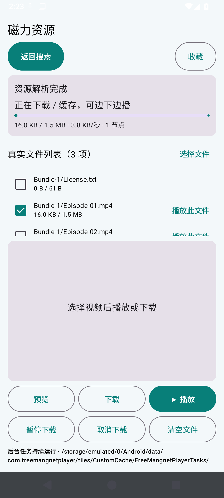

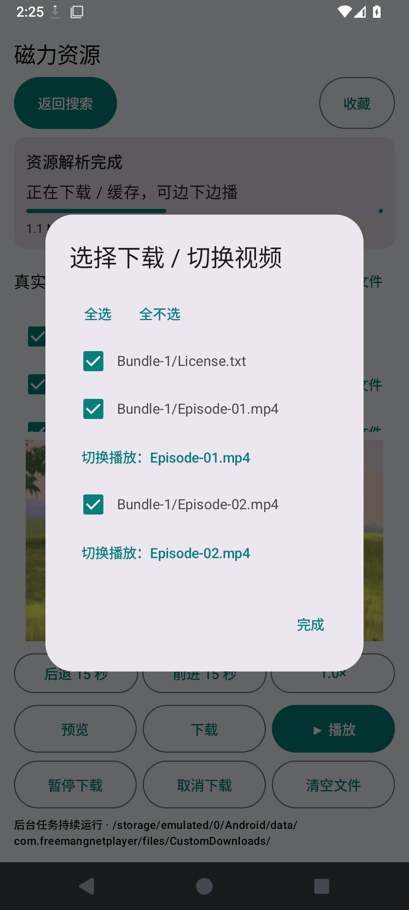

## 5. 边下边播、暂停与取消

点击“▶ 播放”。本次开始播放时已下载 **252,842 / 1,612,714 字节（15.7%）**，播放器处于播放状态，证明未等待整份文件。读取到尚未缓存的位置会请求对应分片并显示缓冲。

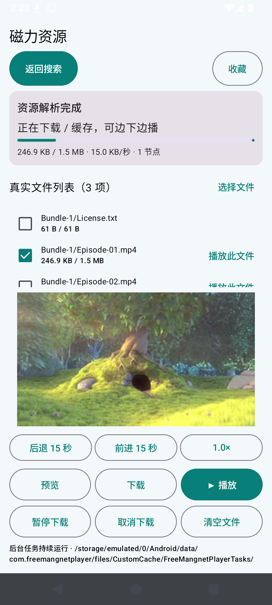

“暂停下载”只暂停传输，已有视频缓存可继续使用；点击“继续下载”恢复。实测暂停稳定后的计数为 **301,994 → 301,994**，恢复后增长。

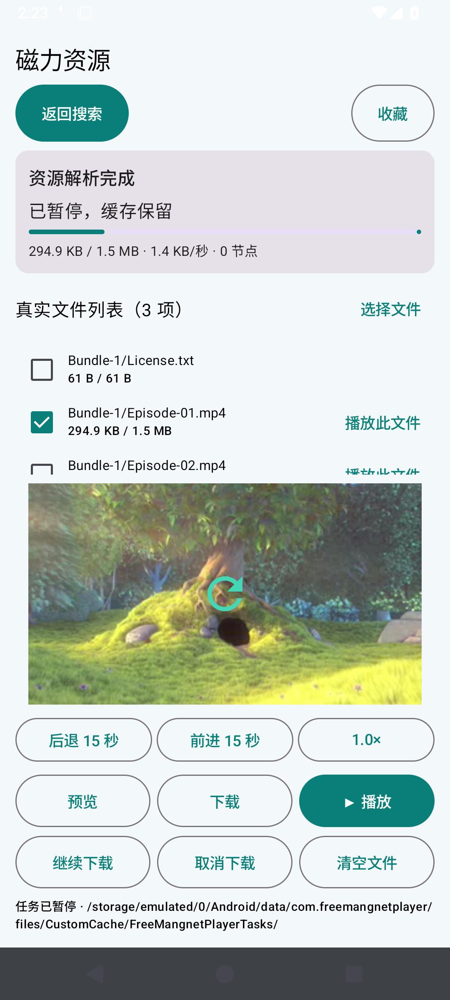

“取消下载”停止任务但保留已下载文件。本次取消正在传输的任务后计数为 **367,530 → 367,530**。重新打开同一磁力可以校验缓存并继续；从下载入口打开会迁移到配置的下载目录。

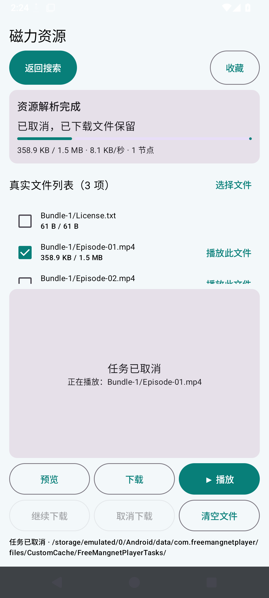

## 6. 后台与普通熄屏

返回搜索并按 HOME 后，下载继续：**433,066 → 712,197 字节**；系统确认服务是前台服务。随后熄屏十秒，计数继续增加：**712,197 → 891,818 字节**。任务活动时持有 CPU 唤醒锁，暂停或完成后释放。

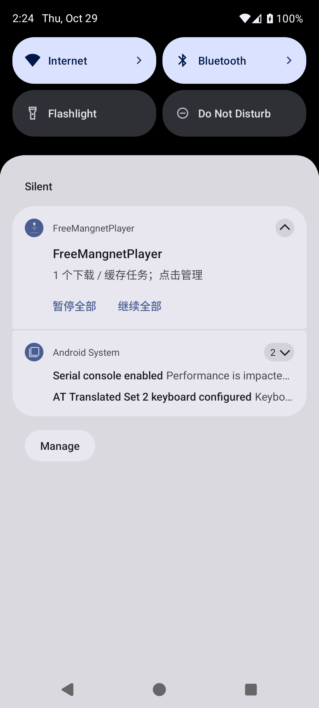

点击通知可进入下载列表；通知提供暂停全部/继续全部入口。本轮验证了通知存在和服务运行，未单独对这两个通知按钮做传输断言。

## 7. 视频切换、倍速与横屏

播放时打开“选择文件”，点击另一个视频的“切换播放”。第 2 个文件是灰度片段；验证记录确认文件索引为第 2 个视频并曾处于播放状态。

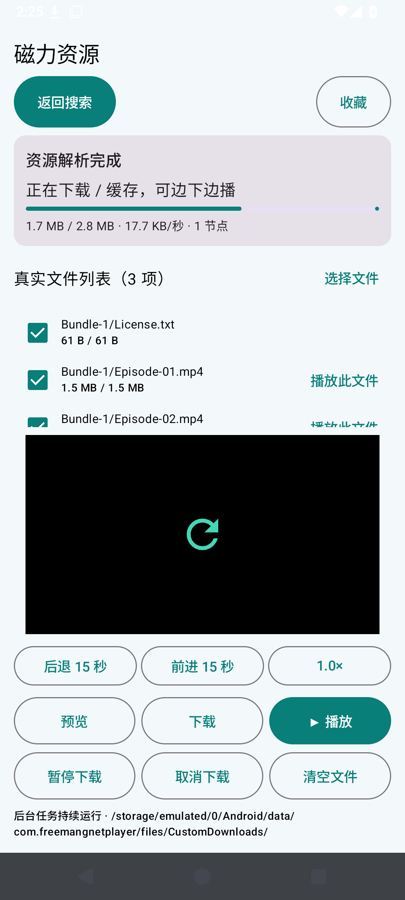

缓存足够后正常显示灰度画面。点击倍速按钮依次切换 0.5/0.75/1/1.25/1.5/2 倍；“前进 15 秒 / 后退 15 秒”可跳转。横屏与小屏使用可滚动内容，顶部返回不随内容消失；旋转后保留播放请求、位置和倍速。

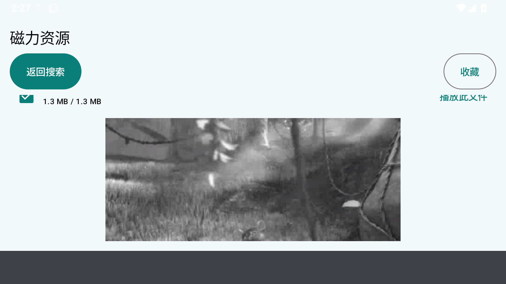

## 8. 下载内容与已有文件复用

选择多项下载后，每个文件均实际写入设置的下载目录。以下校验来自做种端文件与手机文件系统，比较的是完整文件内容。

| 文件 | 字节数 | 两端一致的 SHA-256 |
| --- | --- | --- |
| Bundle-1/License.txt | 61 | `006e67ae38f15ea235267adc960f506263d94fd1fa32548c77b255e313117cfd` |
| Bundle-1/Episode-01.mp4 | 1,612,714 | `0b3d4cff51f4e0962fc11e0abb704e459d3c932fa8e0ec2f47aae19e0ce655b0` |
| Bundle-1/Episode-02.mp4 | 1,366,846 | `f0e0605887aeaea8a8cb15d1cce86c41b636f05a6a35a3c9778631803bb0b785` |

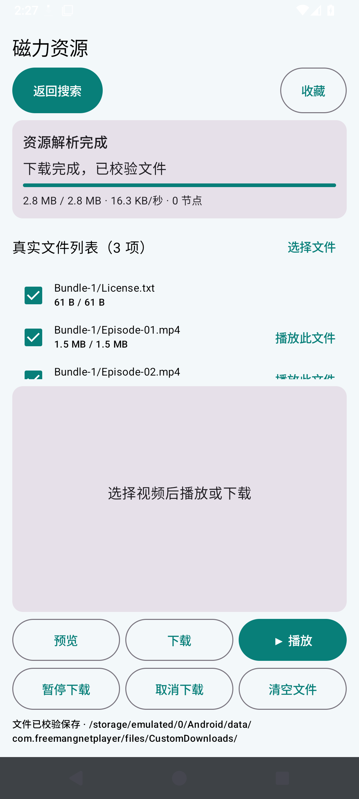

强制停止 APP 后重新打开同一资源，再次从自定义下载目录校验并播放。完整文件复用验证通过，未用不存在的文件或稀疏空洞文件冒充缓存。

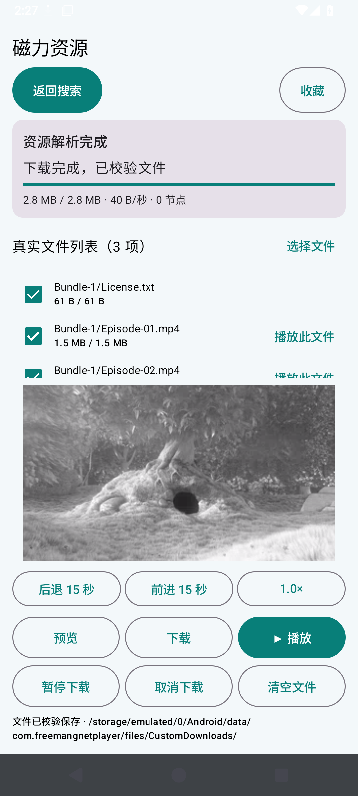

## 9. 数量限制与清空

并发设为一时，新任务显示排队，可以取消。已有完整本地文件的播放不必等待其他下载完成。

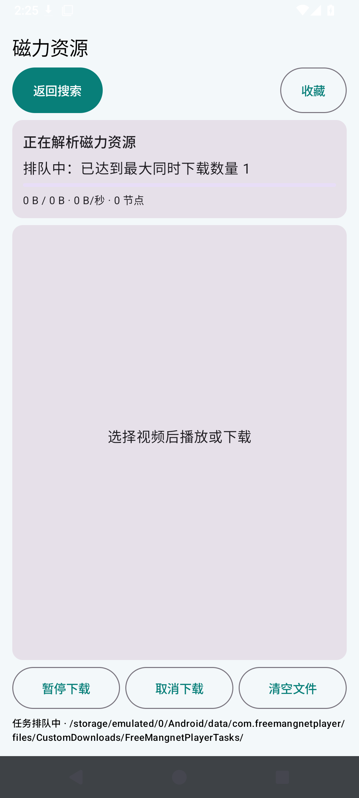

在设置中点击“一键清空下载 / 缓存”，确认后停止对应任务并删除其专属目录；界面显示清理完成。正在打开的资源会保留，先返回再清理。只删除 APP 的任务子目录，不删除你所配置的整份根目录或其他文件。

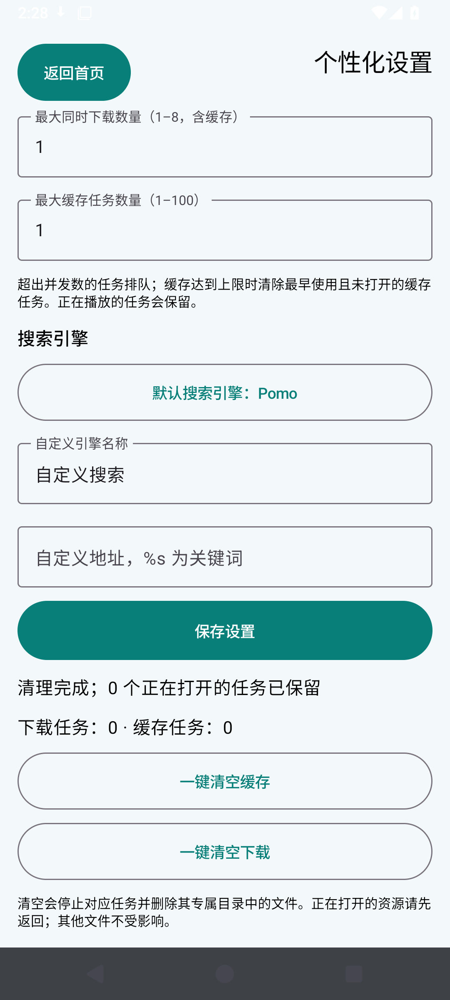

缓存上限为一时，新增第二个缓存，系统检查第一个未打开的任务目录已删除，第二个目录保留。

## 10. 本轮修复的问题与实际限制

- 下载引擎从资源页面移至前台服务，避免返回后停止。隐藏页面不再自动重建播放器或覆盖前台任务诊断。
- 全不选使用暂停，避免零待下载文件引发“种子完成”并断开做种者；继续下载恢复原生会话、原生任务和节点发现。
- 缓存转下载的目标地址持久保存，进程重启后仍迁移到正确位置；清理先关闭读写再删除，失败显示原因。
- 本轮实测为手机模拟器及手机横屏窗口；电视新增启动入口和横幅，平板/电视布局有小屏处理，但**没有用手机截图冒充电视或平板实机验证**。
- 路径仅限应用有权写入的位置，可改为应用存储位置或可写子目录。Android 公共目录受系统权限限制，**不支持把 SAF `content://` 目录直接当成 libtorrent 写入路径**。
- 标准 BTIH 磁力仍需要可连接节点。低于视频码率的网络会缓冲；本轮没有验证任意公网资源的全程流畅、深度 Doze、整夜下载或所有视频编码。
- Android 15 后台 dataSync 前台服务有每日六小时系统限额，达到限额后保存并暂停。系统强制停止、权限变化、存储卡取出及厂商省电限制可能中断任务，需要重新打开或继续。
- **首次从 v0.1.9 升级需卸载旧版：**旧包使用临时调试签名，新版采用固定签名，无法直接覆盖。卸载会删除应用收藏和缓存，请先记录重要磁力。后续 CI 发布沿用固定签名。
- 文档和源码逐提交检查 Git 对象的 UTF-8 与透明加密头，并由 GitHub CI 检查 Markdown 图片路径和渲染。离线 HTML 将真实截图嵌入文件，下载后无需 GitHub 渲染器。
