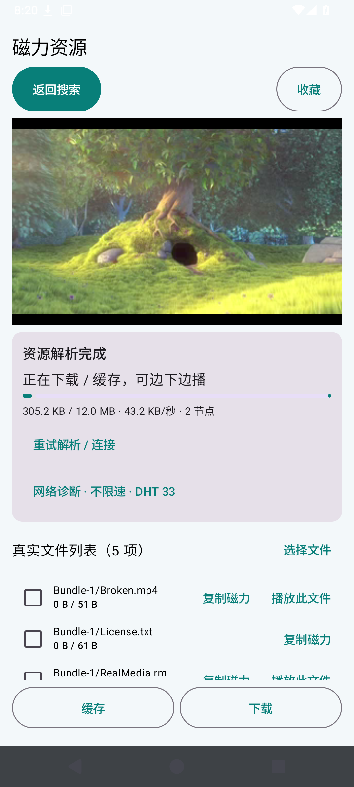
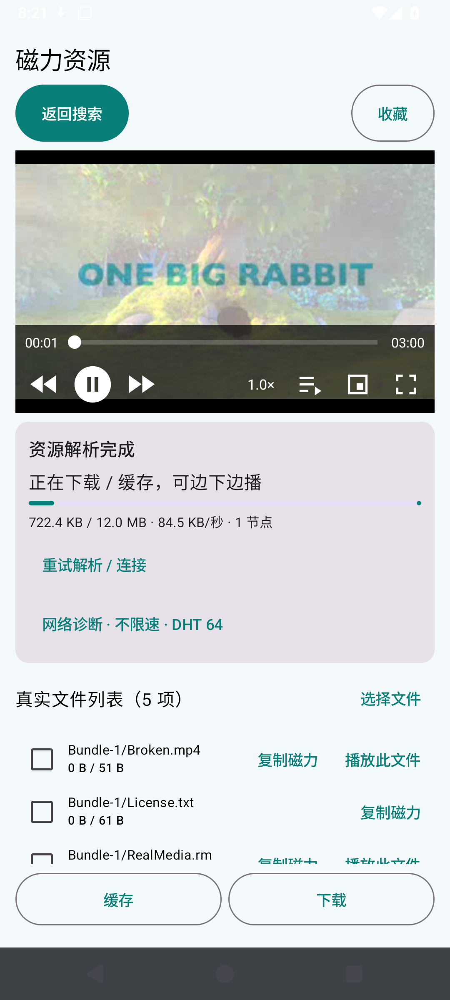
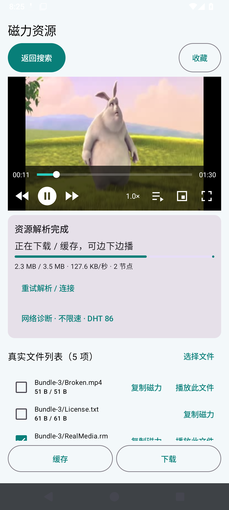
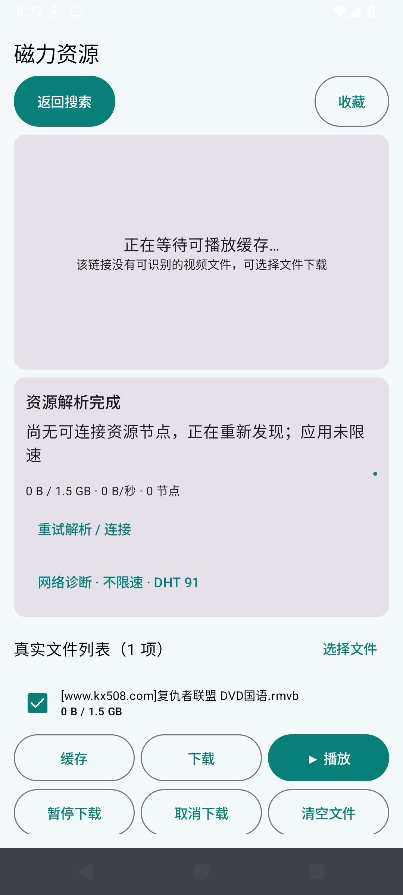
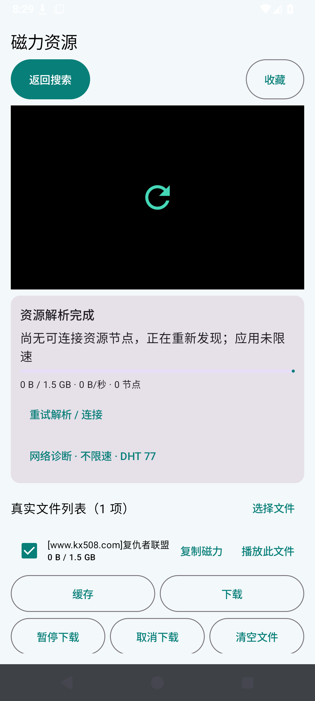
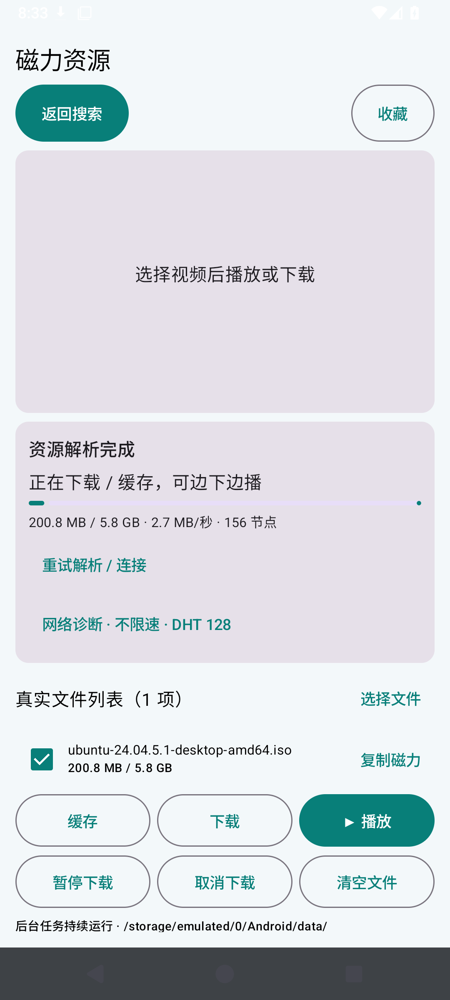
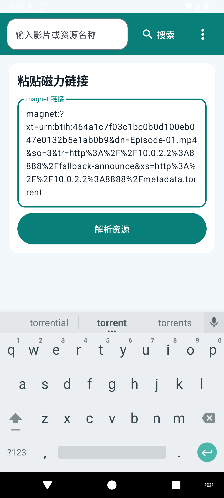

# FreeMangnetPlayer v0.1.13 节点连接与播放优化报告

日期：2026-10-29。实际设备：Android API 35 Pixel 2 模拟器。以下截图来自安装后的 APP，播放测试使用真实 BitTorrent 做种、真实 H.264/AAC 视频及 RealVideo/RealAudio 视频。

- [下载安装包](https://github.com/liao-zc/FreeMangnetPlayer/releases/download/v0.1.13/FreeMangnetPlayer-v0.1.13.apk)
- [离线图文报告](https://github.com/liao-zc/FreeMangnetPlayer/releases/download/v0.1.13/FreeMangnetPlayer-v0.1.13-report.html)
- [实际专项测试记录](https://github.com/liao-zc/FreeMangnetPlayer/actions/runs/40840559773)
- [原始逐项证据](evidence/peer-recovery-verification.json)

## 本轮结果与未完成事项

- 播放专项 21 项通过，下载管理回归 22 项通过；下文附真实画面和原始记录。
- 已新增目标文件磁力复制；修复元数据替换时丢失连接入口、停滞连接恢复和默认选片问题；新增 RM/RMVB 解码。
- **用户更正的 236234… 磁力仍未实际起播。**新旧版本都解析到了文件，但观察期间均为 0 资源节点、0 下载字节。不能把本轮修复称为已经解决这条电影的播放问题，也没有这条电影的播放截图。
- 仍需要在能播放它的 Magnet_player 中取得这条资源的完整分享磁力或 .torrent，并在同一设备网络对照。当前消息没有实际附上参考播放器截图，不能断言该资源失效。

## 1. 为什么取得文件列表仍然无法播放

文件列表是种子的元数据；真正播放需要取得视频分片。DHT 的路由节点数量不等于持有该视频的节点数量。用户截图中 DHT 124、资源节点 0、有效下载 0，说明元数据已到达，视频数据尚未到达。

代码与实测发现的缺陷：

1. HTTP 补充元数据会替换原任务，旧版没有保留原磁力中的 Tracker 地址及已连接节点。新版在替换前保存这些信息，并等待旧任务实际移除，避免新任务被当成重复添加而忽略。
2. 仅开启 uTP 后，模拟器实测出现已连接做种节点但数据停在约 80 KiB、速率个位数 B/s 的问题。新版立即开放 TCP/uTP，连续 10 秒没有有效数据时重新连接并尝试 TCP；TCP 连不上节点持续 20 秒时再开放 uTP。这是连接恢复，不是限速。
3. 缺少独立的资源节点查询与回连。新版在无有效供给时执行独立 DHT 查找，并尝试已发现节点，降低对单次公告的依赖。

4. 默认选片此前把已完成的小视频排在用户选择的正片前面。现优先明确选择的文件，再考虑已缓存状态；测试放入一个已下载的损坏小视频，确认默认起播仍选择正片，手动选择坏文件时才显示媒体错误。

上述缺陷已修复；不能只凭截图断言它们是用户手机上该资源失败的全部原因。

## 2. 元数据完成后继续下载与播放：实际验证

测试服务器先返回空节点列表；提供的补充 .torrent 不包含任何 Tracker。收到补充元数据后，只有原磁力中的 Tracker 能返回真实做种节点，因此可以验证替换后是否保留该入口。

| 检查 | 结果 |
| --- | --- |
| HTTP 补充元数据后取得真实节点与下载字节 | 通过 |
| 保留原 Tracker | 9 个 |
| 从输入磁力至测试观察到实际起播（含 UI 操作开销） | 23.87 秒 |
| 另一独立冷启动视频的起播下载比例 | 3.84% |
| 应用下载/上传速率限制 | 0 / 0，即不限速 |

受控做种服务器使用 128 KiB/s 来观察早期起播，APK 没有这个上限。实际流畅程度仍取决于可达节点、有效供给、网络及视频码率。

## RealMedia 视频解码检查

更正后的磁力对应 `[www.kx508.com]复仇者联盟 DVD国语.rmvb`，大小 1,573,322,851 字节，分片大小 1 MiB。HTTP 取得种子后已验证 info 字典的 SHA-1 与用户 BTIH 一致，原种子没有 Tracker。[种子校验记录](evidence/peer-recovery-user-metadata.json)。

旧版没有将 RM/RMVB 列入视频文件，Media3 内核也不支持 RealMedia 容器。本版将它们识别为视频，并使用 LibVLC 软件解码；其他格式继续使用 Media3。LibVLC 通过仅监听本机的 HTTP Range 接口读取经过原有分片校验的数据，仍使用同一个下载任务。此依赖会增加安装包体积。

实际 RealVideo/RealAudio 视频验证：显示真实画面、播放时间推进、暂停/继续、向前跳转、1.25 倍速、全屏返回及进程未重启。此受控视频用于确认解码功能，用户电影是否实际起播另按下面的公网观测记录。

## 3. 用户提供的同一磁力：旧版与新版观察

测试链接：`magnet:?xt=urn:btih:2362347540b27d8a4142af2bbe0a071f26a3b7a1`。

两版分别清空应用数据，并尝试解析、下载和播放；每版最多观察 150 次采样，UI 操作也计入时间。公网节点状态随时间变化，因此这个顺序对比不能视为同时同节点的性能基准。

| 版本 | 文件列表 | 资源节点 | 有效下载字节 | 实际首次播放时间 |
| --- | --- | --- | --- | --- |
| v0.1.12 | 已取得 | 0 | 0 | 观察期间未起播 |
| v0.1.13 | 已取得 | 0 | 0 | 观察期间未起播 |

独立原生客户端（runner、纯 BTIH、未注入 .torrent）观察结果：元数据 False，资源节点 0，有效载荷 0 字节；错误 无额外错误。原始数据附在用户资源证据中。APP 还附加公共 Tracker 和 HTTP 元数据补充，因此不是完全相同的发现入口。

[本机 HTTP 元数据服务检查](evidence/peer-recovery-metadata-http.json)：使用与 APP 相同的 User-Agent，各入口的状态码、返回字节数与内容是否像种子数据，详见原始记录。此检查只代表 HTTP 服务观察，不代表播放成功。这是 Windows 工作区的观察，不能当作用户手机网络实测，也不能据此断言资源已失效。若该磁力在其他播放器能播放，仍需在用户同一设备网络上对照，或取得其可分享的 .torrent/Tracker 信息，进一步判断发现入口的差异。

每一行按真实观察记录；未起播的资源不标为播放成功。Magnet_player 提供的 GitHub 仓库只有 README 与安装包，没有公开内核源码。本轮没有完成该播放器在用户手机同一网络下的操作对照，不能推断其使用直连、云缓存或其他特定机制。

### 公网下载实测与限速结论

同一模拟器另外测试纯 BTIH 的 Ubuntu 官方种子，实际取得 158 个资源节点和 212,488,977 下载字节。应用上传、下载限速均为 0。这说明本轮测试环境和应用并非普遍只能下载 10 B/s；它不能证明用户电影的资源发现入口已经与另一播放器一致，也不能保证用户手机上的相同速度。

## 4. 选择文件并复制磁力链接

1. 解析后在文件列表点击目标文件旁的“复制磁力”；也可以点播放器中的选片图标，找到“复制磁力：文件名”。
2. 链接写入 Android 系统剪贴板，可粘贴到其他播放器、聊天或文本框。
3. 链接包含原种子的 BTIH、目标文件名 `dn`、文件索引 `so`，并保留原 Tracker、明确节点、Web Seed 和 Exact Source 参数。
4. 多文件种子中的文件共用种子哈希，不能凭空生成单文件的新种子。接收方支持 BEP 53 `so` 才能恢复文件选择；否则会展示整个种子文件列表。

实际点检：点击复制后在系统输入框执行粘贴，核对 BTIH、文件名、文件选择与 Tracker 参数；粘贴回本 APP 后再次解析，检查目标文件索引。结果通过。

## 5. 原有功能回归

本轮专项检查 21 项通过；公网用户资源与 Ubuntu 资源另列为实际观察，不混入通过数量。[下载管理回归](https://github.com/liao-zc/FreeMangnetPlayer/actions/runs/40840572159) 22 项通过，包含真实下载 SHA-256、单选/多选、暂停/继续/取消、后台与熄屏任务、存储位置、设置持久化、缓存保留与删除。[回归原始证据](evidence/peer-recovery-regression.json)。

播放器倍速、前后跳转、时间条、全屏、画中画、多文件切换、临时缓存清理与损坏媒体错误处理也执行了实测。该模拟器上的进程检查通过；尚未完成用户手机原设备的闪退与网络对照。

## 播放专项逐项点检

所有截图为实际界面；截图展示界面状态，时间推进、文件删除与进程校验的断言数据见原始 JSON。

| 操作或检查 | 结果 | 实际截图 |
| --- | --- | --- |
| 补充元数据后保留 Tracker，取得分片并播放 | 通过 | [截图](screenshots/peer-recovery/revision-00-metadata-peer-recovery.png) |
| 所选文件磁力写入系统剪贴板，粘贴回读一致 | 通过 | [截图](screenshots/peer-recovery/revision-00b-file-magnet-copy.png) |
| 复制的磁力再次解析后恢复选片 | 通过 | [截图](screenshots/peer-recovery/revision-02-real-file-list.png) |
| 默认最大下载数量为 5 | 通过 | [截图](screenshots/peer-recovery/revision-01-default-settings.png) |
| 单独粘贴磁力解析真实文件列表 | 通过 | [截图](screenshots/peer-recovery/revision-02-real-file-list.png) |
| 无需下载至 20% 即起播 | 通过 | [截图](screenshots/peer-recovery/revision-03-integrated-controls.png) |
| 播放器按钮集成在视频控制条内 | 通过 | [截图](screenshots/peer-recovery/revision-03-integrated-controls.png) |
| 内置暂停、播放、倍速和前后跳转 | 通过 | [截图](screenshots/peer-recovery/revision-03-integrated-controls.png) |
| 当前时间、总时长与可拖动进度条 | 通过 | [截图](screenshots/peer-recovery/revision-03-integrated-controls.png) |
| 全屏使用内置图标 | 通过 | [截图](screenshots/peer-recovery/revision-04-fullscreen-icons.png) |
| 系统画中画继续播放并恢复 | 通过 | [截图](screenshots/peer-recovery/revision-05-real-pip.png) |
| 切换文件后清除上一临时视频 | 通过 | [截图](screenshots/peer-recovery/revision-06-second-video.png) |
| 主动缓存可在切换资源后保留 | 通过 | [截图](screenshots/peer-recovery/revision-07-explicit-cache.png) |
| 缓存上限不删除主动保留的文件 | 通过 | [截图](screenshots/peer-recovery/revision-07b-cache-limit.png) |
| 新资源释放旧临时缓存 | 通过 | [截图](screenshots/peer-recovery/revision-08-new-resource.png) |
| 强制停止并重开后清临时缓存、保留主动缓存 | 通过 | [截图](screenshots/peer-recovery/revision-08-new-resource.png) |
| 连续六次全屏切换无崩溃、进程未重启 | 通过 | [截图](screenshots/peer-recovery/revision-09-lifecycle-stress.png) |
| RealMedia 解码出现实际视频画面并持续播放 | 通过 | [截图](screenshots/peer-recovery/revision-09c-realmedia.png) |
| RealMedia 暂停、跳转、倍速、全屏操作 | 通过 | [截图](screenshots/peer-recovery/revision-09d-realmedia-fullscreen.png) |
| 损坏文件显示错误，应用进程不重启 | 通过 | [截图](screenshots/peer-recovery/revision-09b-media-error.png) |
| 解析重试与返回操作可响应 | 通过 | [截图](screenshots/peer-recovery/revision-11-retry-responsive.png) |

用户电影：**解析通过，实际播放未通过**，0 节点、0 下载字节；[实际界面](screenshots/peer-recovery/user-resource-v0.1.13.png)。公网 Ubuntu 种子实际下载观察另见上文，未混入上述通过数量。

## 6. GitHub 文档与邮件通知

文档用 UTF-8 明文提交，校验 Git 对象、图片签名、相对链接和 GitHub 渲染；同时提供截图内嵌的离线 HTML。

本项目没有增加任何发送邮件的工作流。GitHub 平台通知由用户账户设置决定；当前 GitHub 授权缺少 notifications 权限，未修改用户个人通知设置。若仍收到 GitHub Actions 邮件，可在 [个人通知设置](https://github.com/settings/notifications) 的 Actions 部分关闭 Email；仓库右上角 Watch 可调整该仓库的通知。

应用名称 FreeMangnetPlayer，包名 com.freemangnetplayer，版本 v0.1.13，与 v0.1.12 使用同一签名，可覆盖安装。
