# FreeMangnetPlayer v0.1.12 播放器与缓存优化报告

日期：2026-10-29。测试设备为 Android API 35 手机模拟器，APK 实际运行；[完整测试记录](https://github.com/liao-zc/FreeMangnetPlayer/actions/runs/40828688059)，提交 `4ed677dae9ff23092a00189a882914e6fd2060e4`。[原始逐项证据](evidence/player-revision-verification.json)。下方截图全部来自实际 APP，未使用页面模型或静态影片图冒充播放。

- [下载 APK](https://github.com/liao-zc/FreeMangnetPlayer/releases/download/v0.1.12/FreeMangnetPlayer-v0.1.12.apk)
- [下载离线图文报告](https://github.com/liao-zc/FreeMangnetPlayer/releases/download/v0.1.12/FreeMangnetPlayer-v0.1.12-report.html)
- [下载源码](https://github.com/liao-zc/FreeMangnetPlayer/releases/download/v0.1.12/FreeMangnetPlayer-v0.1.12-source.zip)

## 逐项结果

| 用户要求 | 实现与实际校验 | 结果 |
| --- | --- | --- |
| 1. 控制按钮嵌入播放器 | 前进、后退、播放/暂停、倍速、切片、全屏、悬浮均位于视频内部；检查实际坐标全部在视频区域内 | 通过 |
| 2. 全屏中使用紧凑图标 | 全屏复用同一控制条，取消顶部胶囊按钮；44 dp 点击区域内放置小图标 | 通过 |
| 3. 当前时间/总时长/进度条 | 视频底部显示时间、已缓冲进度；实际点击进度条并核对跳转后的时间 | 通过 |
| 4. 默认最大下载数为 5 | 首次安装从实际设置页面读到 5；同时下载与缓存共享并发上限 | 通过 |
| 5. 白屏、闪退和重启 | 调整 Surface/解码器释放顺序、错误回调、原生读取与关闭时序；连续全屏切换、切换资源期间检查进程未重启 | 测试设备通过；用户原机型尚未复现，不能保证其所有解码格式均无崩溃 |
| 6. 不以下载 20% 为起播条件 | 元数据到达就准备播放器，按播放需要请求分片；较慢做种端实际起播比例 3.70% | 通过 |
| 7. 切换视频清理临时缓存 | 同链接切文件时停止旧写入再删旧视频；新链接删除上个临时任务；主动“缓存”或“下载”的内容保留 | 通过 |
| 8. 优化磁力解析 | 原始粘贴获取真实多文件列表，校验本地元数据哈希；重试节点发现可操作、可返回；公网纯磁力另记实际结果 | 粘贴解析与重试通过；公网结果见第 8 节 |

## 1. 普通播放的内嵌控制

进入视频后，点一下画面显示控制条，约 5 秒无操作后自动隐藏。下方图标依次提供后退 15 秒、播放/暂停、前进 15 秒、倍速、切换视频、画中画、全屏。倍速按钮保留数值，方便确认当前速度；其他控制使用小图标。

控制条属于 PlayerView，不再在 APP 页面下面单独绘制全屏、悬浮、前进、后退或倍速的大按钮。资源页的“缓存/下载/播放”是任务操作入口；开始播放后，播放控制位于画面内部。电视可使用方向键聚焦、确认键操作。

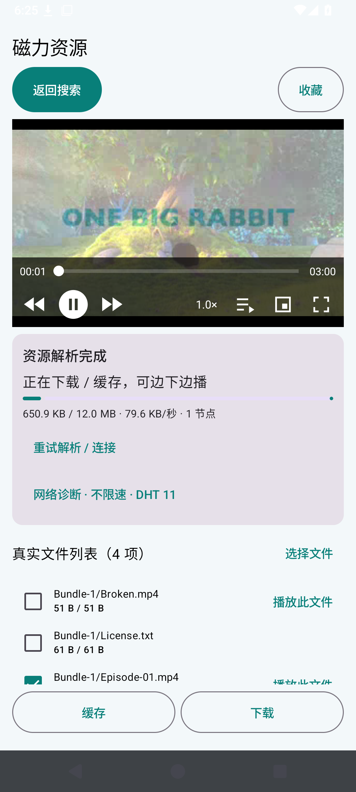

## 2. 全屏与悬浮

点右侧全屏图标进入横屏沉浸播放，点同一图标或系统返回键退出。全屏继续使用底部控制条，不显示顶部大按钮。点画中画图标进入系统悬浮窗口，展开系统窗口回到播放器后继续播放。

系统悬浮需要 Android 8.0+ 且设备支持画中画；部分电视系统不提供此功能。悬浮状态使用系统的窗口控制；这不是需要额外叠加权限的自制悬浮层。

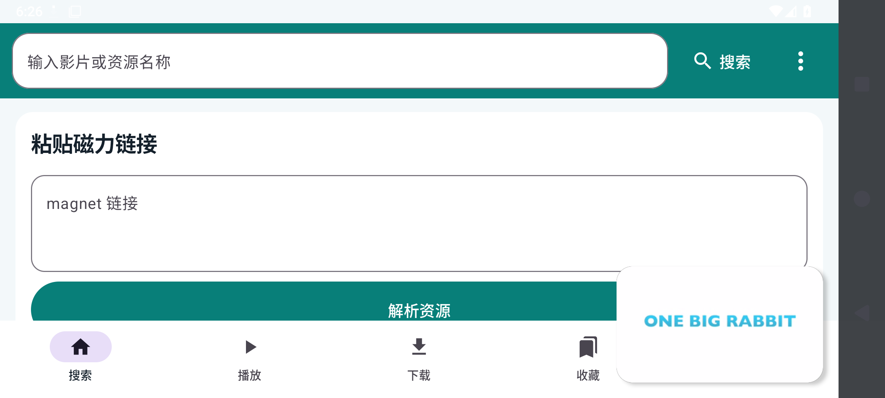

## 3. 播放时间、总时长与拖动

进度条左边是当前播放时间，右边是总时长；浅色部分表示播放器已缓冲的位置。点击或拖动时间条跳转，松手后恢复之前的播放/暂停状态。未缓存的位置会按新位置重新请求分片，节点供给不足时显示缓冲，不读取未校验的磁盘空洞。

实际视频总时长 180.00 秒；本轮进度条操作目标约 18.00 秒，播放器到达 17.71 秒。另已实际操作播放/暂停、前后跳转和倍速。

## 4. 默认并发下载数

主页底部“设置”中，“最大同时下载数量”默认是 5，可手动修改。这个设置是并发任务数，**不是速度限制**。已保存的个性化数值继续沿用，不会每次升级覆盖成 5。超过上限的后台任务排队。

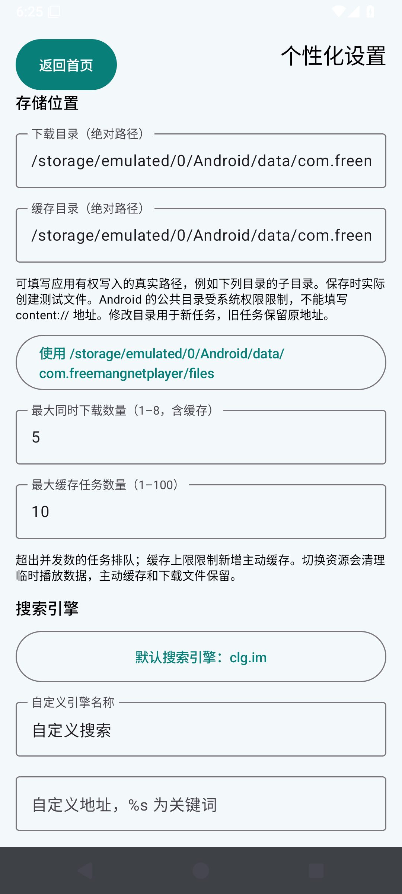

## 5. 白屏与闪退：修复及验证范围

修复内容：

视频现在位于资源详情上方；退出全屏恢复进入前的屏幕方向，避免横向资源信息把视频挤出可视区域。启用备用解码器，并对不支持或损坏的文件显示错误，停止无限准备重试。

1. 视频 Surface 使用黑色背景；全屏等待分片或恢复播放错误时保持视频区域，不跳回白色资源页。
2. 解码器错误回调只提交恢复操作，不在回调内部立即 release；旧播放器回调不能覆盖新的播放器。
3. 打开新资源先停止、释放旧播放器，包含先前的悬浮播放器，避免继续输出旧画面或声音。
4. 解绑旧 PlayerView 与播放器，记录播放状态再释放；分片读取和原生会话销毁使用同一生命周期锁。
5. 切换临时文件必须先停解码器、停止原生写入、等待结束，再删除旧文件，避免写入与删除同时发生。

本轮连续 6 次进入/退出全屏，另包含多文件切换、两个新链接和画中画返回；连续切换阶段进程 PID 始终为 `4326`，没有自动重启，日志没有 APP 崩溃记录。另有一次主动执行的系统停止用于校验缓存持久化，已在原始证据中标明；该操作不作为崩溃或自动重启。

**这些是本轮设备上的实际结果，用户原始闪退尚无设备、完整磁力及崩溃日志，不能断言已找出那次闪退的唯一原因。** 测试覆盖 H.264/AAC 实际音视频；其他硬件解码器或特殊视频格式需要相应资源验证。

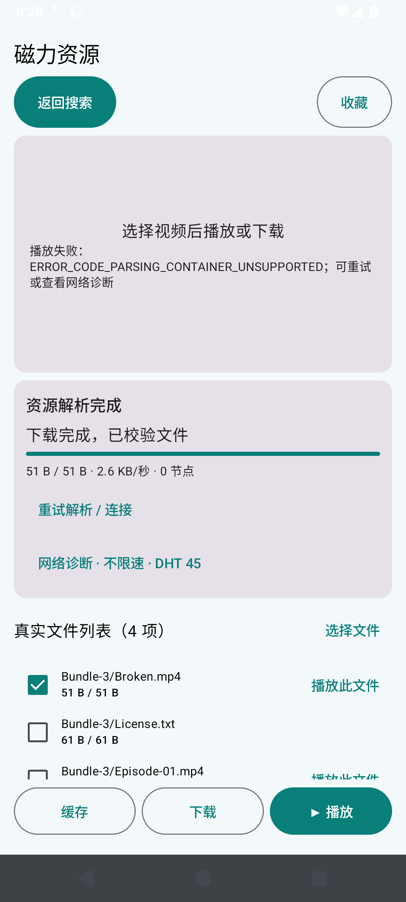

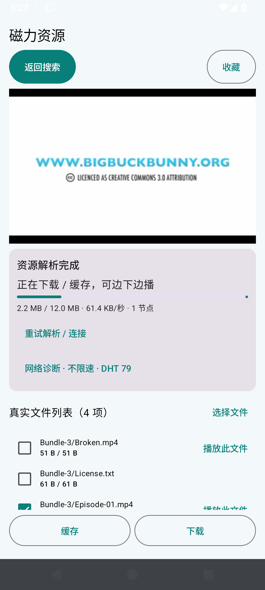

## 6. 边下边播：按所需分片起播

APP 没有“总文件下载 20% 才能播放”的判断。旧报告的 20% 是当时起播采样的下载比例，不能作为功能门槛；本轮从创建播放器前的等待条件中去掉“文件已产生下载字节”，元数据到达后立即准备解码器，在后台读取中等待首批已校验分片。

本轮刻意把**测试做种端**限制为 128 KiB/s，用来避免高速下载在点击/截图期间掩盖起播过程；APK 的上传和下载限速仍是 0，不限速。

| 指标 | 实际值 |
| --- | --- |
| 起播时已下载 | 466,406 / 12,590,316 字节 |
| 起播比例 | **3.70%** |
| 起播后实际播放位置 | 145 毫秒 |
| 视频总时长 | 180.00 秒 |
| 粘贴并获取文件列表 | 9.78 秒，包含 UI 输入/点击和截图开销 |
| 应用下载/上传限速 | 0 / 0，0 表示不限速 |

首部解析、索引和正在播放的分片仍必须取得并校验；MP4 的索引可能位于尾部，所以也优先请求尾部分片。起播数据量随编码、索引位置、分片大小和节点供给变化，不能保证所有影片固定百分比或无缓冲。流畅播放需要持续下载速度高于视频码率。

测试视频来自 Blender Big Buck Bunny（CC BY 3.0），转码为两个真实 H.264/AAC 文件；实际播放包含画面和音频轨。不是用用户此前提供的影视磁力冒充播放成功。

## 7. 临时播放、主动缓存和下载

- 仅点“播放”：创建临时播放数据。换成另一个磁力资源后，停止上个临时任务并删除它的文件。
- 同一个链接切换另一个视频：若未主动保存，停止旧文件写入后删除上个视频，再恢复当前文件任务；播放器从新视频 0 秒开始。
- 主动点“缓存”：将这个磁力任务标为保留，切换资源后保留已选文件的缓存，可从收藏或播放列表重新打开。达到最大缓存数时拒绝新增主动缓存并提示清理或调整设置；不会因新视频的临时播放删除旧主动缓存。
- 主动点“下载”：保留下载文件并后台持续运行，切换播放资源不会删除下载。
- 收藏保存资源入口，**不自动等同于缓存**；若希望离线保留文件，还需点缓存或下载。

实际校验包含：旧视频文件不存在、上一临时资源目录不存在，以及主动缓存文件仍存在；新资源 ID 与播放器的 currentFile 均正确。

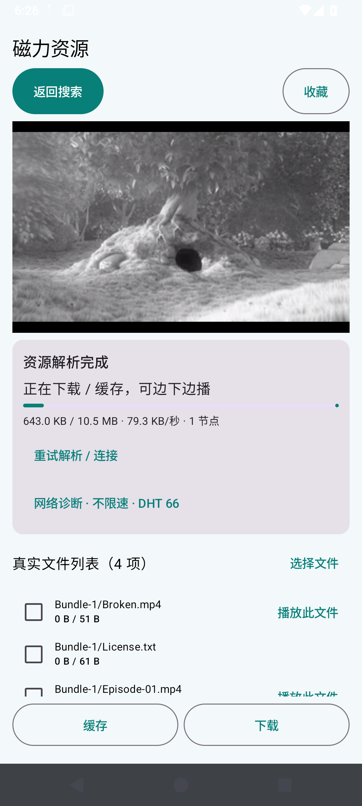

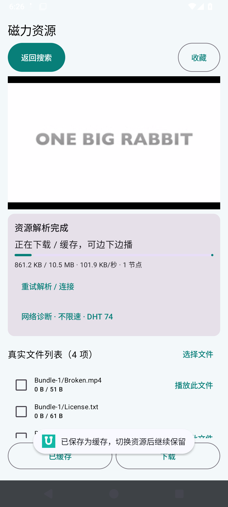

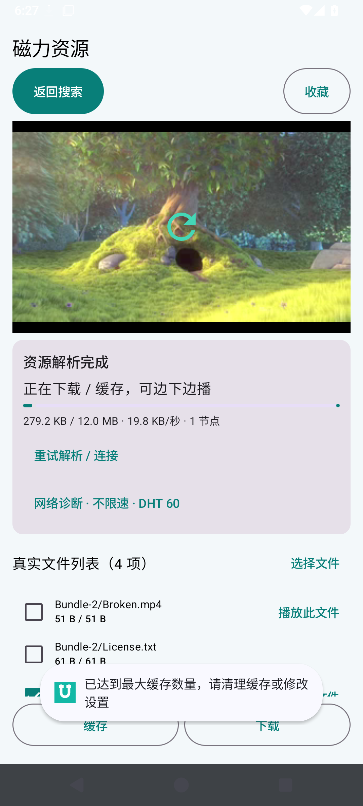

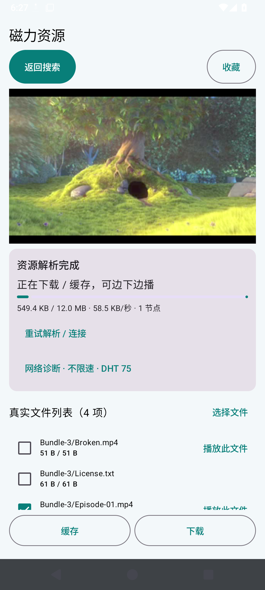

## 8. 磁力解析与节点发现

粘贴入口使用实际键盘输入，未通过测试接口注入 .torrent。真实种子返回多个视频文件和许可证；无效本地元数据会通过哈希核验被丢弃。DHT、Tracker 和直接节点按磁力参数发现资源；HTTP 元数据回退不阻塞 P2P。“重试解析 / 连接”重新发起节点发现，过程始终可以返回。

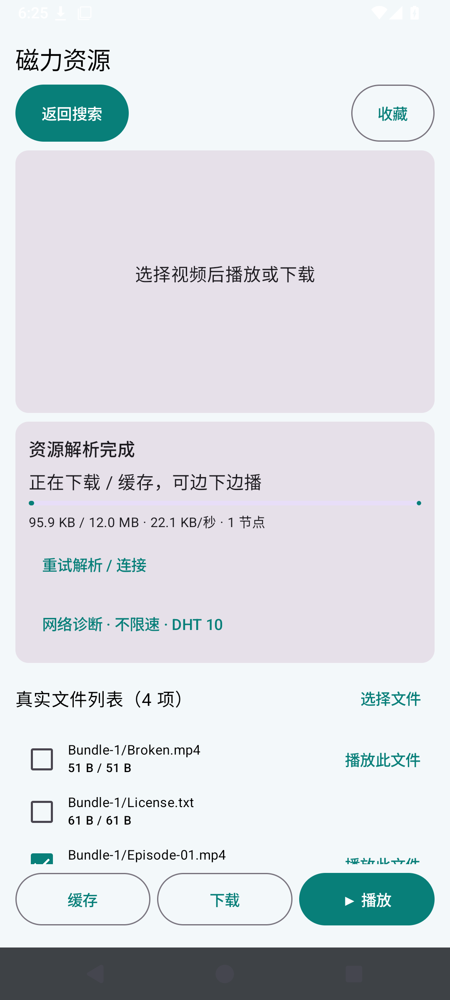

公网额外对照使用官方 Ubuntu 安装镜像的纯 BTIH 磁力，APP 没有预先获取元数据或注入做种节点；观察 75 秒。

| 客户端与网络 | 获取元数据 | DHT 节点 | 资源节点 | 有效接收字节 |
| --- | --- | --- | --- | --- |
| 原生客户端 / runner | True | 72 | 18 | 21,417,387 |
| APP / Android 模拟器 | True | 128 | 102 | 544,818,141 |

该行按实际观测填写；没有取得元数据或数据时，不标作公网解析/下载成功。用户磁力的做种状态、运营商 UDP、VPN、路由器及设备环境仍会影响节点发现。

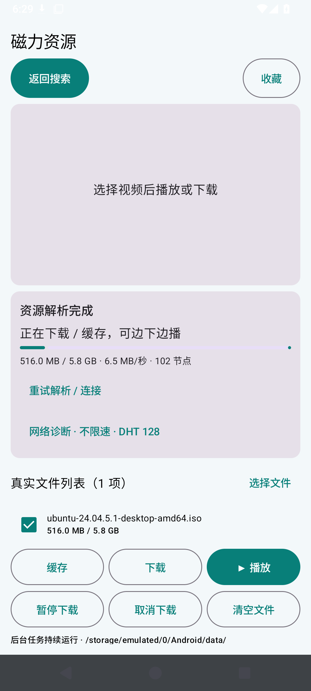

## 其他功能回归

[同一应用代码的 22 项回归](https://github.com/liao-zc/FreeMangnetPlayer/actions/runs/40828693902)通过，涵盖真实下载 SHA-256、单选/多选、暂停/继续/取消、后台/熄屏、设置持久化、队列和清理。[原始证据](evidence/player-revision-regression.json)。

## 发布与文档校验

版本 0.1.12，应用名称 FreeMangnetPlayer，包名 com.freemangnetplayer。使用相同签名，可覆盖安装 v0.1.11。Markdown 文件以 UTF-8 提交，校验 Git 对象、图片签名、相对链接，并运行 GitHub 渲染检查；同时提供图片内嵌的离线 HTML 报告。
