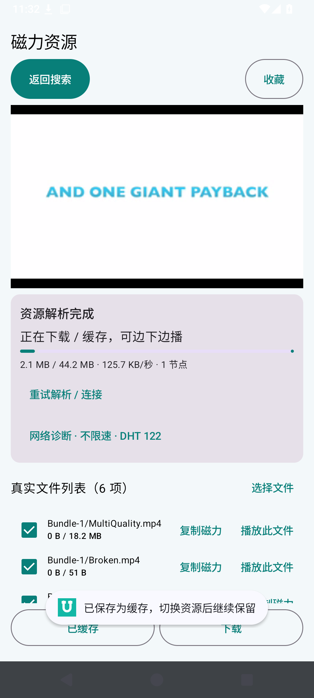
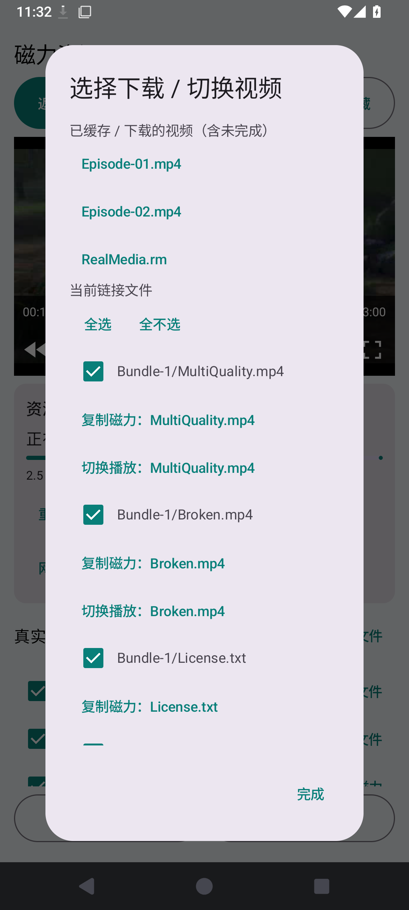
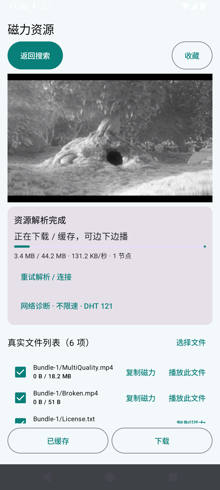
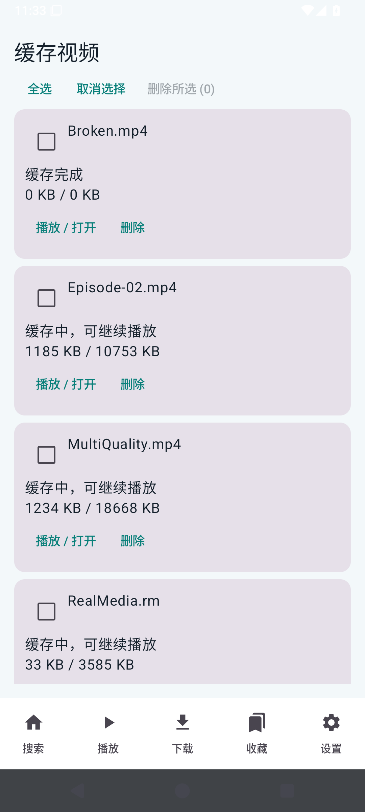
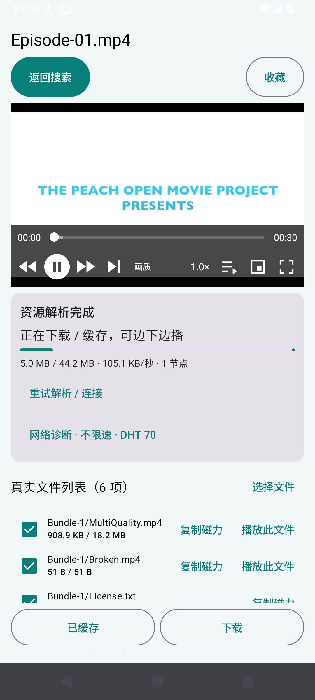
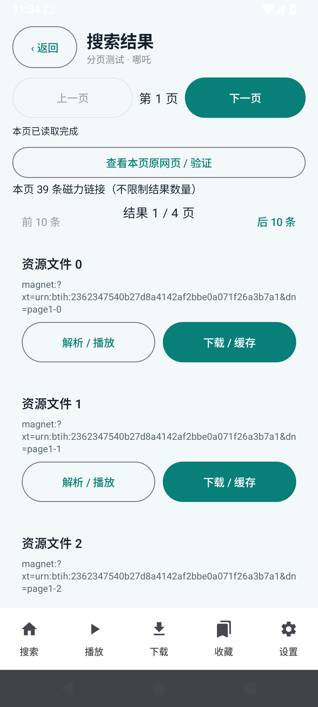
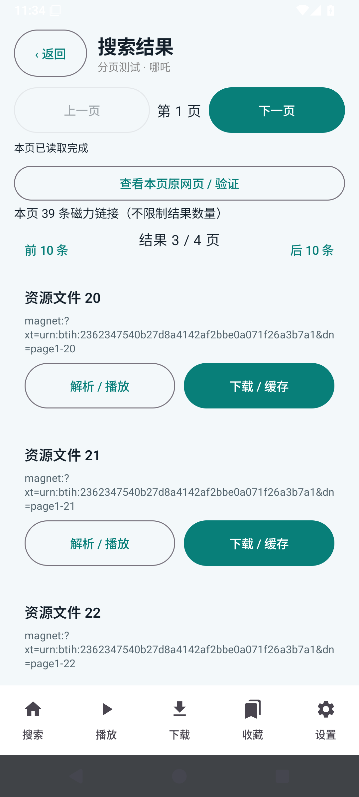
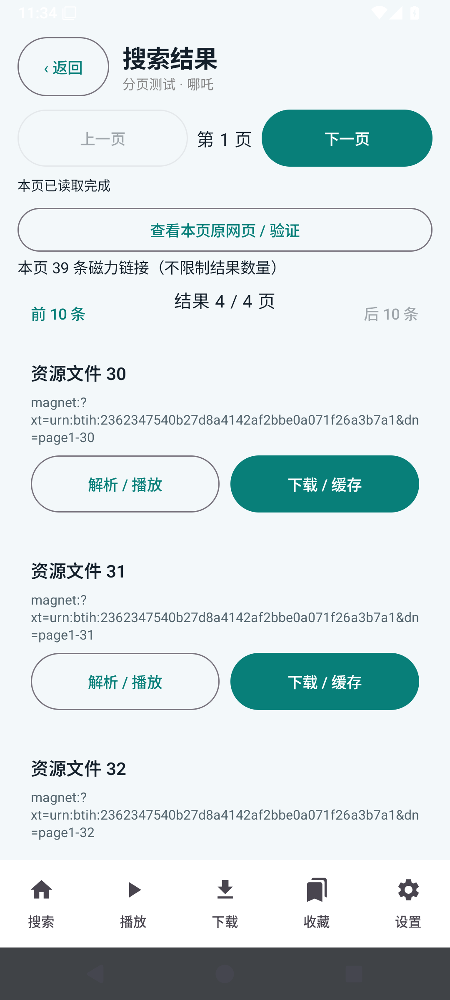

# FreeMangnetPlayer v0.1.15 功能优化与实际验收

日期：2026-10-29。设备：Android 15 / API 35 Pixel 2 x86_64 模拟器。截图来自实际 APK，未使用设计稿替代。ARM 手机、电视、平板尚需真机点检。

- [ARM64 下载](https://github.com/liao-zc/FreeMangnetPlayer/releases/download/v0.1.15/FreeMangnetPlayer-v0.1.15-arm64-v8a.apk)
- [离线图文报告](https://github.com/liao-zc/FreeMangnetPlayer/releases/download/v0.1.15/FreeMangnetPlayer-v0.1.15-report.html)
- [缓存、画质、删除与切换测试](https://github.com/liao-zc/FreeMangnetPlayer/actions/runs/40865626430)
- [两层分页测试](https://github.com/liao-zc/FreeMangnetPlayer/actions/runs/40865626430)
- [播放器回归](https://github.com/liao-zc/FreeMangnetPlayer/actions/runs/40864611733)

## 逐项结果

| 用户要求 | 实现与验证 | 范围 |
| --- | --- | --- |
| 缓存退出后能找到并播放 | 播放页增加“缓存视频”入口；按视频保存磁力和文件索引，退出进程后仍显示，能从列表重新起播 | 未完成缓存也可保存任务；旧缓存无文件列表时显示恢复入口 |
| 搜索结果在 APP 内分页 | 每个网站页按 10 条分屏，前 10 条/后 10 条；保留网站上一页/下一页 | 第一网站页 39 条分成 4 屏，全部可访问；第二网站页 17 条，空末页返回正常，无条数截断 |
| 默认原画质，提供较低分辨率 | 默认选择最高支持视频轨道；画质菜单提供原画质、720p/480p 上限；真实双轨文件由 720p 切至 360p 后恢复 720p | 仅选择已有轨道；单画质文件不能通过该选项降低 BT 流量，未实现本机/云端转码 |
| 缓存、下载、收藏、播放列表支持删除 | 每行删除及复选多选、全选；缓存/下载按文件清理，先关闭写入；收藏/历史默认只删记录，可选清理文件 | 单个缓存文件已验证物理删除，其他文件保留；批量清理与历史/收藏删除分别验证 |
| 下一个视频自动加载已有数据 | 内置文件按钮列出已缓存/下载视频；内置下一集图标切换至队列下一项 | 测试的视频尚未下载完成，已实际切换并播放；不用等全部缓存完成 |
| 测试报告及清理旧资料 | 本报告包含逐项数据及实际截图；清理旧版报告、截图、证据和本轮一次性修改脚本 | Git 历史和旧 Release 继续保留，不以旧证据充当新版本通过 |

## 重要边界

磁力下载的是已经编码的文件。把 1080p 画面缩小至 480p 不会自动减少它需要下载的数据。本版的低清选项实际选择已有的低清轨道；若资源只有单画质轨道，会提示不可用。没有把缩小显示冒充下载提速，也没有测得任意资源立即起播的保证。

用户指定的 `magnet:?xt=urn:btih:2362347540B27D8A4142AF2BBE0A071F26A3B7A1` 仍作为影片验收资源。此前该片元数据成功但视频数据为 0，未达到实际起播。本轮的缓存、删除、多轨与切换使用公开授权 Big Buck Bunny 受控做种素材，用于验证功能机制，**不能替代该影片的成功验收**。对标播放器在现有模拟器中不能稳定启动，同资源立即起播对照仍未完成。

播放器不以固定下载比例作为起播条件；按读取偏移等待已校验并写盘的分片。缓存列表有任务不代表已经有可播放分片，资源没有节点提供数据时仍无法播放。

## 操作说明与实际截图

### 画质入口

点击播放器内“画质”；默认原画质，低清仅在已有对应轨道时可选。

### 显式缓存

选择文件后点击“缓存”。退出资源页后从主页“播放 → 缓存视频”找到它。

### 缓存和下载队列

点击内置文件图标，上方自动显示已有数据的视频，下方为当前磁力的文件列表。

### 下一集播放

点击播放器内下一集图标，进入队列下一项；该测试文件尚未下载完。

### 重启后的缓存入口

重新打开 APP，进入播放页的缓存视频；每行“播放 / 打开”恢复指定文件。

### 收藏删除

在收藏页单选/多选后删除。默认保留下载缓存文件。

### 单文件删除

缓存或下载列表勾选一个文件并确认删除。其余文件保留。

### 批量缓存删除

勾选多个文件或全选，再确认删除。正在播放的文件需先退出播放器。

### 下载文件删除

下载列表按文件显示，可单选或全选清理。

### 实际低清轨道

受控文件含 720p 与 360p 两条轨道；选择 480p 上限后实际输出 360p，随后恢复原画质。

### APP 内分屏分页

同一网站页的 39 条分成 4 屏；网站翻页与 APP 分屏操作分别保留。

## 详细点检数据

| 检查 | 结果 |
| --- | --- |
| `default-original-quality` | 通过 |
| `quality-control-inside-player-with-no-transcoding-claim` | 通过 |
| `explicit-cache-records-files-before-completion` | 通过 |
| `partial-downloaded-video-auto-enters-queue` | 通过 |
| `next-control-switches-to-partial-video` | 通过 |
| `download-library-indexes-individual-files` | 通过 |
| `favorite-file-record` | 通过 |
| `cache-entry-discoverable-after-process-restart` | 通过 |
| `cached-file-reopens-and-plays` | 通过 |
| `existing-lower-resolution-track-selects-real-360p` | 通过 |
| `original-quality-restores-highest-track` | 通过 |
| `favorite-delete-keeps-cache-files` | 通过 |
| `batch-history-delete-keeps-cache` | 通过 |
| `single-cached-file-delete-preserves-other-files` | 通过 |
| `batch-cache-file-delete` | 通过 |
| `batch-download-file-deletion` | 通过 |
| `source-page-1-complete` | 通过 |
| `local-ten-result-screen-1` | 通过 |
| `local-ten-result-screen-2` | 通过 |
| `local-ten-result-screen-3` | 通过 |
| `local-ten-result-screen-4` | 通过 |
| `local-page-back-restores-first-screen` | 通过 |
| `source-page-2-complete` | 通过 |
| `source-page-3-complete` | 通过 |
| `previous-page-restores-all-results` | 通过 |
| `empty-page-and-back-responsive` | 通过 |

播放器原有倍速、跳转、全屏、画中画、临时缓存释放、错误反馈等 21 项另做回归，逐项状态见证据。

[缓存与画质证据](evidence/current-library.json) · [分页证据](evidence/current-pages.json) · [播放器回归](evidence/current-player.json)

Markdown 使用 UTF-8 明文，发布后核对 GitHub 内容与渲染，另提供图片内嵌离线 HTML。后台六小时真机、全部 ABI 真机及所有编码组合不在本轮已通过范围。
