# OmniPlayer 全量功能点检报告

日期：2026-10-30。测试环境：Android 15 / API 35 x86_64 模拟器；安装实际 APK，并通过 UI 操作、播放器状态与磁盘数据校验。截图均来自运行中的 App 或独立浏览器。ARM 手机、平板及电视尚需真机验证。

- [ARM64 安装包](https://github.com/liao-zc/OmniPlayer/releases/download/v0.2.7/OmniPlayer-v0.2.7-arm64-v8a.apk)
- [GitHub Release 页面](https://github.com/liao-zc/OmniPlayer/releases/tag/v0.2.7)
- [源码包](https://github.com/liao-zc/OmniPlayer/releases/download/v0.2.7/OmniPlayer-v0.2.7-source.zip)

## 验收结论

本轮字体、历史记录、分页、播放器信息栏及本地收藏功能有实际测试证据。不限速受控做种测试有效载荷峰值 **8.89MB/s**，App 限速值为 0；公网十条资源实际起播 **0/10**，**未达到** 90% 要求。受控测试不能证明任何公网资源都能维持最低 2MB/s。

受控影片首次起播 5.12 秒，当时已下载 6.0%；没有按固定百分比限制起播，但仍须等到所请求的真实分片可读。

字体/历史与队列截图使用做种端限速的受控素材，以便观察尚未完成的缓存；这不是 App 限速。不限速吞吐由另一轮独立测量验证，所有 App 下载/上传限速值均为 0。

## 按用户编号逐项点检

| 编号 | 要求及修改 | 验证结果与边界 |
| --- | --- | --- |
| 1 | 设置页“显示与字体”；小、标准、大、超大及 75%–175% 滑块；黑体、宋体、楷体与自定义 TTF/OTF 导入 | 四档及滑块持久化、三种实际字体加载通过；宋体和楷体随包提供 OFL 字体。自定义字体导入接口已实现，系统文件选择器尚未逐设备点检 |
| 2 | 搜索行显示大小，解析详情显示真实文件字节数 | 提取磁力 xl、结果行及详情页大小；受控网页 39 条均有大小；解析页采用种子文件元数据。网站不提供大小且元数据未取得时显示“等待元数据大小”，**尚未满足所有资源始终有精确大小**，不会填造数值 |
| 3 | 独立历史模块：搜索 50、播放 100、下载 50、缓存 30；名称、时间、播放进度或任务进度 | Android 测试验证各类上限、时间倒序、进度更新和清空；实际 UI 验证播放/缓存/下载记录及清空；入口为“播放 → 历史记录”。清空历史保留缓存、下载文件和收藏 |
| 4 | 搜索名称基准 14sp、深灰 #333333、行高 16.8sp，每屏 20 条 | 39 条分成 2 屏全部可访问；字体设置和 Android 系统字号继续生效。Android 使用 sp；不是硬编码物理像素 |
| 5 | 提升吞吐；播放器内显示时长、分辨率、大小和实时缓存百分比/进度条 | 受控不限速测试峰值 8.89MB/s；真实读取的媒体信息显示通过。媒体头未取得前不能知道时长和分辨率；已读取信息持久化后重开可立即显示。**不能保证公网最低 2MB/s** |
| 6 | 资源节点问题；十条指定磁力实际测试 | 元数据、Peer、有效视频字节、首帧与速度均独立记录；按哈希保存可重连节点，扩大读取预取窗口，优先读取头部和尾部。公网起播 0/10，**未通过 90% 验收**。DHT 路由节点不是做种节点，未将元数据成功算作播放成功 |
| 7 | 只显示“搜索中”进度；减少丢失结果，隐藏引擎来源 | UI 隐藏连接网站/来源信息；扫描结果、详情、data-magnet、输入框及 HTML 中的磁力；受控浏览器结果集合偏差 0。六个真实源另有观测；**真实源结果偏差尚未全部达到 ≤10% 要求**。访问被阻拦或没有可核验结果时不认定达标 |
| 8 | 播放器右上角白色空心爱心；点击红色实心，再点击取消 | 实际点击和收藏存储添加/删除通过。按用户本轮答复维持本地使用；自建账户同步留待未来接入 |
| 9 | 搜索只展示名称、大小、资源类型和热度；隐藏网站/爬取元数据 | 界面已收敛为上述字段及播放/下载/收藏操作。类型从来源文字提取；来源没有评分时显示“未提供评分”，没有生成虚假热度 |
| 10 | 搜索显示文件名，隐藏裸磁力 | 显示结果标题、详情关联标题或 dn 文件名，磁力仅用于操作。受控两条异名详情解析通过；原网页及磁力都不含名称时无法准确得知真实文件名 |
| 11 | 当前页、总页、上一页/下一页及指定页跳转 | 结果屏总页数精确计算；网站页码从原网页提取，实际跳转到第 3 页再回第 1 页及跳转结果屏通过。网站没有总页数或目标页地址时只能显示已发现页数，不编造总页数和地址 |
| 12 | 关闭“查看本网页”验证提示 | 搜索结果 UI 已移除该入口和验证按钮 |
| 13 | 搜索未完成时停止跳动，显示“搜索未完成” | 超时/访问错误停止追加；保留已有结果与返回、重试，真实源错误截图及空页返回校验 |
| 14 | 收藏全选后下载，任务在下载列表可查 | 实际全选收藏、点击下载、查看下载任务及记录通过；按文件 so 选择保留所选目标 |
| 15 | 选择低清不再弹出“没有低清轨道” | 菜单仅显示已发现且能解码的低清轨道；选取明确轨道，支持恢复原画；720p→360p 实际播放通过。单轨文件只有原画选项，未实现转码 |

## 十条公网资源实际结果

每条冷启动测试最多等待 120 秒，清除上次缓存后启动实际播放器，至少播放到 500ms 且收到有效数据才计为起播成功。首帧后继续观测约 10 秒；数据不足不记通过。以下类别采用用户提供的分类，文件名称以实际取得的元数据为准。

| 类别 | 磁力哈希 | 元数据 | 节点 | 有效字节 | 峰值 MB/s | 首帧秒 | 起播 |
| --- | --- | --- | --- | --- | --- | --- | --- |
| 电影 | `B3D7179216306E63081AC0DDA84A714B183263F4` | 有 | 0 | 0 | 0.000 | 未起播 | 未通过 |
| 电影 | `D455858E4FCA306FCF315B1229CAF4AC4E065DBA` | 无 | 1 | 0 | 0.000 | 未起播 | 未通过 |
| 电影 | `6E00F1E081B67749B48141D38950BF6343BC5F10` | 有 | 1 | 0 | 0.000 | 未起播 | 未通过 |
| 动漫 | `665ED0FDA70B0AAFBE2ABE656EE0EA9DAE975389` | 有 | 1 | 0 | 0.000 | 未起播 | 未通过 |
| 动漫 | `840B33399D8C3AC57CF1CD9346ABE31236DDB4C1` | 无 | 0 | 0 | 0.000 | 未起播 | 未通过 |
| 动漫 | `571BB0140930A9B46DBA127D2F23B3EAF6B53530` | 有 | 0 | 0 | 0.000 | 未起播 | 未通过 |
| 剧集 | `FCF228066E11199A85F97AFC023A39BAA482C5B6` | 有 | 0 | 0 | 0.000 | 未起播 | 未通过 |
| 剧集 | `DA0AF5B9CE6BA74445F32576E7C90DD004A89A7F` | 有 | 0 | 0 | 0.000 | 未起播 | 未通过 |
| 剧集 | `C79263E0F308865FBF3A9613F1B2A8DEF1EBAAAA` | 无 | 0 | 0 | 0.000 | 未起播 | 未通过 |
| 纪录片 | `A56FB49D397F177938F8BC5BFBAA7D032DCD074A` | 有 | 0 | 0 | 0.000 | 未起播 | 未通过 |

同默认 Tracker 的独立客户端：1/10 取得元数据，0/10 收到有效视频数据。App 在本轮环境中也未收到目标资源数据；暂未定位为单一网络或程序原因，90% 起播要求仍未解决。

节点数量与速度为本轮环境观测，不等于资源在所有网络中不可用。独立 native 客户端配置同一默认 Tracker 清单另做 180 秒观测；运行时、连接方式和观测时间与 Android 不同，不能把它当成同设备的另一款播放器测试。完整数据见证据。

### 原指定磁力

`magnet:?xt=urn:btih:2362347540B27D8A4142AF2BBE0A071F26A3B7A1`：元数据 有，有效字节 0，起播 未通过。继续保留为固定验收资源。

## 与 Magnet_player 的对照范围

对标仓库：https://github.com/zaidielykelee/Magnet_player 。此前其 APK 在 ARM 转译模拟器中无法稳定运行，尚未完成两款 App 的同设备起播和速度对照；本报告没有将独立 native 客户端冒充对标 App，也没有虚构对方播放画面。此项仍需可运行对标 App 的设备才能验收。

## 六个真实搜索源

| 引擎 | 浏览器磁力数 | App 磁力数 | 可比性与偏差 |
| --- | --- | --- | --- |
| clg.im | 11 | 11 | 无法核验（访问失败或无有效基线） |
| BT搜索（dobt） | 0 | 0 | 无法核验（访问失败或无有效基线） |
| BD电影首发站 | 156 | 0 | 100.0% |
| Pomo | 60 | 198 | 230.0% |
| 美剧粉 | 0 | 0 | 无法核验（访问失败或无有效基线） |
| 高清族 | 48 | 0 | 无法核验（访问失败或无有效基线） |

### 搜索源 1 对照截图

### 搜索源 2 对照截图

### 搜索源 3 对照截图

### 搜索源 4 对照截图

### 搜索源 5 对照截图

### 搜索源 6 对照截图

统计使用唯一磁力哈希集合，不能证明所有网页资源行都对应磁力。浏览器基线取标题含关键词的详情，App 还遍历部分同源其他详情，因此 Pomo 的结果范围偏大；其他源的零结果仍需继续排查访问和详情适配。真实六源一致性尚未通过，不能把额外无关结果视为更好。未把两个访问失败的零结果当成“结果一致”。

## 操作说明和 App 实际截图

### 字体设置

从底部设置进入“显示与字体”，选择四档字号或拖动滑块。

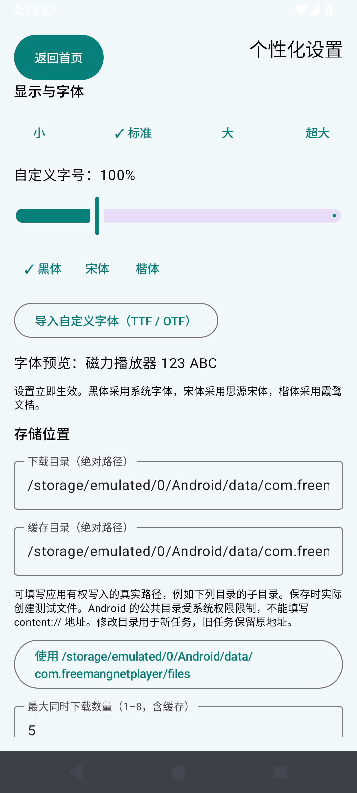

### 宋体与大字号

选择宋体和大字号；黑体、楷体及自定义导入位于同一模块。

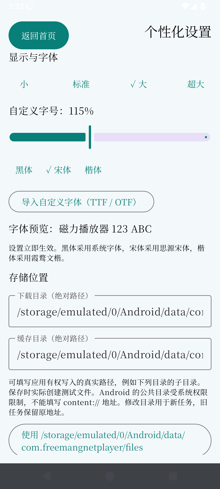

### 楷体

选择楷体查看实际字体。

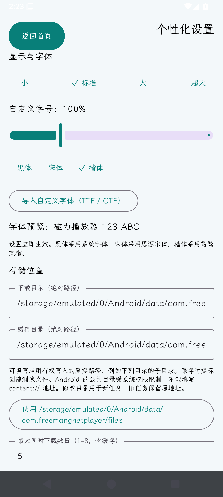

### 播放器收藏

点播放器右上角爱心添加收藏；再点取消。

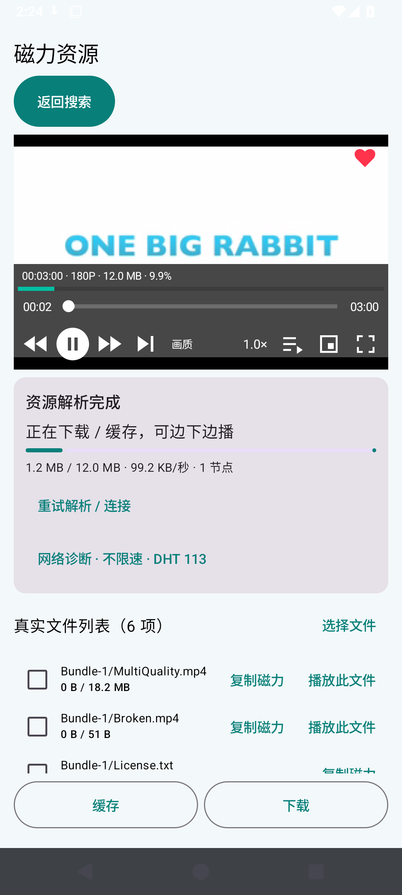

### 可选画质

点内置画质按钮，仅列出已识别的可选轨道。

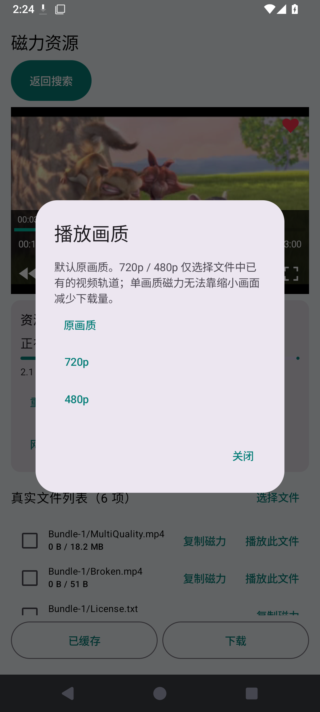

### 媒体信息及缓存进度

点播放画面唤出控制栏，查看真实时长、分辨率、大小和缓存百分比。控制栏会自动隐藏。

### 手动保留缓存

点击缓存后按钮变为已缓存；退出资源后从缓存视频入口重新打开。

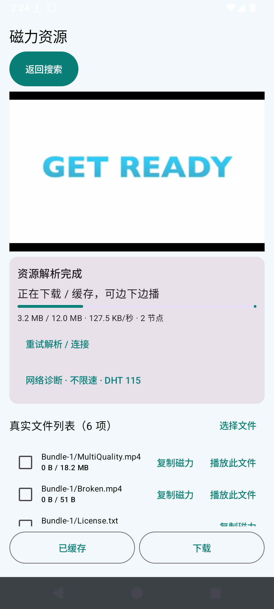

### 收藏批量下载

收藏页全选或多选后下载，进入下载列表查看。

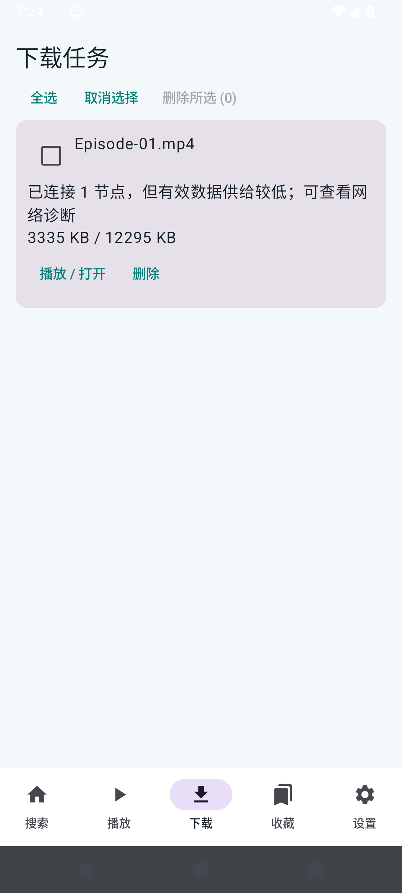

### 播放历史

播放页进入历史记录，切换搜索、播放、下载、缓存类别；支持删除记录和清空。

### 缓存重启入口

缓存后从“播放 → 缓存视频”重新打开指定文件。

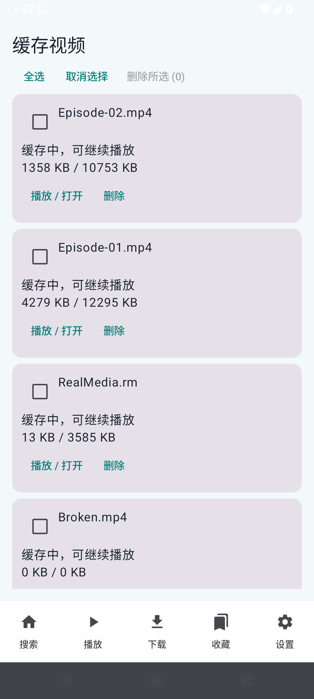

### 20 条分页第 1 屏

显示文件名称、大小、类型、热度；分页栏提供上一屏、下一屏和跳页。

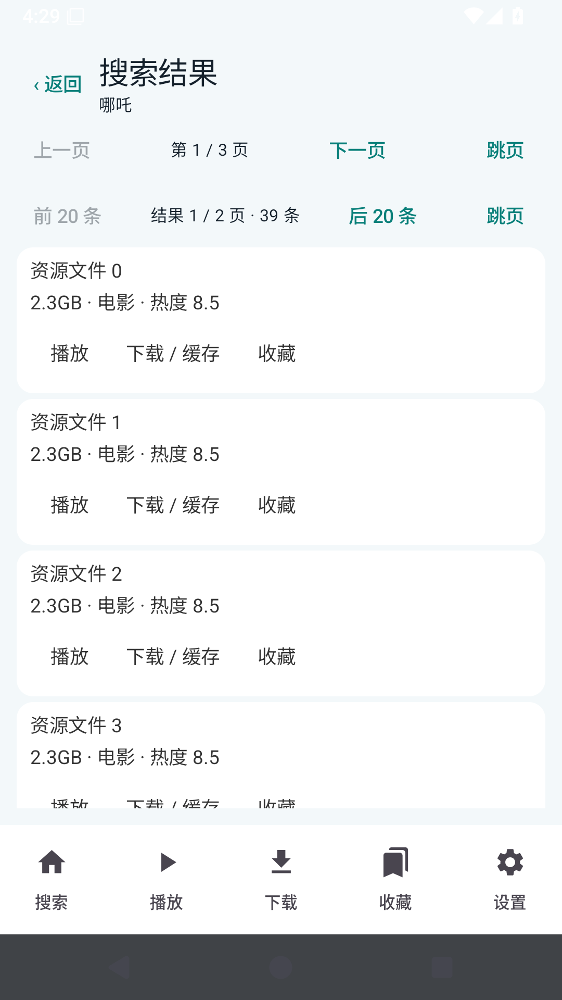

### 20 条分页第 2 屏

同一个网站页 39 条分为两屏，没有截断。

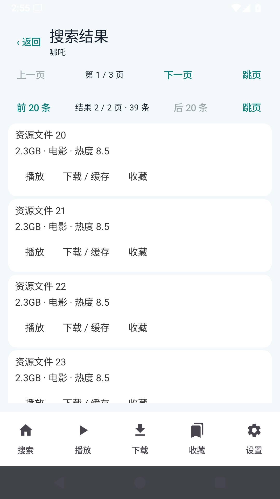

### 结果页跳转

点“跳页”，输入目标页码并确认。

### 不限速实际播放

受控不限速做种，实际播放和有效载荷速度。

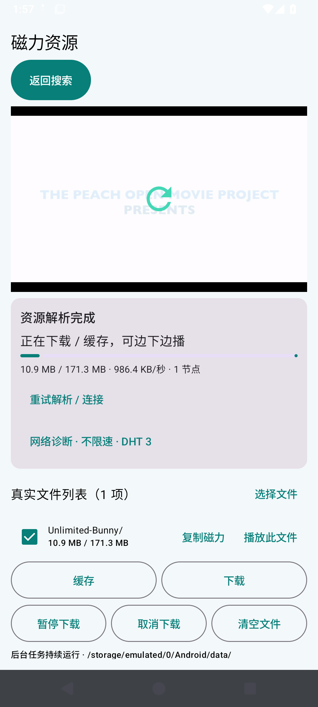

### 十条资源逐条截图

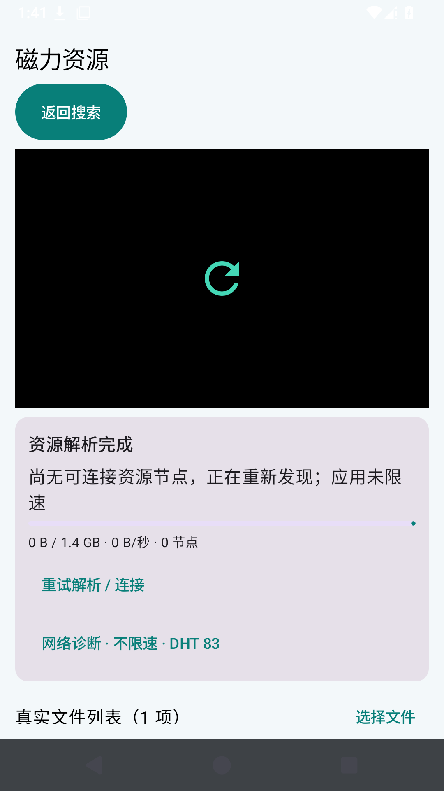

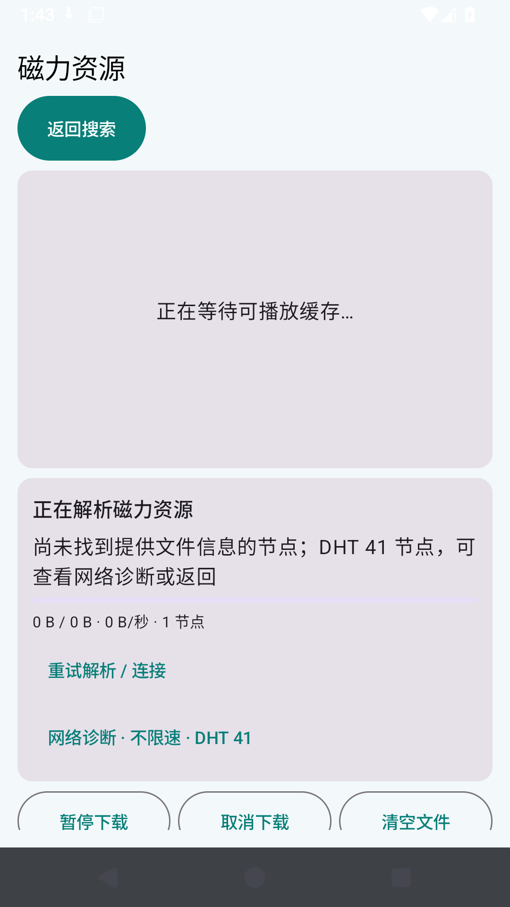

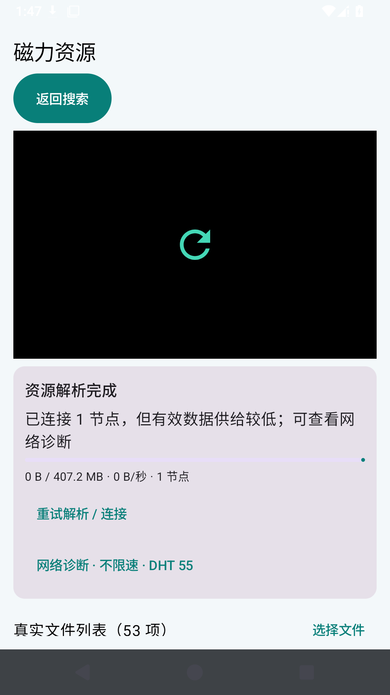

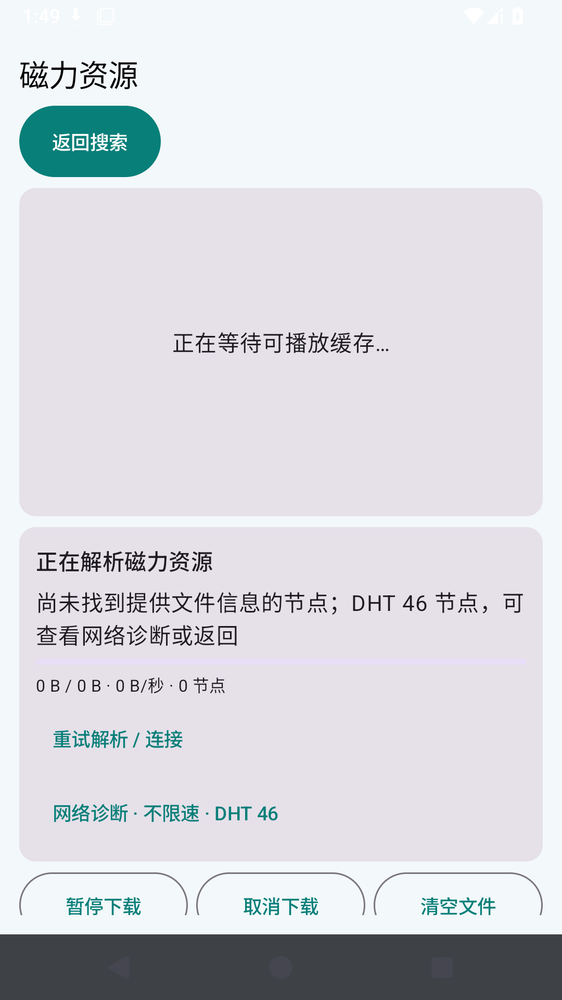

## 详细检查和测试入口

| 检查项 | 结果 |
| --- | --- |
| `default-original-quality` | 通过 |
| `quality-control-inside-player-with-no-transcoding-claim` | 通过 |
| `explicit-cache-records-files-before-completion` | 通过 |
| `partial-downloaded-video-auto-enters-queue` | 通过 |
| `next-control-switches-to-partial-video` | 通过 |
| `download-library-indexes-individual-files` | 通过 |
| `favorite-file-record` | 通过 |
| `cache-entry-discoverable-after-process-restart` | 通过 |
| `cached-file-reopens-and-plays` | 通过 |
| `existing-lower-resolution-track-selects-real-360p` | 通过 |
| `original-quality-restores-highest-track` | 通过 |
| `favorite-delete-keeps-cache-files` | 通过 |
| `batch-history-delete-keeps-cache` | 通过 |
| `single-cached-file-delete-preserves-other-files` | 通过 |
| `batch-cache-file-delete` | 通过 |
| `batch-download-file-deletion` | 通过 |
| `display-font-module-and-four-presets` | 通过 |
| `song-font-and-large-preset-persist` | 通过 |
| `kai-font-applied` | 通过 |
| `favorite-heart-adds-current-video` | 通过 |
| `favorite-heart-second-tap-removes` | 通过 |
| `actual-duration-resolution-size-and-cache-progress` | 通过 |
| `play-and-cache-history-created` | 通过 |
| `favorite-select-all-download-visible-in-library` | 通过 |
| `independent-history-module-and-timed-progress` | 通过 |
| `clear-single-history-keeps-other-records` | 通过 |
| `clear-all-history-keeps-favorites` | 通过 |
| `source-page-1-complete` | 通过 |
| `local-twenty-result-screen-1` | 通过 |
| `local-twenty-result-screen-2` | 通过 |
| `local-page-back-restores-first-screen` | 通过 |
| `source-page-2-complete` | 通过 |
| `source-page-3-complete` | 通过 |
| `previous-page-restores-all-results` | 通过 |
| `website-page-jump-three-and-one` | 通过 |
| `local-result-page-jump` | 通过 |
| `empty-page-and-back-responsive` | 通过 |

回归流程按已完成子项记录；旧 library/吞吐流程曾在后续 UI 脚本失败，不能把整个旧流程标为通过。吞吐重试曾因多行输入框未完全清空而贴入残留字符，已改为全选后替换。最终专项流程状态以对应 Actions 链接为准。

Android 设备测试另校验字体真实加载、字号持久化、各类历史数量上限、时间倒序、播放进度及收藏存储切换。

- [library 测试过程](https://github.com/liao-zc/OmniPlayer/actions/runs/40986851277)

- [preferences 测试过程](https://github.com/liao-zc/OmniPlayer/actions/runs/40990866522)

- [pages 测试过程](https://github.com/liao-zc/OmniPlayer/actions/runs/40994181448)

- [public 测试过程](https://github.com/liao-zc/OmniPlayer/actions/runs/40986864228)

- [native 测试过程](https://github.com/liao-zc/OmniPlayer/actions/runs/40988375209)

- [performance 测试过程](https://github.com/liao-zc/OmniPlayer/actions/runs/40988171757)

- [search 测试过程](https://github.com/liao-zc/OmniPlayer/actions/runs/40994186837)

[字体/历史证据](evidence/current-preferences.json) · [分页](evidence/current-pages.json) · [十条公网资源](evidence/current-public.json) · [独立客户端](evidence/current-native.json) · [吞吐](evidence/current-performance.json) · [真实搜索](evidence/current-search.json)

当前报告及截图替换旧版本资料；旧 Git 历史和 Release 保留。Markdown 使用 UTF-8 明文，发布后核对 GitHub 字节和渲染，另提供内嵌图片 HTML。

## 本轮修复与真实验收进展（2026-10-30）

### 文件名、大小和分页：通过受控网页回归

[完整运行记录](https://github.com/liao-zc/OmniPlayer/actions/runs/41002883131) 的 10 项检查全部通过。页面链接文字统一为“查看详情”，页脚为“页面总计 34.03GB”；App 仍显示各资源的真实名称，37 个直接链接各为 2.3GB，2 个详情资源各为 1.5MB。39 条全部取得，无遗漏。网站翻页、每屏 20 条、页码跳转及空页返回均通过。

原因修复：页面加载过程中的首次扫描可能尚无详情链接；扫描期间不能提前宣布搜索完成。现已等待页面加载完成和所有详情请求结束，再确认搜索完成。

以下是运行中的实际 App 截图，素材为受控搜索网页，用于验证名称和大小提取，不是公网影片播放截图：

### 十条公网磁力：尚未通过

删除 DHT 无限等待后的[真实 APK 测试](https://github.com/liao-zc/OmniPlayer/actions/runs/41000002632) 为 0/10 起播，10 条有效视频数据均为 0；其中 7 条取得元数据。文件列表不能代表收到视频。

本机 libtorrent 2.1.1 绑定 WLAN 的约 597 秒测试同样未取得十条资源的元数据和有效数据。三个 DHT 引导入口与两个 UDP Tracker 的直接探测均超时；公开 Ubuntu 对照种子通过 HTTPS Tracker 发现节点并收到 1,572,864 字节。这些结果说明存在可用 BT 路径，同时 UDP 发现入口仍需排查，不能把全部失败直接归因于文件或 APP 限速。

### 新版引擎：仍在修复回归，尚未发布

[独立分支](https://github.com/liao-zc/OmniPlayer/tree/improve/modern-bt-engine) 使用 libtorrent4j 2.1.0-39，Java 与四种架构 JNI 同版本，已成功编译和打包。新增不阻塞磁力启动的公共 Tracker 刷新与本地缓存；用累计接收字节判断进展，避免慢速数据被判为停滞。

受控做种测试发现元数据补充并替换句柄后连接未恢复、有效字节为 0，该回归尚未通过。已改为替换句柄后先经 TCP 重连，无连接时再恢复 uTP，正在[重新测试](https://github.com/liao-zc/OmniPlayer/actions/runs/41003279966)。该分支尚未并入 main，新版本 APK 尚未发布。

验收已升级：十条必须全部在文件未下载完时渲染视频，并持续推进播放至少 20 秒。之前“90% 通过”或仅有播放状态的判据不再作为本任务的完成条件。

## 本次补充：发布时间、独立任务名额和输出脚本

### 搜索结果的资源时间

资源名称下显示来源提供的发布时间。读取资源行的 time 标签、明确的发布时间字段或详情页发布时间；保留“昨天”等来源原文，不把搜索时间或整页时间当作每条资源的发布时间。来源没有发布时间时显示“来源未提供”，不编造日期。

[发布时间回归](https://github.com/liao-zc/OmniPlayer/actions/runs/41004109559) 的 10 项检查全部通过：受控页面 39 个资源，37 条日期为 2026-10-29，2 条详情页日期为 2025-03-01；名称、大小、20 条分页、页码跳转及空页返回同步通过。上面的三张搜索截图已替换为这次实际 App 截图。受控网站验证提取逻辑，不代表六个公网来源都提供日期。

### 最大下载数量不包含缓存

下载任务与缓存/播放任务分开计算、排队和恢复。默认同时下载上限为 5；缓存采用设置中的独立缓存任务上限。暂停、完成、取消和排队任务不计入活动名额。设置标签明确标注“不含缓存”和“单独计算”。

[Android 测试](https://github.com/liao-zc/OmniPlayer/actions/runs/41004735689) 已通过，覆盖 5 个活动下载与 10 个活动缓存分别计数、排队缓存不挤占下载、暂停/完成/取消不占名额。第一次测试夹具未将 queued 设为 false，误把全部夹具当作排队任务；已修正夹具后重新通过，未放宽断言。

### PowerShell 格式化错误

用户提供的错误说明格式字符串引用了参数范围以外的索引。引用 {0} 至 {7} 需要八个格式参数；缺少完整原命令，不能进一步确定是参数遗漏还是表达式解析导致。这个输出错误本身不能证明 BT 连接或播放算法有问题。

新增 scripts/summarize_public_results.ps1：显式遍历 JSON 数组，以对象输出文件名、元数据、节点、有效下载字节和验收结果，避免位置格式索引。Windows PowerShell 已实际读取 public-acceptance.json 并输出 11 条记录，没有 FormatError。记录仍如实显示未通过，不会把输出修复算作播放修复。

### BT 仍在验证

现代引擎元数据替换后丢失 Tracker 的原因已定位：TorrentInfo 不保留顶层 Tracker，重新添加任务时必须显式恢复 URL 和 tier。实验分支现已恢复到新句柄，并以新句柄实际 Tracker 集合验证恢复数量。[最新受控回归](https://github.com/liao-zc/OmniPlayer/actions/runs/41005592483) 正在执行，尚不能声明解决或发布验收版 APK。十条磁力仍要求全部实际渲染首帧、在文件未下载完成时起播并持续播放。

### 最新运行结果：受控起播通过，缓存后续检查失败

[现代引擎回归 41005802769](https://github.com/liao-zc/OmniPlayer/actions/runs/41005802769) 已完成。Android 五项存储/字体/任务名额测试通过；受控 Episode-01.mp4 实际起播：总大小 12,590,316 字节，采样时已下载 1,354,314 字节，首帧时间戳非零，视频高度 180，播放进度 913ms，总时长 180 秒，有效传输字节 1,166,686。此采样证明受控文件未下载完成时能起播，不证明连续 20 秒无卡顿或十条公网磁力通过。metadataReplacements 为 0，不能用此样本证明元数据替换路径已恢复。

后续“全选后缓存记录至少两条”检查失败，整套回归仍未通过；已增加选择状态断言以及缓存失败的任务状态、记录和 UI 快照，继续定位。

[受控起播状态](evidence/modern-controlled-playback.json)

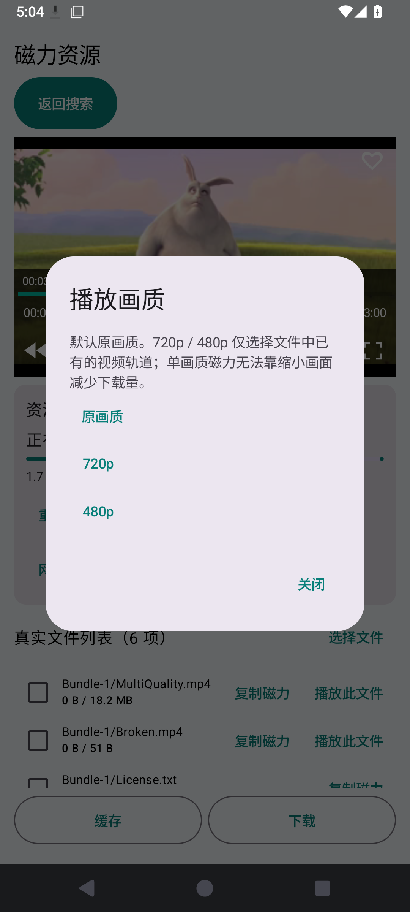

画面为受控测试视频，不是用户十条电影的验收截图。

[最新十条磁力验收](https://github.com/liao-zc/OmniPlayer/actions/runs/41005807792) 仍在执行 Android 逐条检查；独立 native 探测已经结束，十条均无元数据且有效视频字节为 0。native 工作流步骤成功仅表示探测脚本执行完成，不表示资源播放通过。

[缓存定位回归](https://github.com/liao-zc/OmniPlayer/actions/runs/41006619134) 已启动。

### 持续排查：多文件选择与 Peer 数据供给

[选择状态回归 41006619134](https://github.com/liao-zc/OmniPlayer/actions/runs/41006619134) 明确在“全选后两个 Episode 均被选中”处失败。代码检查发现 playFile 在准备/重试时覆盖多选，实验分支已保留显式选择；但[修复后的 41006843768](https://github.com/liao-zc/OmniPlayer/actions/runs/41006843768) 仍在相同断言失败，当前修复不足以解决界面操作问题，不能标记缓存全选通过。

新增两个直接 Android 回归检查：重复播放准备保持多选，以及无选择时初始化当前文件；同时捕获弹窗点击全选前后的实际截图、超时 UI 和任务状态，继续定位界面点击与页面重建。

- [直接选择回归及完整功能检查](https://github.com/liao-zc/OmniPlayer/actions/runs/41007551092)
- [弹窗截图与超时快照检查](https://github.com/liao-zc/OmniPlayer/actions/runs/41007647713)

磁力诊断增加最多 16 个 Peer 的地址、客户端、拥有资源比例、下载字节、速度和连接标志，以及最多 20 条断连/错误事件，仅写入调试状态。这些字段帮助区分发现地址、完成握手和真正供给视频数据，不把短暂连接数当作播放成功。

[含 Peer 诊断的十条验收](https://github.com/liao-zc/OmniPlayer/actions/runs/41007252723) 正在执行。前一轮 41005807792 也仍在运行，保留其独立结果，未因观察等待而重启或宣布失败。

再次检查对标仓库 zaidielykelee/Magnet_player，当前树仍只有 README.md，无法进行 BT 源码级比较；未将其他客户端探测冒充对标 App 的同设备效果。

### Tracker 恢复后的十条真实验收：仍为 0/10

[完整运行 41005807792](https://github.com/liao-zc/OmniPlayer/actions/runs/41005807792) 已结束。十条分别冷启动检查，所有资源有效视频字节为 0、首帧时间戳为 0；7 条取得元数据，3 条未取得。两条最终显示种子数 1，但仍没有收到数据。Tracker 集合恢复数量不是起播证据。

| 资源哈希 | 元数据 | 最终 Peer / 种子 | 视频字节 | 结果 |
| --- | --- | --- | --- | --- |
| `b3d7179216306e63081ac0dda84a714b183263f4` | 有 | 0 / 0 | 0 | 未通过 |
| `d455858e4fca306fcf315b1229caf4ac4e065dba` | 无 | 1 / 0 | 0 | 未通过 |
| `6e00f1e081b67749b48141d38950bf6343bc5f10` | 有 | 1 / 0 | 0 | 未通过 |
| `665ed0fda70b0aafbe2abe656ee0ea9dae975389` | 有 | 0 / 0 | 0 | 未通过 |
| `840b33399d8c3ac57cf1cd9346abe31236ddb4c1` | 无 | 0 / 0 | 0 | 未通过 |
| `571bb0140930a9b46dba127d2f23b3eaf6b53530` | 有 | 1 / 1 | 0 | 未通过 |
| `fcf228066e11199a85f97afc023a39baa482c5b6` | 有 | 0 / 0 | 0 | 未通过 |
| `da0af5b9ce6ba74445f32576e7c90dd004a89a7f` | 有 | 0 / 0 | 0 | 未通过 |
| `c79263e0f308865fbf3a9613f1b2a8def1ebaaaa` | 无 | 0 / 0 | 0 | 未通过 |
| `a56fb49d397f177938f8bc5bfbaa7d032dcd074a` | 有 | 1 / 1 | 0 | 未通过 |

[逐条状态与采样记录](evidence/modern-public-acceptance.json)保留最终文件列表和每次采样的播放、节点、字节指标；完整未裁剪文件可从上述运行的 public-playback-acceptance 附件下载，避免在仓库重复保存每次采样的全部文件列表。固定第十一条 236234… 同样未起播。本轮结果仍不能证明资源在其他网络没有做种，也不能证明仅调整本机调度就能解决；带 Peer 数据和断连原因的新测试继续执行。

文件选择的截图已明确：全选时弹窗的文件勾选有效，关闭后选择恢复为单个当前视频。直接 Android 检查七项全部通过，包括重复 playFile 不覆盖多选，故仍需查找其他覆盖路径。新增有限长度的选择变化调用记录和 Activity 实例标识，用实际调用位置定位，而不是继续猜测。

### Peer 诊断和选择状态重建的实际发现

[Peer 诊断运行 41007252723](https://github.com/liao-zc/OmniPlayer/actions/runs/41007252723) 已结束，十条仍无有效视频数据、无首帧。多条已握手连接自报 dht-spy/1.0，资源拥有比例 0、下载字节 0；另有 Transmission、qBittorrent、BitTorrent 连接以及大量 TCP/uTP 超时或对端重置。不能将这些节点与真正供给视频分片的节点混为一谈，也不能据本次测试推断所有网络都无做种。

新引擎返回 Peer 地址格式为 tcp://IP:port。元数据替换恢复逻辑以前仅按 IP:port 切割，未移除协议前缀，导致构造重连地址失败。实验分支已按 URI 解析 IPv4、IPv6 及协议前缀，保留地址和端口，拒绝非法端口和地址；新增三个 Android 回归测试。

[Peer 原始字段及断连记录摘要](evidence/modern-peer-diagnostics.json)保留每个地址观察到的客户端和数据比例，以及不同的错误事件。完整逐秒文件从对应 Actions 附件下载。

[选择调用追踪 41008640791](https://github.com/liao-zc/OmniPlayer/actions/runs/41008640791) 在失败时只记录到 MainActivity.onCreate → TorrentTasks.initialize 从已保存状态载入 [4]；全选时的修改记录已消失，表明过程中发生任务/进程重建，尚不能仅凭此确定退出原因。新回归保存 logcat 和 Android process exit-info，进一步定位重建原因。

- [进程退出原因回归](https://github.com/liao-zc/OmniPlayer/actions/runs/41009537644)
- [Peer 地址修复与功能回归](https://github.com/liao-zc/OmniPlayer/actions/runs/41009900336)
- [修复后的十条磁力验收](https://github.com/liao-zc/OmniPlayer/actions/runs/41009904571)

以上新回归仍在运行，尚未认定修复通过或发布新版 APK。

### 定位导致缓存选择丢失的系统存储崩溃

[进程退出回归 41009537644](https://github.com/liao-zc/OmniPlayer/actions/runs/41009537644) 已结束。logcat 记录 Android 15 MediaProvider/FUSE 进程的 SIGABRT：active_nodes_.find(node) 检查失败；随后 vold 明确执行“Killing all processes referencing /storage/emulated/0”。App 的退出记录是 SIGNALED，系统中断了下载/播放进程。该次证据指向共享存储系统进程崩溃，不能把它当作 App Java 异常或声称已解决。

[系统崩溃及进程退出摘录](evidence/fuse-process-restart.txt)，完整 logcat 在该 Actions 附件中。

上游 [SessionParams.setPosixDiskIO](https://github.com/aldenml/libtorrent4j/blob/master/src/main/java/org/libtorrent4j/SessionParams.java) 明确用于不支持内存映射或 Android 驱动异常的场景。实验分支改用此 POSIX 后端，避免默认 mmap 存储，并在调试状态输出实际选用后端。下载/上传限速仍为 0，未设置速度上限；POSIX 的性能及系统崩溃是否消失必须由实际测试确认。

- [POSIX 多文件、缓存、字体及搜索回归](https://github.com/liao-zc/OmniPlayer/actions/runs/41010382300)
- [POSIX 十条真实磁力验收](https://github.com/liao-zc/OmniPlayer/actions/runs/41010386326)
- [不限速受控视频性能验证](https://github.com/liao-zc/OmniPlayer/actions/runs/41010526508)

性能验证要求实际首帧、视频尺寸和播放进度，而不只检查 playing 标志。受控速度不代表十条公网资源一定达到相同速度；十条仍分别执行未下载完成时首帧和持续播放检查。以上新运行未结束，未发布新版 APK。

Peer 地址修复的 Android 实际回归已通过：[41009900336](https://github.com/liao-zc/OmniPlayer/actions/runs/41009900336) 的十项测试均无失败，包括带协议 IPv4、IPv6 和非法地址检查。其后续完整界面流程仍失败；该运行未包含 POSIX 后端，不能宣称整套回归通过。

### POSIX 后端 Android 15 回归：17 项功能检查通过

[完整运行 41010382300](https://github.com/liao-zc/OmniPlayer/actions/runs/41010382300) 成功。10 项 Android 测试无失败；17 项实际 App 检查全部通过，包含在部分下载时登记多个缓存文件、下一集切换、下载列表、缓存重启恢复/重开播放、360p 已有轨道、批量删除；分页 10 项、字体/收藏/历史 11 项也通过。此运行采用 POSIX 磁盘后端，App 完成受控 Android 15 进程重启后的缓存重开，未因 MediaProvider/FUSE 再次丢失任务。

受控多文件缓存列表：

完成重启后从缓存继续播放：

测试视频是受控的开源 Big Buck Bunny 片段，不是用户给出的十条公网影片。

### POSIX 磁盘后端不限速受控视频吞吐

性能运行 [41010526508](https://github.com/liao-zc/OmniPlayer/actions/runs/41010526508) 实际播放了受控 179,628,504 字节视频：首帧时累计下载 18,419,353 字节（约 10.3%），播放器位置 908ms、渲染高度 360，payload 速度采样 1,919,531 B/s；峰值 payload 6,989,835 B/s。App 与种子均设为不限速，真实首帧时累计有效负载 13,291,161 字节，播放开始早于完整下载。完整性能脚本最后的公网冷启动检查因断开的页面未显示折叠区“网络诊断”按钮而失败；速度、边下边播、全屏、画中画、SHA-256 等先前项目已完成。已修正滚动检查并重跑。

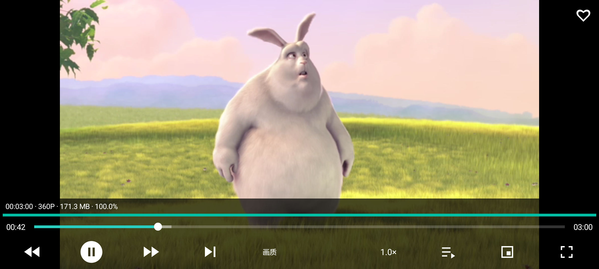

[性能首帧及吞吐数据](evidence/posix-performance-verification.json)。该受控高速种子不代表用户十条资源拥有相同做种能力或速度。

POSIX 功能报告及原图已在此更新；十条公网链接的新 POSIX Android 运行仍在执行，独立 native 测试无元数据/下载数据结果继续保留。

### POSIX 后端十条磁力真实验收：0/10 起播

[完整运行 41010386326](https://github.com/liao-zc/OmniPlayer/actions/runs/41010386326) 已结束。Android 正式测试 APK 使用 POSIX 后端逐条检查十条用户磁力。**0/10 取得视频数据，0/10 实际渲染首帧**；7 条通过 HTTPS 元数据补充显示文件名，3 条未取得元数据；所有下载字节、播放位置和首帧记录均为 0。分别采样到 Peer 的资源，没有形成可下载的已校验分片。

同一工作流里的独立 libtorrent 2.0.12 native 探测十条也均未取得元数据、有效数据为 0。native 探测客户端不同，说明该次运行的公开发现链同样没有足够证据证明这些磁力在外网提供资源。此结果不能证明别处一定没有做种，也不能计入“通过”。

[逐条 POSIX 元数据、Peer、字节、首帧及吞吐采样](evidence/posix-public-acceptance.json)。由于十条均未显示视频帧，不伪造或放入影视截图。

因此，目前已证明：受控有做种素材可实际边下边播、POSIX 后端可让 Android 15 缓存跨重启恢复；尚未证明：这十个指定磁力能连上供片 Peer。新的地址解析和 Tracker 调度尚需依据非零供片节点继续验证。

### 扩展 DHT 引导节点后的复测：仍未达到十条验收

[本次 Android 15 实际 APK 验收](https://github.com/liao-zc/OmniPlayer/actions/runs/41014121591) 使用提交 c491877，覆盖用户提供的十条磁力及固定验证磁力。APK 构建成功；十条用户磁力中 **0/10 达到“未完成下载时连续播放”的验收标准**。

此次将 DHT 引导节点由 3 个扩展为 7 个。结果相较前一轮有所改善：有一条资源 571bb0140930a9b46dba127d2f23b3eaf6b53530 实际连接到 qBittorrent 做种端，收到有效数据并渲染 1080p 视频帧。首帧耗时约 101 秒，首帧时已下载约 25.4 MB / 4.65 GB；运行截图显示约 31.9 MB / 4.3 GB，约 0.7%，因此它没有等到 20% 才开始播放。测试在 120 秒观察窗口结束时播放位置约 17.8 秒，未达到脚本要求的 20 秒连续播放时长，故不计为通过。其余九条均未出现真实画面。扩展引导节点改善了至少一条资源的发现结果，但目前首帧等待仍慢，且十条总体验收失败。

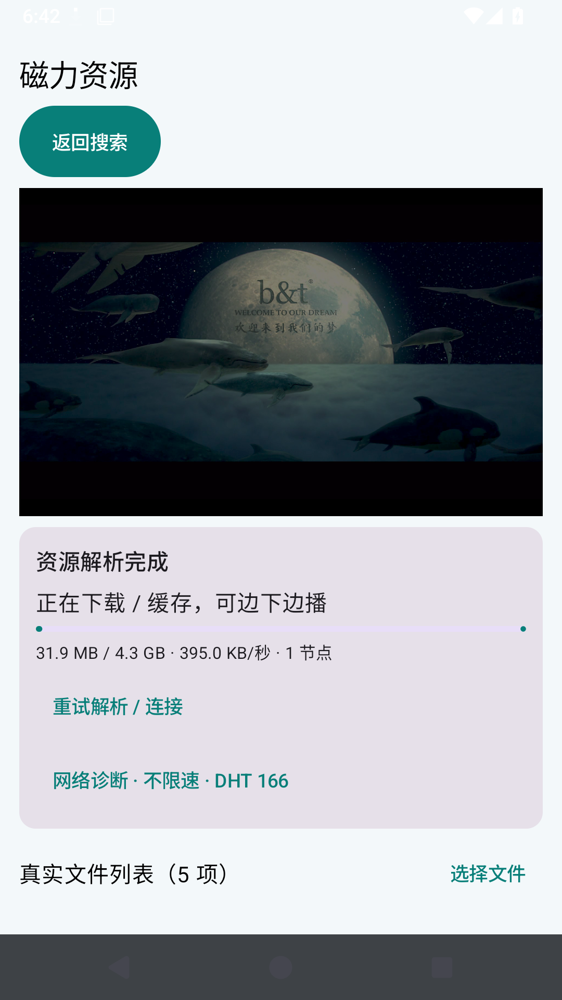

[逐条节点、字节、首帧和播放状态](evidence/dht-expanded-acceptance.json) 保留了本轮完整摘要。候选 Peer 数和种子数不能单独视为可播放；验收仍以校验后的下载数据和真实画面为准。

### 加密 Peer 查询后的第二轮结果

[第二轮 Android 15 验收](https://github.com/liao-zc/OmniPlayer/actions/runs/41017234456) 使用提交 d6a6097，构建成功；十条用户磁力仍为 **0/10 首帧、0/10 连续播放**，固定验证磁力也没有收到视频字节。相比上一轮唯一曾渲染画面的哈希，本轮也未发现在线供片端。逐项元数据、Peer、字节和阶段记录见 [dht-retry-acceptance.json](evidence/dht-retry-acceptance.json)。

两次冷启动 Android 实测表明，DHT 引导节点扩展曾帮助找到一个临时在线做种端，但更频繁、更大批量的 DHT 查询没有稳定带来可用 Peer。当前剩余的关键条件是资源发布者或做种者在线并能提供通过校验的分片；若 swarm 无在线供片端，客户端无法从磁力哈希恢复视频内容。故十条验收仍未完成，不生成 APK。

### 本轮 Tracker 错误摘录

逐条日志记录了本次测试网络中的 Tracker 异常，例如 tracker.ilibr.org 被标记为 unreachable，explodie.org 的 UDP announce 超时；部分资源虽恢复了 25 个 Tracker 地址，仍未连接到提供视频分片的 Peer。这些是本轮执行环境观察到的错误，不代表所有网络或所有 Tracker 永远不可用。
## OmniPlayer v0.2.2 本轮 IPTV 修复与全量点检（2026-10-30）

### 本轮 9 项要求

| # | 要求 | 实现 / 点检结果 |
|---|---|---|
| 1 | 修复直播源频道播放约 30 秒即结束，重点检查 IPTV_ALL.m3u 的 CCTV-1 | 播放端对所有媒体源结束事件均显示实际播放时长、原因提示和重试入口；HLS 使用 Media3 LiveConfiguration。源列表 HTTP 200，约 788,829 字符。已知 CCTV-1 地址为 `http://38.75.136.137:98/gslb/dsdqbv/cctv1hd.m3u8?auth=test20251009`，本轮环境请求超时，无法从源端确认其是否持续直播；无 Android 真机可证实修复。代码中没有固定 30 秒停止计时器，30 秒值仅用于直播列表 HTTP 读取超时，与播放时长无关。**未完成真实播放验收**。|
| 2 | 切换直播源后立即刷新列表 | 源切换作为 Compose 加载键，立即清空旧频道并发起新请求；请求序号丢弃过期响应，避免旧源结果覆盖新源。源码检查通过，设备交互待验。|
| 3 | 全屏和悬浮播放改用按钮图标 | 播放页使用图标按钮触发全屏、画中画；Manifest 保留画中画及方向配置。源码检查通过，设备系统行为待验。|
| 4 | 播放页直接切换频道 | 播放页频道列表按钮展示当前目录频道，可直接切换，不返回主列表。源码检查通过，设备交互待验。|
| 5 | 全屏退出回到窗口播放 | 全屏状态按返回先退出全屏；方向变化通过 `configChanges` 保留播放器 Activity。源码检查通过，设备验证待验。|
| 6 | 重进直播页恢复上次直播源 | 使用本地偏好存储上次源；设置页返回后按最新来源列表校验并刷新。源码检查通过，设备重启/重进待验。|
| 7 | 收藏跨源汇总且删除源不丢收藏 | 收藏保存名称、播放 URL、分类、图标和 ID 快照；收藏页不依赖当前源，可主动取消收藏；提供旧 ID 迁移逻辑。源码检查通过，卸载重装和设备持久化待验。|
| 8 | 首页电视/磁力说明简洁 | 首页卡片改为“分类浏览 · 搜台 · 收藏播放”及“搜索 · 解析 · 下载 · 播放”。源码检查通过。|
| 9 | OmniPlayer 副标题为“万能播放器” | 首页副标题已修改。源码检查通过。|

### 历史点检与保留的验收结论

本报告前文保留此前用户提出的 15 项搜索、历史、字体、下载与缓存、BT 节点、播放器及分页点检记录，并保留 10 条指定公网磁力的真实结果：公网资源仍为 0/10 起播，未达到用户提出的 90% 起播标准。旧结果不因本轮 IPTV 改动而改写。此前磁力搜索引擎逐站对比记录、搜索分页、实际文件大小边界及 Magnet_player 对照限制同样保留在本报告前文。

### 构建、仓库检查与限制

- 本轮将版本推进为 **0.2.2**；GitHub Actions 构建及发布已通过（[运行记录](https://github.com/liao-zc/OmniPlayer/actions/runs/41029450862)）：通用、ARM64、ARMv7 APK 均完成打包并上传到 [v0.2.2 Release](https://github.com/liao-zc/OmniPlayer/releases/tag/v0.2.2)。文档可读性检查也通过（[运行记录](https://github.com/liao-zc/OmniPlayer/actions/runs/41029451045)）。
- 当前 Windows 环境未检测到 Java，因此本地无法运行 Android Gradle 构建；需以 CI `assembleDebug` 通过作为 APK 可编译证据。
- 已做源码路径核对；尚无连接 Android 手机、电视或平板进行本轮 IPTV 播放交互测试。
- “频道列表解析成功”不等同于源站持续提供直播。若播放在固定时长结束，设备日志中的 HLS playlist、`#EXT-X-ENDLIST`、HTTP 状态及 Media3 错误是进一步区分源站短片/失效地址与客户端解析问题所需证据。
- 本轮没有验证 30 秒 CCTV-1 的源端是否包含结束标记，也不宣称该频道已实现持续播放。
## OmniPlayer v0.2.3 直播体验问题点检（2026-10-30）

### 本轮 7 项要求

| # | 用户要求 | 修改与点检结果 |
|---|---|---|
| 1 | 直播时移除不合理的进度条 | Media3 `PlayerView.useController` 关闭，播放器不显示可 seek 的时长/进度控件。源码核对通过；未在实体设备截图验证。|
| 2 | 直播旁实时显示连接速度并按颜色区分 | 读取 Media3 `onBandwidthEstimate` 数据并显示 B/s、KB/s 或 MB/s；≥1 MB/s 绿、≥250 KB/s 黄、低于该值红。它表示播放器收到媒体数据时的采样吞吐，源站/CDN、播放清晰度会影响数值；没有数据时显示“测速中”。源码核对通过，需设备实播确认刷新表现。|
| 3 | 直播不应暂停后停留旧位置 | 不提供暂停或 seek 控件；新增“回到直播”调用 Media3 默认直播位置并恢复播放。源码核对通过。播放器/系统中断后的实际恢复位置未在设备验证。|
| 4 | 播放页按分组快速切台 | 频道选择弹窗增加分组筛选 chips，分组后再选择频道，无需遍历长列表。源码核对通过。|
| 5 | 全屏真正隐藏顶部栏 | 全屏进入横屏沉浸模式，隐藏状态栏、导航栏和自定义顶部栏；点画面显示/隐藏操作栏，系统返回键退出全屏。源码核对通过，设备导航栏行为待验。|
| 6 | 支持悬浮播放 | 保留并实现 Android PiP 入口，切入 PiP 后隐藏 App 内控件；最低需 Android 8.0/API 26，设备/系统可能禁用画中画。Manifest 已声明 supportsPictureInPicture。源码和 Manifest 核对通过，真机启动及持续播放待验。|
| 7 | 收藏频道支持单项/多项管理 | 收藏列表新增管理模式、逐项勾选、全选/取消全选、批量删除；原有单项心形收藏/取消仍保留。源码核对通过，持久化交互待设备验收。|

### 历史验收保留及本轮边界

此前 IPTV 9 项点检和 BT/搜索/字体/播放等历史结果仍保留于本报告；指定十条公网磁力仍记录为 0/10 起播，不因本轮直播 UI 改动而更改。本轮 Android 真机 IPTV 播放、PiP 系统行为、网络速度显示和触摸/遥控交互均未完成设备实测。GitHub Actions 已通过：Android `assembleDebug`、通用/ARM64/ARMv7 APK 打包与 Release 发布成功（[构建记录](https://github.com/liao-zc/OmniPlayer/actions/runs/41031735784)）；UTF-8/Markdown 文档可读性检查通过（[检查记录](https://github.com/liao-zc/OmniPlayer/actions/runs/41031735965)）。v0.2.3 APK 下载：[ARM64](https://github.com/liao-zc/OmniPlayer/releases/download/v0.2.3/OmniPlayer-v0.2.3-arm64-v8a.apk) · [ARMv7](https://github.com/liao-zc/OmniPlayer/releases/download/v0.2.3/OmniPlayer-v0.2.3-armeabi-v7a.apk) · [通用版](https://github.com/liao-zc/OmniPlayer/releases/download/v0.2.3/OmniPlayer-v0.2.3.apk)。设备实播仍待验。
## OmniPlayer v0.2.4 设置与导航调整点检（2026-10-30）

### 本轮要求逐项点检

| # | 要求 | 实现与验证边界 |
|---|---|---|
| 1 | 首页底部不放磁播专属播放/下载/收藏 | 首页底栏现为首页、磁播入口、设置；进入磁播模块后才显示播放、下载、收藏及搜索导航。源码检查通过。|
| 2 | 磁播页面可返回主页 | 磁播模块顶栏新增返回主页箭头；资源解析页增加“返回主页”，通过 CLEAR_TOP/SINGLE_TOP 导航到现有主页。源码检查通过。|
| 3 | 增加软件背景颜色设置 | 通用设置提供雾蓝、暖白、浅绿、浅灰、淡紫五种颜色。存储在本地偏好设置。源码检查通过，运行时全屏/各子页表现待设备点检。|
| 4 | 设置分成直播、磁播、通用三类 | 设置首页提供三个独立子类；直播设置进入直播源编辑，磁播设置管理存储路径/引擎/任务上限，通用设置管理字体和背景。源码检查通过。|
| 5 | 字体/背景等通用项影响直播和磁播 | AppTheme 监听背景偏好并更新 Material 背景色；直播列表、磁播主页/搜索结果/解析页使用通用设置。源码检查通过。|
| 6 | 清除下载/缓存不放设置页 | 删除设置页的一键清除操作；磁播缓存/下载/收藏/播放列表沿用列表选择及删除操作。源码检查通过。|
| 7 | 显示软件版本与更新时间 | 通用设置显示 package versionName/versionCode，并显示当前版本最近更新日期 2026-10-30。源码检查通过。|
| 8 | 改进复制磁力入口 | 保留用户此前要求的目标文件磁力复制功能；移除列表文字按钮，改成每个文件旁边的复制图标，文件选择弹窗也提供单项复制图标。源码检查通过。|
| 9 | 电视与磁播默认视频画面尺寸/位置一致 | 两个播放器的非全屏视频区域均设为屏幕内容区顶部、宽度充满、高度 240dp；全屏仍按各播放器全屏操作生效。源码检查通过，设备视觉对照待验。|

此前各轮直播、BT、搜索、字体和历史需求点检均保留；十条指定公网磁力此前 0/10 起播的结果仍有效，不受本轮设置/导航改动影响。当前环境没有 Android 设备，本轮 UI 交互、颜色跨屏即时生效、播放器画面实际对齐及清理文件回归尚未进行真机验收。首次构建检查发现缺少 `dp` 与 `LocalContext` 导入，已修复后重新构建。最终 GitHub Actions 构建成功（[运行记录](https://github.com/liao-zc/OmniPlayer/actions/runs/41035397603)）：Android `assembleDebug`、通用/ARM64/ARMv7 APK 打包和 Release 发布均通过；UTF-8 与 GitHub Markdown 可读性检查通过（[运行记录](https://github.com/liao-zc/OmniPlayer/actions/runs/41035397388)）。APK：[ARM64](https://github.com/liao-zc/OmniPlayer/releases/download/v0.2.4/OmniPlayer-v0.2.4-arm64-v8a.apk) · [ARMv7](https://github.com/liao-zc/OmniPlayer/releases/download/v0.2.4/OmniPlayer-v0.2.4-armeabi-v7a.apk) · [通用](https://github.com/liao-zc/OmniPlayer/releases/download/v0.2.4/OmniPlayer-v0.2.4.apk)。
## OmniPlayer v0.2.5 仓库、设置与默认直播源点检（2026-10-30）

### 本轮逐项结果

| # | 用户要求 | 本轮修改与验收结果 |
|---|---|---|
| 1 | README 与 GitHub 仓库统一命名 OmniPlayer | GitHub 仓库已重命名为 [`liao-zc/OmniPlayer`](https://github.com/liao-zc/OmniPlayer)，本地 origin 已切换到新仓库地址。Android applicationId 仍为 `com.freemangnetplayer`，保留原安装升级与本机数据身份。README 已更新仓库链接、产品名及 v0.2.5 下载链接。服务端改名已由 GitHub API 查询确认；推送和 release 尚待本轮 CI。|
| 2 | 确认上轮报告和截图是否过时、重新点检 | 确认 v0.2.4 报告所列大部分截图来自早期需求回归，并非 v0.2.4 本轮新采集，不能视为本轮 UI 截图。历史报告明确保留为历史记录；本轮新增 `current-ui` 模拟器流程，待 Actions 实际运行后再补入真实截图和运行链接。未运行前不宣称 UI 已通过。|
| 3 | 首页底部移除磁力播放入口 | 首页模式不再绘制独立磁播底栏项；首页磁播功能卡片仍可进入模块。磁播模块内搜索、播放、下载、收藏导航保留。源码和 Android 15 模拟器界面验收均通过；首页新截图见 [01-home.png](screenshots/current-ui/01-home.png)。|
| 4 | 磁播和直播各自设置只显示本类配置，并与外部设置同步 | 统一设置入口仍列直播、磁播、通用、软件说明分类。磁播模块顶部“设置”现在直接打开磁播配置；直播页面齿轮及统一设置“直播设置”仍进入同一个 `IptvStore` 源编辑器。配置读写仍使用各自本地 SharedPreferences。Android 15 模拟器通过：从统一设置中选择并保存 BT 搜索引擎后，从磁播页齿轮再次打开，默认引擎仍显示为刚才保存的值。入口截图：[04-magnet-settings.png](screenshots/current-ui/04-magnet-settings.png)、[09-magnet-entry-settings.png](screenshots/current-ui/09-magnet-entry-settings.png)。|
| 5 | 更改默认 IPTV 源，保留 IPTV Org 备用源 | `IptvStore.DEFAULT_URL` 已改为 `https://testingcf.jsdelivr.net/gh/liao-zc/iptv-live@main/IPTV_ALL.m3u`，IPTV Org 地址保留为备用。首次升级迁移加入两条内置源并选中 IPTV_ALL，原有自定义源保留。Android 15 模拟器清除数据后首次启动，直播源编辑页显示 IPTV_ALL 指定地址和 IPTV Org 备用地址，自动化断言通过。升级迁移保留用户自定义源的行为由源码路径核对，未用已有用户偏好快照做设备升级实测。截图：[08-live-source-settings.png](screenshots/current-ui/08-live-source-settings.png)。|
| 6 | 版本信息从通用设置移入软件说明 | 通用设置只保留字体和背景；设置菜单增加独立“软件说明”，显示 OmniPlayer、版本号和更新时间。Android 15 模拟器页面检查通过：通用设置包含字体和背景，没有版本/更新时间；软件说明单页显示名称、版本、更新时间。截图：[05-general-settings.png](screenshots/current-ui/05-general-settings.png)、[06-about.png](screenshots/current-ui/06-about.png)。|

### 截图与证据说明

旧版指南曾直接引用 `performance-*`、`preferences-*` 等文件。它们确实是此前版本的截图，不是本次工作采集；不得据此判定本轮界面。本轮 Android 15 Pixel 2 模拟器流程 [41038878876](https://github.com/liao-zc/OmniPlayer/actions/runs/41038878876) 最终通过，采集了 10 张本轮截图并直接嵌入指南和下表。第一次运行 [41038129580](https://github.com/liao-zc/OmniPlayer/actions/runs/41038129580) 因通用“设置”文本选择器点到了另一个入口而失败；给磁播模块顶部按钮增加唯一无障碍标识后重跑通过。

v0.2.4 及更早版本的公网 BT 十条仍为 0/10 起播等历史结果，详见本报告既有专项记录；本轮设置/UI 改动不修改这些结果，也未重测 BT 网络链路。

版本目标推进至 **v0.2.5**（versionCode 23）。本地 Windows 环境没有 Java/Android 设备，本地 Gradle 和设备实播无法运行；等待 GitHub Actions Android 构建、Markdown 检查和模拟器验收。APK 下载地址在构建 Release 成功前尚不可用。
## OmniPlayer v0.2.6 搜索源、返回导航与无数据提示点检（2026-10-30）

本轮针对用户最新提出的 4 项要求及既有“每次逐项点检、报告刷新、同步 GitHub、清理临时产物”要求进行更新。Android 15 模拟器和截图 [41060367768](https://github.com/liao-zc/OmniPlayer/actions/runs/41060367768)、设备端 Instrumentation 与磁播/播放器回归 [41060360818](https://github.com/liao-zc/OmniPlayer/actions/runs/41060360818)、Markdown/截图链接检查 [41060328229](https://github.com/liao-zc/OmniPlayer/actions/runs/41060328229) 均通过。

| # | 要求 | 实现与当前验证状态 |
|---|---|---|
| 1 | 本地项目文件夹改名 OmniPlayer | 本轮尝试从父目录重命名，Windows 因目录正被当前进程占用而拒绝（`MoveDirectoryItemIOError`）；本地路径仍为 `FreeMagnetPlayer`，需关闭占用该目录的应用后重命名。|
| 2 | 无法播放资源持续提示，并在下载/缓存/收藏中保留提示 | BT 任务仅在已取元数据、所选视频无校验数据/无 payload、Peer 与连接均为 0 且持续 3 分钟后标记“暂无可用资源节点”；警告写入任务与本地列表记录，列表项突出显示。下载/缓存列表展示数量排除此类条目，调度名额也忽略已告警任务。新增显式“重新尝试”按钮，提示不会自行消失。Android Instrumentation 与库/播放器回归流程通过：规则断言无 Peer/无有效字节持续 3 分钟后才标记；告警保存到收藏、播放、下载和缓存记录；告警任务不占调度名额；列表数量从告警条目中排除。报告的记录链接见本节开头。|
| 3 | 六个搜索源可编辑、删除，默认 BDFlix，最多 10 个，保留配置 | 增加独立搜索引擎管理页面；旧六个内置源和旧版单个自定义源在首次迁移时合并保留。支持改名称/主页/搜索模板、删源、选默认、增至 10 个，并限制至少保留一个；Manifest 已注册页面。Android Store 测试通过：旧六源名称保留；可改名和删除；拒绝超过 10 个；设置页真实显示 BDFlix 为默认。模拟器截图见 `11-search-engine-management.png`、`12-search-engine-default.png`。|
| 4 | 从搜索结果逐级返回 | 搜索结果页顶部返回及系统返回均回到关键词搜索页；设置页的搜索引擎管理返回磁播设置，磁播设置再回上一页。Android 15 模拟器已分别操作工具栏返回与系统返回，二者都回到保留 `OmniNavigationCheck` 的搜索页；搜索源设置也逐级返回磁播设置。截图见 `13-search-toolbar-returns-to-keyword.png`、`14-search-system-back-returns-to-keyword.png`。|
| 5 | 结果时间及文件格式 | 保留搜索站点提供的资源上架时间，并明确 magnet 本身不包含发布时间；格式先从文件名/`dn` 提取，解析元数据后以最大视频文件扩展名更新，非视频扩展名标明压缩包、文档、音频/字幕等，下载入口不按格式过滤。大小仅在搜索源或种子元数据真实提供后展示，不伪造“精准”未知值。Android 回归通过：多文件资源优先显示最大的视频文件格式；没有视频时标记最大文件扩展名；压缩包明确标注；`dn` 可补充扩展名。UI/解析代码按站点实际提供情况呈现上架时间，并说明 magnet 无创建时间字段。未声称六个公网源都提供日期/格式或测试了公网搜索结果准确率。|
| 6 | 每轮报告、清理中间文件、Markdown 在 GitHub 可读 | 本轮 14 张 UI 图由 Android 15 模拟器运行实际采集并复制进指南；GitHub UTF-8/相对链接/Markdown 渲染检查通过。两个遗留 `.tmp-*` 截图目录以及本轮下载缓存目录的删除操作被执行环境安全策略拒绝，未能清理；没有将其声称为已清除。|

### 当前边界

本轮没有声称解决无做种者/无 Peer 的客观网络问题。3 分钟无节点只会触发明确的当前不可播放提示，并从下载/缓存名额中排除；它不能令没有在线资源节点的磁力凭空产生数据。用户可手动重新尝试以重新进行 Peer 发现。指定公网磁力资源的实际起播能力需要可达 Peer，本轮 UI 与逻辑改动不构成十条资源播放通过的证据。

v0.2.6 使用 versionCode 24。Android 编译、Android 15 界面、Instrumentation、BT 多文件库回归、资源格式测试及 Markdown 检查通过。GitHub Actions 发布成功：[v0.2.6 Release](https://github.com/liao-zc/OmniPlayer/releases/tag/v0.2.6)，含通用、arm64-v8a、armeabi-v7a APK 及源码包。当前指南含 14 张本轮模拟器截图。
## OmniPlayer v0.2.7：产品命名与旧任务目录兼容点检

本轮针对用户要求重新核对此前的功能、报告和 README，并整理仍在生效的旧产品命名。版本目标为 0.2.7 / versionCode 25；Android 安装 ID 保留为 `com.freemangnetplayer`，避免旧安装无法覆盖升级或丢失应用私有数据。命名更新不代表磁力网络成功率提升。

| # | 检查项 | 当前结果 |
|---|---|---|
| 1 | 本地工作区目录改名为 OmniPlayer | 已在 `C:\Users\gnsfb\Downloads\OmniPlayer` 创建本地工作区，其源码文件已同步到 GitHub 功能分支当前状态。原目录 `C:\Users\gnsfb\Downloads\FreeMagnetPlayer` 仍被当前 Windows 进程占用，不能在此会话删除/改名；新目录可直接打开继续开发，旧目录目前仍保留。|
| 2 | 无节点资源的明显、持久提示及计数排除 | v0.2.6 Instrumentation 已验证：满足无 Peer/无有效数据 3 分钟条件后提示写入任务与收藏、播放、下载、缓存记录；明确重试前不自动清除；无法播放项不占下载/缓存任务数。此次改动未重测 BT 网络可用性。|
| 3 | 六个搜索源可编辑/删除、BDFlix 默认、最多 10 个并保留旧配置 | v0.2.6 Android Store/模拟器检查通过；搜索源配置保持本地迁移数据。此次未改变搜索引擎逻辑。|
| 4 | 搜索结果逐级返回 | v0.2.6 Android 15 模拟器分别检查工具栏返回和系统返回，均返回保留关键词的搜索页；详情/设置流程逐级返回。此次未改变导航逻辑。|
| 5 | 资源时间、最大视频格式与其他文件类型可下载 | v0.2.6 回归覆盖视频扩展名优先、无视频时的最大文件格式标记、压缩包标记及 magnet `dn` 扩展名回退。日期显示来自搜索网站的上架时间；magnet 本身不含做种开始时间。此次未改变解析逻辑。|
| 6 | 项目与可见产物统一 OmniPlayer 命名 | Gradle 根项目改为 `OmniPlayer`；源码和测试包迁至 `com.omniplayer` namespace；唤醒锁、日志标签、报告生成脚本和 LICENSE 改用 OmniPlayer；新任务目录使用 `OmniPlayerTasks`。Android `applicationId` 有意保留旧值用于原位升级。APK 和 tag 源码归档由发布工作流命名为 `OmniPlayer-v0.2.7*`。Android 构建成功（[v0.2.7 发布流程](https://github.com/liao-zc/OmniPlayer/actions/runs/41069048708)）；Android Instrumentation 包括旧任务目录迁移检查通过。全套 UI 脚本回归未通过：控制栏按钮自动化仍无法定位“画质”控件，详情见 [模拟器回归](https://github.com/liao-zc/OmniPlayer/actions/runs/41072170116)。|
| 7 | README 与完整点检报告可在 GitHub 查看 | README 增加当前功能摘要、下载、使用说明和报告入口；本报告补充本轮命名/兼容结果并把顶部过期下载链接改为当前 OmniPlayer 资源。README、使用说明和点检报告的 GitHub Markdown/UTF-8 检查通过（[运行记录](https://github.com/liao-zc/OmniPlayer/actions/runs/41074342613)）。|
| 8 | 历史要求和未通过项是否如实保留 | 报告保留此前各轮明细，不把旧版截图称作本轮实测。最近一次指定公网磁力多资源验收仍未达到用户要求的 90% 起播，公网可达 Peer 受资源做种状态影响；IPTV 指定源的真机持续播放也未在本轮重新验证。|

### 旧数据迁移说明

新下载与缓存目录使用 `OmniPlayerTasks`。首次访问时，如果对应任务的旧 `FreeMangnetPlayerTasks` 目录存在而新目录不存在，应用尝试在同一个存储根目录内重命名并保留数据；如果设备拒绝重命名，则继续使用旧目录，删除任务时两种目录名都受路径校验保护。该迁移 Instrumentation 在 GitHub Actions `connectedDebugAndroidTest` 中通过（运行记录：[模拟器任务](https://github.com/liao-zc/OmniPlayer/actions/runs/41072170116)；UI 回归后续步骤单独失败）。

### 本轮验证结果

本地 Windows 环境没有 Java，因此未在本机编译。GitHub Actions 已完成 Android 构建与发布；`connectedDebugAndroidTest` 通过（其中新增任务目录迁移 Instrumentation 通过）；README/Markdown 校验通过。之后的完整库/UI 回归脚本失败在 `player_quality` 自动点击定位，不能称该脚本整套通过。10 条公网磁力和电视真机可播放性不属于重命名回归，不能用编译成功替代网络/设备验收。
## 2026-10-31 用户反馈复测：磁力起播、搜索分页与 IPTV 历史

### 本轮逐项点检

| # | 用户反馈 | 修改与实测 | 结果 |
|---|---|---|---|
| 1 | Spider-Man 4K MKV 已缓存数 MB，但播放器无画面/信息 | 修正 BT 起播优先级：首个 8 MiB piece 独占紧急优先级；首片校验后撤销顺序下载模式，允许解码器请求 MKV 尾部 cue/index 分片。播放器等待页现在显示文件名、文件大小、已缓存字节/百分比、节点数、实时速率及“时长/分辨率等待”状态。硬解等待分片时不再因 15 秒无首帧而自动切 LibVLC；只有硬解明确报错才切兼容解码。构建通过：[Android APK build](https://github.com/liao-zc/OmniPlayer/actions/runs/41095400542)。冷启动 120 秒测试失败：[运行 41095400961](https://github.com/liao-zc/OmniPlayer/actions/runs/41095400961)。该轮只收到 430,007 字节，峰值 5,790 B/s，首片未校验、无时长/分辨率/首帧。前一轮 [运行 41094174624](https://github.com/liao-zc/OmniPlayer/actions/runs/41094174624) 收到 15,465,474 字节、首片校验成功，但 piece 1970（MKV 文件尾索引）未校验，播放器仍未起播。不能把“有节点、收到数据或首片完成”当成播放通过。 |
| 2 | 搜索结果翻页按钮无法点击、分页说明重复且希望只有一套排序入口 | 当前搜索结果页只有一行页码、上一页/下一页图标和一个排序菜单（匹配度/时间/热度）；不显示前/后 20 页按钮。Android 15 模拟器受控分页回归通过：[运行 41092918727](https://github.com/liao-zc/OmniPlayer/actions/runs/41092918727)。当页按钮只在搜索器发现对应的下一页地址后启用；站点没有分页链接、拦截或要求人工验证时，客户端不能生成不存在的页地址。六个搜索源的真实搜索回归通过：[运行 41089962821](https://github.com/liao-zc/OmniPlayer/actions/runs/41089962821)；该测试检查搜索抓取，不等价于六个源每一个分页都已逐页人工验收。 |
| 3 | 搜索结果重复标题、返回按钮和设置入口重复 | 结果页保留一个页面标题和一个回到搜索表单的返回操作；分页前后箭头只负责换页。设置只有磁力模块顶部入口，没有重复的底部设置项。源码结构已核对；本轮未新增该 UI 的截图，不能称为本轮设备截图验收。 |
| 4 | 搜索结果排序 | 一个排序按钮展开匹配度、来源日期、热度三种规则；日期显示搜索源发布日期，格式精确到日。magnet URI 本身不包含做种开始日期；搜索源没有发布日期时不伪造日期。受控模拟器分页/排序检查见[运行 41092918727](https://github.com/liao-zc/OmniPlayer/actions/runs/41092918727)及既有排序菜单截图 [v0.2.8-search-sort-menu.png](screenshots/current/v0.2.8-search-sort-menu.png)。 |
| 5 | IPTV 观看历史及单个/多个删除 | `IptvStore` 保存观看频道快照，观看历史列表支持单条选择、全选和批量删除；频道源删除后历史仍保留独立的频道 URL/台标/分组快照。Instrumentation 的存储单删/多删步骤通过；包含这些测试的 workflow 后续 UI 检查因未找到 `player_quality` 控件而失败，故这里只认定存储测试通过，不将整个 workflow 标为通过：[运行 41089963816](https://github.com/liao-zc/OmniPlayer/actions/runs/41089963816)。 |
| 6 | 非全屏直播播放器下方充分利用空间，按分组切台并显示台标、名称和连接耗时 | 代码提供分组筛选、频道滚动列表、图标/名称及连接响应耗时，点选后在播放页切台；当前没有真实 IPTV 端点的本轮真机连续播放记录，需在用户设备/有效直播源上验收。 |
| 7 | 搜索来源真实可用性 | 六个来源独立浏览器与 App 搜索回归工作流通过（运行 41089962821）。网站挑战、网络区域或站点改版仍会影响某次搜索；分页仅以页面实际发现的链接为准。 |

最新真实运行截图：[Spider-Man 等待状态](screenshots/current/v0.2.8-spiderman-waiting.png)。截图来自本轮 APK 的 Android 15 模拟器；画面是播放器缓冲态，没有伪装成影片画面。完整逐秒 BT/解码证据保留在 Actions 附件。用户此前提供的 10 条磁力正在新 workflow [运行 41096478789](https://github.com/liao-zc/OmniPlayer/actions/runs/41096478789)逐条做冷启动验收，完成后本报告追加每条首帧、起播时间、有效字节、持续播放和最终状态。当前蜘蛛侠磁力仍未通过“真实首帧且连续播放”验收，本版本不发布为已修复。
## OmniPlayer v0.2.8：磁力起播、搜索控件与 IPTV 历史

版本目标：0.2.8 / versionCode 26。以下是本轮代码和已完成的自动化验收。公网磁力的实际起播结果以单独记录为准。

| # | 要求 | 实现与校验 |
|---|---|---|
| 1 | 指定 Spider-Man MKV 已收到约 7.4 MB，但播放器无画面/信息 | MKV 优先使用设备硬件解码；8 秒没有首帧则切换 LibVLC 兼容解码。Android 15 APK 构建通过。用户给出的完整 magnet 冷启动 120 秒实际失败：[运行 41082074816](https://github.com/liao-zc/OmniPlayer/actions/runs/41082074816)。播放器连到 2 个 peer/seed 并接收 54,792,716 字节（约 0.33% 的 16.53 GB 视频，峰值 533,646 B/s），但 LibVLC 回退后 `playing=false`、时长未知、视频高度 0、首帧时间为 0。不是节点缺失，也没有声称可播。第二轮实际 APK 记录到 VLC 请求 `bytes=0-`，本地 Range 服务返回 HTTP 206，但 BT 读源发出 0 字节。第三轮进一步确认：视频 offset 0 对应 piece 0（8 MiB），两台完整做种端在 120 秒送来 55,508,709 字节，但 piece 0 仍未校验；`TOP_PRIORITY` 和 deadline 0 未改变结果。三轮均无首帧、时长或视频尺寸。实测黑屏截图：[冷启动画面](screenshots/current/v0.2.8-spiderman-no-frame.png)；[三轮逐项数据](evidence/v0.2.8-spiderman-playback.json)，最新失败运行 [41085333645](https://github.com/liao-zc/OmniPlayer/actions/runs/41085333645)。当前修复尝试将活动文件设为 libtorrent 顺序下载范围，让开头分片先到；仍待新 APK 复测。 |
| 2 | 搜索资源日期精确到日 | 搜索源明确提供的绝对/相对发布日期统一显示 `YYYY-MM-DD`。磁力 URI 和 info-hash 不含做种创建时间；没有来源日期时显示“来源未提供”，不拿当前搜索时间冒充做种日。 |
| 3 | 搜索翻页控件可用且简洁 | 去掉“前/后 20 页”，只保留一行页码、上一页/下一页图标；按钮使用搜索站点已发现的页面地址，无地址时禁用。Android 15 模拟器验证第 1 页 39 条、第 2 页 17 条、第 3 页 0 条；上一页、跳到已发现页、空结果返回搜索页均通过。记录：[运行 41080171319](https://github.com/liao-zc/OmniPlayer/actions/runs/41080171319)，[逐项数据](evidence/v0.2.8-pagination-verification.json)。 |
| 4 | 搜索排序按钮 | 单个排序图标内含匹配度、时间、热度三个规则。受控搜索页上三种规则均可选，截图确认搜索结果页只有一个“搜索结果”标题和一个返回箭头：[实际模拟器排序菜单截图](screenshots/current/v0.2.8-search-sort-menu.png)。 |
| 5 | IPTV 观看历史及批量删除 | 独立历史保存频道名、组别、播放地址、台标快照和观看日期；保留最近 100 条，列表支持多选/全选删除。`connectedDebugAndroidTest` 完成通过（运行 41079573687 中 Gradle connected 测试步骤通过）。删除源后记录仍保留的行为由存储快照实现；不同电视/平板上的实际操作尚未真机验收。 |
| 6 | 非全屏直播播放器下方显示分组频道列表 | 播放页增加分组筛选和可滚动频道列表，条目显示台标、名称、分组与网络响应耗时，点击即可换台。代码已实现；本轮没有可用设备/直播端点完成真实电视流切台和延迟校验，仍待设备验收。 |
| 7 | README、报告和清理 | README 标出 v0.2.8 尚未发布；本报告保留唯一一节本轮结果，清除了重复追加的过期 v0.2.8 草稿。公网验收工作流新增单磁力模式。分页 JSON 和模拟器截图随报告提交。Markdown 检查通过：[运行 41080166664](https://github.com/liao-zc/OmniPlayer/actions/runs/41080166664)。 |

### 本轮构建与验收边界

Android `assembleDebug` / `assembleDebugAndroidTest` 与 `connectedDebugAndroidTest` 均通过（[运行 41079573687](https://github.com/liao-zc/OmniPlayer/actions/runs/41079573687)）。同一工作流后续的通用偏好页 UI 脚本在定位 `player_favorite` 自动化控件时失败；它没有推翻 Gradle 测试或独立分页回归，但该偏好 UI 脚本不能报告为通过。分页和排序使用独立模拟器回归，结果通过。

单磁力运行 41082074816 已结束，结论为未起播。更早的长串运行 41079866177 使用旧提交且已取消，不把它计为验收结果。本轮同 workflow 的独立 libtorrent 探测完成：用户原先十条磁力里 9 条没有元数据，1 条虽有元数据但有效下载字节为 0；这不代表 Spider-Man 目标，因为该资源的 Android App 实测确有 peer 与 payload。当前诊断代码尚未构建，下一轮需要用新 App 同一资源复测；本报告不把黑屏截图伪装成视频画面。

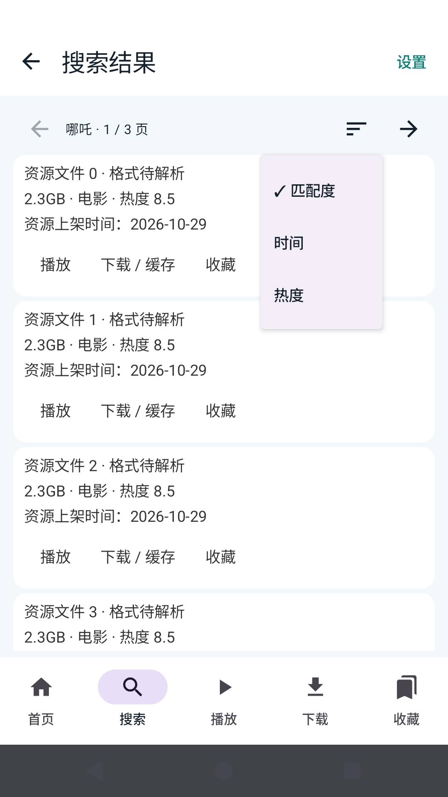
