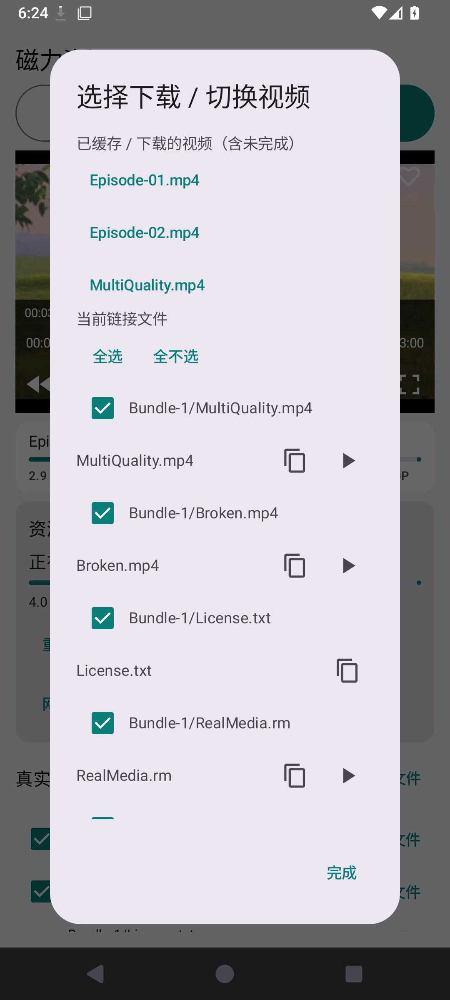
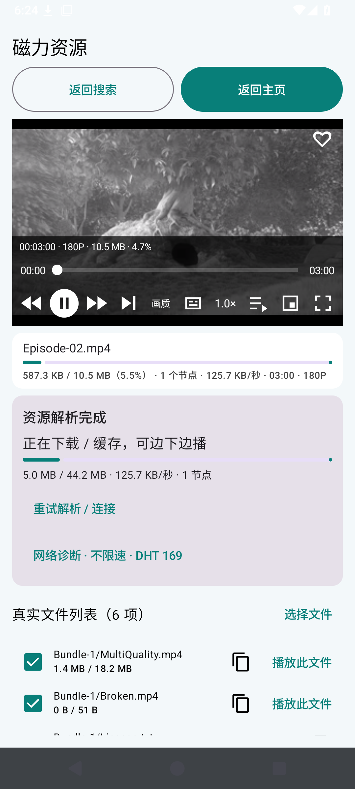
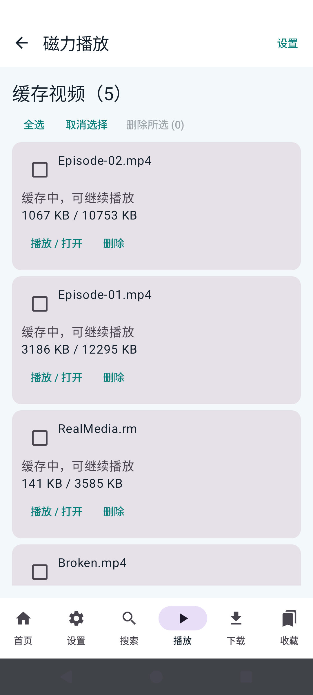
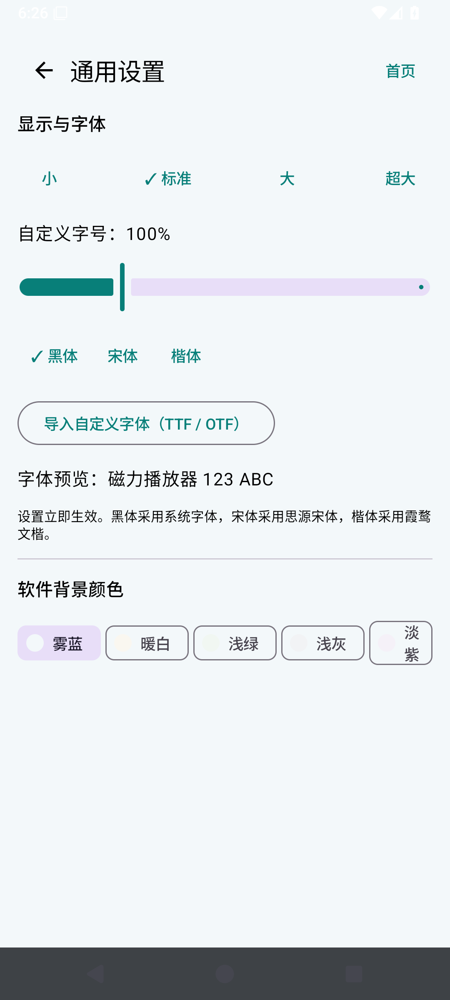
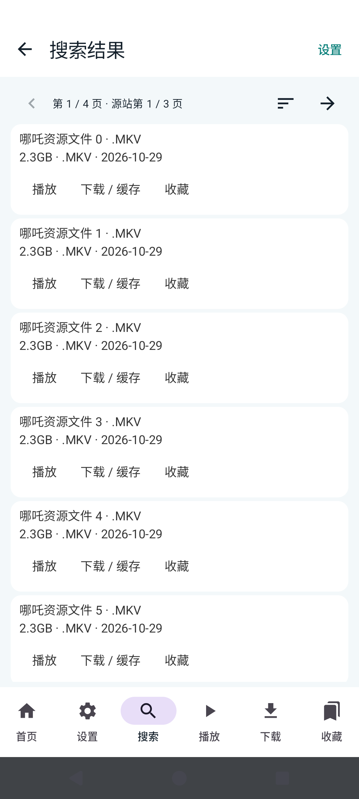
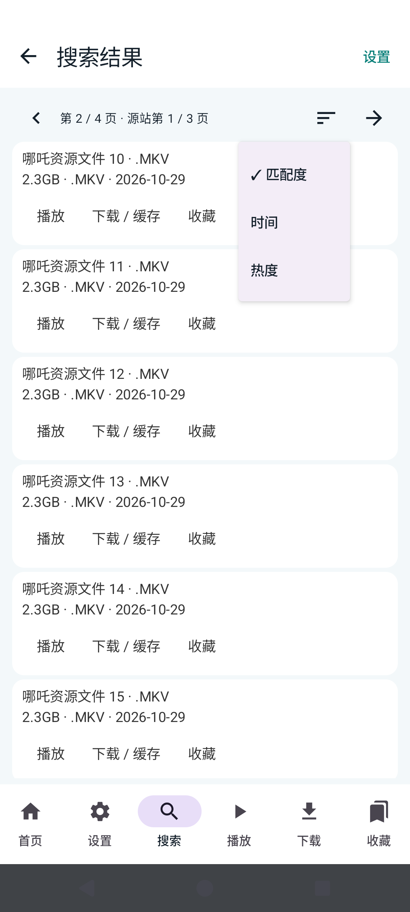

# OmniPlayer 重构与全功能点检报告

更新日期：2026-10-31

## v0.3.4 本轮改动

本轮新增并在 `docs/requirements-checklist.md` M 节逐项登记了用户提出的 13 项需求。代码已实现缓存片段范围显示、播放器 seek 回调、播放任务调度优先、观看位置/时长保存、系统目录与 M3U 文件选择取消、频道选择器缩放、更新下载进度，以及 ABI 拆分发布流程。新增 instrumentation 覆盖分片区间计算、播放位置按文件恢复、播放优先级策略。以下项目在本轮 GitHub Actions 完成前不提前记为通过。

### 本轮验收状态

| 项目 | 状态 | 验证边界 |
|---|---|---|
| 13 条需求清单 | 已同步 | 每项及验收方法见 `docs/requirements-checklist.md` M 节。 |
| Android 构建、instrumentation、模拟器 UI 与分页回归 | 待本轮 Actions | 需成功执行 `scripts/run_full_ci.ps1 -PublishRelease`。 |
| 缓存片段条 | 逻辑测试待 CI | 基于 libtorrent 的已校验 piece 显示分段；时间位置为按字节比例估算，VBR 时间轴精度有限。 |
| 指定 Spider-Man magnet | 本轮未联网下载或播放 | 该公网 torrent 是否存活、能否起播取决于做种与节点。本轮使用受控素材验证代码，不能报告公网播放通过。 |
| 本地与远端 APK | 待 v0.3.4 发布 | 发布工作流生成四种 ABI APK，并检查包内 JNI ABI 集合、保存文件大小和 SHA-256。 |

### APK 体积说明

之前的通用 APK 同时装入 arm64-v8a、armeabi-v7a、x86、x86_64 的 libtorrent 原生库，且 LibVLC 也包含多个 ABI，因此单个 APK 会包含多个设备用不到的 native payload。v0.3.4 发布流程按 ABI 分别构建，并检查每个 APK 的 `lib/` 目录只包含目标 ABI；实际体积以 Release 的 `APK-SIZES.txt` 为准。应用 ID 与签名配置保持不变，设计上支持覆盖安装并保留本地偏好和任务数据；本轮仍需 CI 确认包签名和 ABI 检查后才能作最终结论。

本轮已把磁力播放、IPTV 直播、通用能力和全局设置按职责拆分，并按历史需求建立了逐项功能清单。完整架构见 [架构说明](architecture.md)，逐项结果与证据边界见 [全量功能点检清单](requirements-checklist.md)。

## 本轮重构

- `core`：共用偏好、字体/背景、存储路径、更新、媒体格式和大小显示。
- `magnet`：搜索模型/UI/链接处理/网页桥接、BT 任务与 Peer、播放器、下载缓存和内容管理。
- `live`：播放列表读取、M3U 解析/频道数据、直播列表、源设置、播放器与直播历史收藏；三个 Activity 分文件维护。
- `settings`：全局设置页面。
- `MainActivity` 保留应用入口、导航和搜索 WebView 会话生命周期；持久化键、包名和外部 magnet 入口保持兼容。

## 本轮验证结果

| 检查 | 结果 |
|---|---|
| Manifest 与分域组件路径检查 | 通过，10 个 Android 组件路径由 CI 静态脚本核对 |
| Android APK 编译 | 通过，GitHub Actions `41162201200` |
| Android instrumentation 编译 | 通过，同一 Actions run |
| API 35 Android 模拟器 instrumentation | 通过，同一 Actions run：`connectedDebugAndroidTest` 成功 |
| GitHub Markdown UTF-8/渲染检查 | 通过，Actions `41162201204`；README 和使用说明成功渲染 |
| 工作区与远端内容核对 | 通过，54 个本轮变更路径逐文件 blob SHA 比对，0 个不一致；远端分支 `b90d974f` 后追加解码回退修复提交 `c26378e7` |
| `git diff --check` | 通过；保留既有 CRLF/LF 换行提示 |
| 本机 Gradle | 未启动：该 Windows 环境没有 JDK；使用远端 Java 17 + Android SDK 完成构建与测试 |

## 仍未通过的产品验收项

指定公网磁力的边下边播仍有明显首帧延迟。历史 Actions `41158983146` 测得一个指定资源约 0.1% 下载量时出首帧，但等待约 107 秒，有效速度约 175–736 KB/s。因此这不满足“快速起播”，也不能证明用户提供的十条资源达到 90% 成功率或最低 2 MB/s。可用 Peer/Tracker、做种状态、路由器和网络质量会改变结果，客户端无法凭算法为无种/无可用节点资源制造数据。

全功能表将每项标成通过、部分或未通过，并注明本轮实测、历史证据或尚缺的设备/公网条件。重构后的编译与 instrumentation 已通过，但这不代表所有历史 UI、所有直播源、真实公网种子和多机型体验均在本轮逐项实测通过。

## v0.3.1 APK 发布核验

| 项目 | 结果 |
|---|---|
| APK 构建与模拟器回归 | 通过：GitHub Actions [41183135730](https://github.com/liao-zc/OmniPlayer/actions/runs/41183135730)，API 35 回归全部完成 |
| GitHub Release | 已发布：[OmniPlayer v0.3.1](https://github.com/liao-zc/OmniPlayer/releases/tag/v0.3.1) |
| 远端 APK | [OmniPlayer-0.3.1.apk](https://github.com/liao-zc/OmniPlayer/releases/download/v0.3.1/OmniPlayer-0.3.1.apk)，307,441,494 bytes |
| 本地 APK | `dist/OmniPlayer-debug.apk`，307,441,494 bytes，与远端一致 |
| SHA-256 | `23AB8726EB0B33B83F5D886089C853A32157D9EBD60DA388F2D6981D474B7A12`（本地计算值与 GitHub Release asset digest 一致） |
## 2026-10-31 当前分支复核补记

| 检查 | 结果 |
|---|---|
| 最新架构拆分代码构建与 API 35 instrumentation | 通过：Actions [41162813195](https://github.com/liao-zc/OmniPlayer/actions/runs/41162813195) |
| GitHub Markdown 渲染 | 通过：Actions [41165205364](https://github.com/liao-zc/OmniPlayer/actions/runs/41165205364) |
| 当前分支全量媒体库/设置/搜索分页回归 | 前六轮媒体库综合回归分别在画质控件检测处停止。Actions `41167470912` 的播放器截图和 Android 视图树已确认控件实际显示，失败原因为测试脚本误把缺少 `visible-to-user` 字段当作不可见。截图见 [播放器控制条](screenshots/current-ui/16-player-controls.png)。已改为对 Android 原生控件按可见状态与有效边界判断，第七轮媒体库 Actions `41168057232`、播放器细项 Actions `41168059729` 正在重跑。 |
| 当前分支截图采集 | 通过：Actions [41164612904](https://github.com/liao-zc/OmniPlayer/actions/runs/41164612904)，14 张手机模拟器截图已更新到 `docs/screenshots/current-ui/`。该截图任务与最新播放器控制条顺序调整只差一行，不影响截图中的设置和直播页面。 |
| 最新播放器控制条回归 | 进行中：Actions [41168057232](https://github.com/liao-zc/OmniPlayer/actions/runs/41168057232)，验证修正后的原生控件可见性判定；之前失败源于自动化错误判定，后续偏好/分页检查未执行。 |
| 公网磁力快速起播 | 未通过：历史受控/公网证据仍显示启动慢，无法证明十条用户磁力达到 90% 成功或 2 MB/s。 |

`41163294809` 已通过编译和 instrumentation 单元/组件测试，但后续综合脚本在播放器画质控件检查处停止，因此后续偏好与搜索分页阶段未执行。修复后的完整结果应以新的 CI run 为准。本地项目文件夹仍名为 `FreeMagnetPlayer`，安装包 ID `com.freemangnetplayer` 为兼容旧安装而保留；界面和仓库名称为 OmniPlayer。
## 一键 CI 和当前续检状态

- `scripts/run_full_ci.ps1` 会带退避重试推送当前分支，启动 `.github/workflows/library.yml`，等待 Actions，并把 APK 与报告下载到 `artifacts/ci/<run-id>/`。
- 工作流执行包边界与文本编码检查、APK/instrumentation 构建、Android 模拟器测试、缓存/下载媒体库 UI 回归、偏好回归和搜索分页回归；子套件失败时继续运行其余套件。
- `scripts/summarize_ci_results.py` 汇总逐项 JSON 检查结果为 Markdown，报告、测试截图、状态 JSON 和 APK 一并成为 Actions artifact。
- 缓存和偏好 UI 测试脚本现采用精确按钮文本及可点击祖先定位，修正状态说明被误点的问题。修复仍待新的 CI run 验证。
- 本机没有 Java/Python，APK 由 CI 构建后下载。GitHub API 明文文档修复已发布，当前本地与远端分支同步到 `6d3457049f247248f38527ead1f9cbdf836a3bd1`。

## Markdown 明文修复与最新 CI

- Actions run [41170874885](https://github.com/liao-zc/OmniPlayer/actions/runs/41170874885) 发现提交对象中的 README 被 SafeNet 过滤加密，失败在仓库编码检查。
- 已从 `.gitattributes` 删除错误 `fmp-plaintext` 清理过滤规则，并通过 GitHub Contents API 发布 README、报告和完整需求表单的 UTF-8 明文版本；本地 Fetch 后 `HEAD` 与远端 ref 一致，提交 `6d3457049f247248f38527ead1f9cbdf836a3bd1`。
- 下一次 `scripts/run_full_ci.ps1` 将重新验证仓库所有文本对象；只有其编码检查与后续 Android/模拟器套件完成后，才把 Markdown 和 APK 构建记为通过。

## 2026-10-31 后续回归与交付

本次修正了媒体库回归脚本在多文件缓存后重新打开播放器时的步骤：它现在通过单个磁力 `VIEW` Intent 重开，并确认 `PlayerActivity` 位于前台且播放位置有效，再检查未完成视频的队列切换。此修复是测试稳定性修正；应用播放实现本身未因这次回归错误而变更。

| 检查 | 结果 |
|---|---|
| 架构边界、文本/UTF-8 检查、Python 脚本语法 | 通过：Actions [41176052615](https://github.com/liao-zc/OmniPlayer/actions/runs/41176052615) |
| APK 与 Android instrumentation 构建 | 通过：同一 Actions run |
| API 35 instrumentation 与受控媒体库回归 | 通过：真实启动 APK；播放器 Intent 重开、缓存跨重启恢复、多文件队列和下一条播放等 19 项均通过 |
| 字体/播放历史/收藏回归 | 通过：同一模拟器 run，11 项检查通过 |
| 搜索源分页、上一页/跳页与排序 | 通过：受控 fixture，6 项检查通过；每页 10 条、来源分页按本次模拟器验证 |
| CI 汇总报告 | 36 项通过，0 项失败；完整报告见 `artifacts/ci/41176052615/OmniPlayer-CI-Report.md` |
| 最新 APK | 从此 run 的 Actions artifact 提取至 `dist/OmniPlayer-debug.apk`；SHA-256：`B8E3A1BD7F165EDD083E87FAF0713AAA4F53290A801C176CAB83A31C86D94557` |

本次按用户要求排除了那 10 条指定公网磁力的专项验收，报告没有把它们写成通过。当前 CI 使用本地受控做种素材；公网种子可用性、首帧速度、真实频道播放/画中画、所有电视设备适配和搜索源逐站结果对照仍未由本次模拟器 run 验证。无源站大小/发布日期字段时，客户端也不能生成“精准”元数据；对应未通过项保持未通过，详见需求表。

`scripts/run_full_ci.ps1` 现在默认无限退避重试 GitHub 推送，成功后执行 `.github/workflows/library.yml`；它从 Actions artifact 按 ZIP 条目提取 APK 与 CI Markdown 报告，避免为取得 APK 下载整包截图数据。`scripts/download_ci_artifact.ps1` 是该提取脚本。完整截图仍保留在 Actions run artifact，当前点检用的截图也存于 `docs/screenshots/current-ci/`。

### 当前 run 的模拟器截图

## 2026-10-31 全量 CI 与交付更新

- 最新成功 CI：[41179560907](https://github.com/liao-zc/OmniPlayer/actions/runs/41179560907)，提交 3f7df41151644ac6d127d025cd1532f92521a5a7；36 项通过、0 项失败。报告见 [CI 报告与 APK artifact](https://github.com/liao-zc/OmniPlayer/actions/runs/41179560907)。
- 本地 APK：[OmniPlayer-debug.apk](../dist/OmniPlayer-debug.apk)，307,441,494 bytes，SHA-256 B8E3A1BD7F165EDD083E87FAF0713AAA4F53290A801C176CAB83A31C86D94557。它取自 CI run 41176052615；当前成功 run 和该 run 的 app/ 树逐文件相同，因此 APK 对应当前应用源码。
- 无 Peer 行为：策略级 instrumentation 通过，真实 3 分钟 BT/UI 端到端未验证。
- 用户提供的十条公网磁力验收按要求排除；未写成通过。
