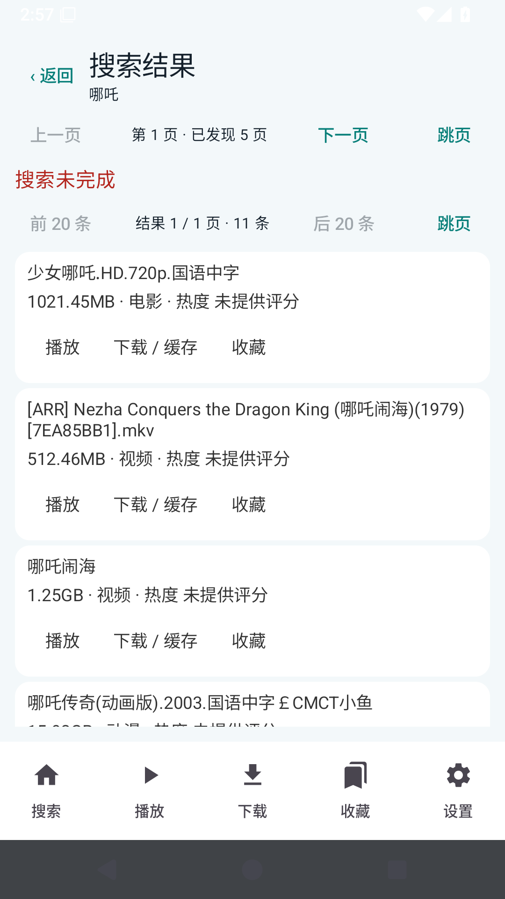

# FreeMangnetPlayer v0.1.16：15 项需求点检报告

日期：2026-10-30。测试环境：Android 15 / API 35 x86_64 模拟器；安装实际 APK，并通过 UI 操作、播放器状态与磁盘数据校验。截图均来自运行中的 App 或独立浏览器。ARM 手机、平板及电视尚需真机验证。

- [ARM64 安装包](https://github.com/liao-zc/FreeMangnetPlayer/releases/download/v0.1.16/FreeMangnetPlayer-v0.1.16-arm64-v8a.apk)
- [离线图文报告](https://github.com/liao-zc/FreeMangnetPlayer/releases/download/v0.1.16/FreeMangnetPlayer-v0.1.16-report.html)
- [源码包](https://github.com/liao-zc/FreeMangnetPlayer/releases/download/v0.1.16/FreeMangnetPlayer-v0.1.16-source.zip)

## 验收结论

本轮字体、历史记录、分页、播放器信息栏及本地收藏功能有实际测试证据。不限速受控做种测试有效载荷峰值 **8.89MB/s**，App 限速值为 0；公网十条资源实际起播 **0/10**，**未达到** 90% 要求。受控测试不能证明任何公网资源都能维持最低 2MB/s。

受控影片首次起播 5.12 秒，当时已下载 6.0%；没有按固定百分比限制起播，但仍须等到所请求的真实分片可读。

字体/历史与队列截图使用做种端限速的受控素材，以便观察尚未完成的缓存；这不是 App 限速。不限速吞吐由另一轮独立测量验证，所有 App 下载/上传限速值均为 0。

## 按用户编号逐项点检

| 编号 | 要求及修改 | 验证结果与边界 |
| --- | --- | --- |
| 1 | 设置页“显示与字体”；小、标准、大、超大及 75%–175% 滑块；黑体、宋体、楷体与自定义 TTF/OTF 导入 | 四档及滑块持久化、三种实际字体加载通过；宋体和楷体随包提供 OFL 字体。自定义字体导入接口已实现，系统文件选择器尚未逐设备点检 |
| 2 | 搜索行显示大小，解析详情显示真实文件字节数 | 提取磁力 xl、结果行及详情页大小；受控网页 39 条均有大小；解析页采用种子文件元数据。网站不提供大小且元数据未取得时显示“等待元数据大小”，**尚未满足所有资源始终有精确大小**，不会填造数值 |
| 3 | 独立历史模块：搜索 50、播放 100、下载 50、缓存 30；名称、时间、播放进度或任务进度 | Android 测试验证各类上限、时间倒序、进度更新和清空；实际 UI 验证播放/缓存/下载记录及清空；入口为“播放 → 历史记录”。清空历史保留缓存、下载文件和收藏 |
| 4 | 搜索名称基准 14sp、深灰 #333333、行高 16.8sp，每屏 20 条 | 39 条分成 2 屏全部可访问；字体设置和 Android 系统字号继续生效。Android 使用 sp；不是硬编码物理像素 |
| 5 | 提升吞吐；播放器内显示时长、分辨率、大小和实时缓存百分比/进度条 | 受控不限速测试峰值 8.89MB/s；真实读取的媒体信息显示通过。媒体头未取得前不能知道时长和分辨率；已读取信息持久化后重开可立即显示。**不能保证公网最低 2MB/s** |
| 6 | 资源节点问题；十条指定磁力实际测试 | 元数据、Peer、有效视频字节、首帧与速度均独立记录；按哈希保存可重连节点，扩大读取预取窗口，优先读取头部和尾部。公网起播 0/10，**未通过 90% 验收**。DHT 路由节点不是做种节点，未将元数据成功算作播放成功 |
| 7 | 只显示“搜索中”进度；减少丢失结果，隐藏引擎来源 | UI 隐藏连接网站/来源信息；扫描结果、详情、data-magnet、输入框及 HTML 中的磁力；受控浏览器结果集合偏差 0。六个真实源另有观测；**真实源结果偏差尚未全部达到 ≤10% 要求**。访问被阻拦或没有可核验结果时不认定达标 |
| 8 | 播放器右上角白色空心爱心；点击红色实心，再点击取消 | 实际点击和收藏存储添加/删除通过。按用户本轮答复维持本地使用；自建账户同步留待未来接入 |
| 9 | 搜索只展示名称、大小、资源类型和热度；隐藏网站/爬取元数据 | 界面已收敛为上述字段及播放/下载/收藏操作。类型从来源文字提取；来源没有评分时显示“未提供评分”，没有生成虚假热度 |
| 10 | 搜索显示文件名，隐藏裸磁力 | 显示结果标题、详情关联标题或 dn 文件名，磁力仅用于操作。受控两条异名详情解析通过；原网页及磁力都不含名称时无法准确得知真实文件名 |
| 11 | 当前页、总页、上一页/下一页及指定页跳转 | 结果屏总页数精确计算；网站页码从原网页提取，实际跳转到第 3 页再回第 1 页及跳转结果屏通过。网站没有总页数或目标页地址时只能显示已发现页数，不编造总页数和地址 |
| 12 | 关闭“查看本网页”验证提示 | 搜索结果 UI 已移除该入口和验证按钮 |
| 13 | 搜索未完成时停止跳动，显示“搜索未完成” | 超时/访问错误停止追加；保留已有结果与返回、重试，真实源错误截图及空页返回校验 |
| 14 | 收藏全选后下载，任务在下载列表可查 | 实际全选收藏、点击下载、查看下载任务及记录通过；按文件 so 选择保留所选目标 |
| 15 | 选择低清不再弹出“没有低清轨道” | 菜单仅显示已发现且能解码的低清轨道；选取明确轨道，支持恢复原画；720p→360p 实际播放通过。单轨文件只有原画选项，未实现转码 |

## 十条公网资源实际结果

每条冷启动测试最多等待 120 秒，清除上次缓存后启动实际播放器，至少播放到 500ms 且收到有效数据才计为起播成功。首帧后继续观测约 10 秒；数据不足不记通过。以下类别采用用户提供的分类，文件名称以实际取得的元数据为准。

| 类别 | 磁力哈希 | 元数据 | 节点 | 有效字节 | 峰值 MB/s | 首帧秒 | 起播 |
| --- | --- | --- | --- | --- | --- | --- | --- |
| 电影 | `B3D7179216306E63081AC0DDA84A714B183263F4` | 有 | 0 | 0 | 0.000 | 未起播 | 未通过 |
| 电影 | `D455858E4FCA306FCF315B1229CAF4AC4E065DBA` | 无 | 1 | 0 | 0.000 | 未起播 | 未通过 |
| 电影 | `6E00F1E081B67749B48141D38950BF6343BC5F10` | 有 | 1 | 0 | 0.000 | 未起播 | 未通过 |
| 动漫 | `665ED0FDA70B0AAFBE2ABE656EE0EA9DAE975389` | 有 | 1 | 0 | 0.000 | 未起播 | 未通过 |
| 动漫 | `840B33399D8C3AC57CF1CD9346ABE31236DDB4C1` | 无 | 0 | 0 | 0.000 | 未起播 | 未通过 |
| 动漫 | `571BB0140930A9B46DBA127D2F23B3EAF6B53530` | 有 | 0 | 0 | 0.000 | 未起播 | 未通过 |
| 剧集 | `FCF228066E11199A85F97AFC023A39BAA482C5B6` | 有 | 0 | 0 | 0.000 | 未起播 | 未通过 |
| 剧集 | `DA0AF5B9CE6BA74445F32576E7C90DD004A89A7F` | 有 | 0 | 0 | 0.000 | 未起播 | 未通过 |
| 剧集 | `C79263E0F308865FBF3A9613F1B2A8DEF1EBAAAA` | 无 | 0 | 0 | 0.000 | 未起播 | 未通过 |
| 纪录片 | `A56FB49D397F177938F8BC5BFBAA7D032DCD074A` | 有 | 0 | 0 | 0.000 | 未起播 | 未通过 |

同默认 Tracker 的独立客户端：1/10 取得元数据，0/10 收到有效视频数据。App 在本轮环境中也未收到目标资源数据；暂未定位为单一网络或程序原因，90% 起播要求仍未解决。

节点数量与速度为本轮环境观测，不等于资源在所有网络中不可用。独立 native 客户端配置同一默认 Tracker 清单另做 180 秒观测；运行时、连接方式和观测时间与 Android 不同，不能把它当成同设备的另一款播放器测试。完整数据见证据。

### 原指定磁力

`magnet:?xt=urn:btih:2362347540B27D8A4142AF2BBE0A071F26A3B7A1`：元数据 有，有效字节 0，起播 未通过。继续保留为固定验收资源。

## 与 Magnet_player 的对照范围

对标仓库：https://github.com/zaidielykelee/Magnet_player 。此前其 APK 在 ARM 转译模拟器中无法稳定运行，尚未完成两款 App 的同设备起播和速度对照；本报告没有将独立 native 客户端冒充对标 App，也没有虚构对方播放画面。此项仍需可运行对标 App 的设备才能验收。

## 六个真实搜索源

| 引擎 | 浏览器磁力数 | App 磁力数 | 可比性与偏差 |
| --- | --- | --- | --- |
| clg.im | 11 | 11 | 无法核验（访问失败或无有效基线） |
| BT搜索（dobt） | 0 | 0 | 无法核验（访问失败或无有效基线） |
| BD电影首发站 | 156 | 0 | 100.0% |
| Pomo | 60 | 198 | 230.0% |
| 美剧粉 | 0 | 0 | 无法核验（访问失败或无有效基线） |
| 高清族 | 48 | 0 | 无法核验（访问失败或无有效基线） |

### 搜索源 1 对照截图

### 搜索源 2 对照截图

### 搜索源 3 对照截图

### 搜索源 4 对照截图

### 搜索源 5 对照截图

### 搜索源 6 对照截图

统计使用唯一磁力哈希集合，不能证明所有网页资源行都对应磁力。浏览器基线取标题含关键词的详情，App 还遍历部分同源其他详情，因此 Pomo 的结果范围偏大；其他源的零结果仍需继续排查访问和详情适配。真实六源一致性尚未通过，不能把额外无关结果视为更好。未把两个访问失败的零结果当成“结果一致”。

## 操作说明和 App 实际截图

### 字体设置

从底部设置进入“显示与字体”，选择四档字号或拖动滑块。

### 宋体与大字号

选择宋体和大字号；黑体、楷体及自定义导入位于同一模块。

### 楷体

选择楷体查看实际字体。

### 播放器收藏

点播放器右上角爱心添加收藏；再点取消。

### 可选画质

点内置画质按钮，仅列出已识别的可选轨道。

### 媒体信息及缓存进度

点播放画面唤出控制栏，查看真实时长、分辨率、大小和缓存百分比。控制栏会自动隐藏。

### 手动保留缓存

点击缓存后按钮变为已缓存；退出资源后从缓存视频入口重新打开。

### 收藏批量下载

收藏页全选或多选后下载，进入下载列表查看。

### 播放历史

播放页进入历史记录，切换搜索、播放、下载、缓存类别；支持删除记录和清空。

### 缓存重启入口

缓存后从“播放 → 缓存视频”重新打开指定文件。

### 20 条分页第 1 屏

显示文件名称、大小、类型、热度；分页栏提供上一屏、下一屏和跳页。

### 20 条分页第 2 屏

同一个网站页 39 条分为两屏，没有截断。

### 结果页跳转

点“跳页”，输入目标页码并确认。

### 不限速实际播放

受控不限速做种，实际播放和有效载荷速度。

### 十条资源逐条截图

## 详细检查和测试入口

| 检查项 | 结果 |
| --- | --- |
| `default-original-quality` | 通过 |
| `quality-control-inside-player-with-no-transcoding-claim` | 通过 |
| `explicit-cache-records-files-before-completion` | 通过 |
| `partial-downloaded-video-auto-enters-queue` | 通过 |
| `next-control-switches-to-partial-video` | 通过 |
| `download-library-indexes-individual-files` | 通过 |
| `favorite-file-record` | 通过 |
| `cache-entry-discoverable-after-process-restart` | 通过 |
| `cached-file-reopens-and-plays` | 通过 |
| `existing-lower-resolution-track-selects-real-360p` | 通过 |
| `original-quality-restores-highest-track` | 通过 |
| `favorite-delete-keeps-cache-files` | 通过 |
| `batch-history-delete-keeps-cache` | 通过 |
| `single-cached-file-delete-preserves-other-files` | 通过 |
| `batch-cache-file-delete` | 通过 |
| `batch-download-file-deletion` | 通过 |
| `display-font-module-and-four-presets` | 通过 |
| `song-font-and-large-preset-persist` | 通过 |
| `kai-font-applied` | 通过 |
| `favorite-heart-adds-current-video` | 通过 |
| `favorite-heart-second-tap-removes` | 通过 |
| `actual-duration-resolution-size-and-cache-progress` | 通过 |
| `play-and-cache-history-created` | 通过 |
| `favorite-select-all-download-visible-in-library` | 通过 |
| `independent-history-module-and-timed-progress` | 通过 |
| `clear-single-history-keeps-other-records` | 通过 |
| `clear-all-history-keeps-favorites` | 通过 |
| `source-page-1-complete` | 通过 |
| `local-twenty-result-screen-1` | 通过 |
| `local-twenty-result-screen-2` | 通过 |
| `local-page-back-restores-first-screen` | 通过 |
| `source-page-2-complete` | 通过 |
| `source-page-3-complete` | 通过 |
| `previous-page-restores-all-results` | 通过 |
| `website-page-jump-three-and-one` | 通过 |
| `local-result-page-jump` | 通过 |
| `empty-page-and-back-responsive` | 通过 |

回归流程按已完成子项记录；旧 library/吞吐流程曾在后续 UI 脚本失败，不能把整个旧流程标为通过。吞吐重试曾因多行输入框未完全清空而贴入残留字符，已改为全选后替换。最终专项流程状态以对应 Actions 链接为准。

Android 设备测试另校验字体真实加载、字号持久化、各类历史数量上限、时间倒序、播放进度及收藏存储切换。

- [library 测试过程](https://github.com/liao-zc/FreeMangnetPlayer/actions/runs/40986851277)

- [preferences 测试过程](https://github.com/liao-zc/FreeMangnetPlayer/actions/runs/40990866522)

- [pages 测试过程](https://github.com/liao-zc/FreeMangnetPlayer/actions/runs/40994181448)

- [public 测试过程](https://github.com/liao-zc/FreeMangnetPlayer/actions/runs/40986864228)

- [native 测试过程](https://github.com/liao-zc/FreeMangnetPlayer/actions/runs/40988375209)

- [performance 测试过程](https://github.com/liao-zc/FreeMangnetPlayer/actions/runs/40988171757)

- [search 测试过程](https://github.com/liao-zc/FreeMangnetPlayer/actions/runs/40994186837)

[字体/历史证据](evidence/current-preferences.json) · [分页](evidence/current-pages.json) · [十条公网资源](evidence/current-public.json) · [独立客户端](evidence/current-native.json) · [吞吐](evidence/current-performance.json) · [真实搜索](evidence/current-search.json)

当前报告及截图替换旧版本资料；旧 Git 历史和 Release 保留。Markdown 使用 UTF-8 明文，发布后核对 GitHub 字节和渲染，另提供内嵌图片 HTML。

## 正在进行的文件名与公网连接修复（2026-10-30）

本节为排查记录，十条公网磁力尚未通过边下边播验收。

- 操作文案“查看详情”“查看详细”等不再作为资源名称；优先保留有效网页文件名，缺失时使用磁力 dn。多个磁力共用的页面总大小不再分配给每条结果。
- 删除添加磁力之前无限等待 DHT 就绪的逻辑，让 Tracker 连接立即启动；DHT 在路由节点可用后继续工作。
- 使用本机 libtorrent 2.1.1，关闭下载和上传限速，分别测试全部网卡与绑定实际 WLAN。两组客户端通过局域网发现互相连接产生的节点不计为公网有效资源节点；后续诊断关闭局域网发现。
- 分页回归第一次失败：有效网页文件名被磁力 dn 替代。已恢复网页有效文件名优先并重跑。第一次失败不能记为通过。
- 最新 Ubuntu 对照种子的 HTTPS Tracker 已返回节点，实际有效数据仍需继续观察。HTTPS 可访问不等于 BT 下载通过。
- 本轮源码已同步 GitHub；尚未发布新 APK，v0.1.16 的旧测试结果不代表本轮修复已通过。

正在执行的回归：[搜索分页](https://github.com/liao-zc/FreeMangnetPlayer/actions/runs/41000403214)、[十条磁力真实播放](https://github.com/liao-zc/FreeMangnetPlayer/actions/runs/41000002632)、[列表与播放功能](https://github.com/liao-zc/FreeMangnetPlayer/actions/runs/41000014234)。

优化依据：[libtorrent 流式分片调度说明](https://www.libtorrent.org/streaming.html)。该说明要求按播放读取位置设置紧急分片 deadline；单纯顺序下载不能保证首个分片被最快节点处理。

### 新版引擎评估进展

独立分支 [improve/modern-bt-engine](https://github.com/liao-zc/FreeMangnetPlayer/tree/improve/modern-bt-engine) 使用 Maven Central 已发布的 libtorrent4j 2.1.0-39，四种 JNI 架构与 Java 版本一致。已适配元数据导出、Tracker 参数及优先级接口；用累计有效接收字节识别下载进展，避免把低于 1KB/s 的下载误判为无进展。

[新版 APK 的十条播放测试](https://github.com/liao-zc/FreeMangnetPlayer/actions/runs/41001410886) 已通过 assembleDebug，模拟器验收仍在进行。编译通过不代表播放通过，该分支尚未并入 main，也未发布新版本。

本机绑定 WLAN 的十条诊断运行约 597 秒：10 条均未取得元数据，视频有效下载字节均为 0。公开 Ubuntu 最新对照种子取得 1,572,864 字节实际数据，证明当前环境存在可用 BT 传输路径，不能直接据此认定十条目标种子无节点。

搜索分页仍漏抓 2 个详情页（37/39），已增加真实过滤异常与工作线程状态诊断并继续重跑，尚未通过本轮完整分页验收。
