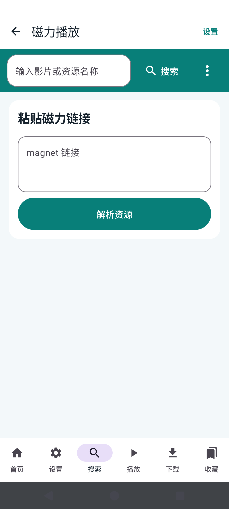
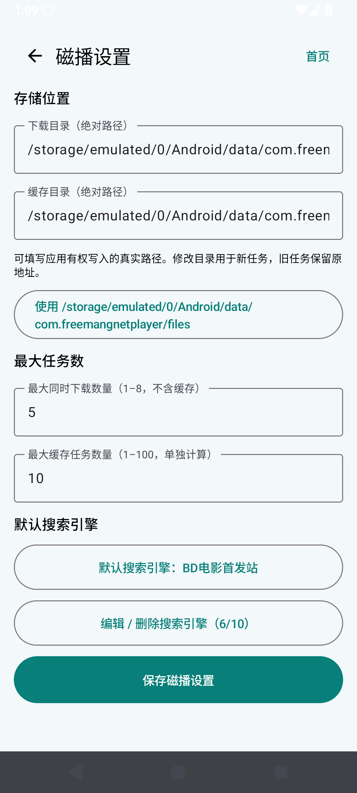
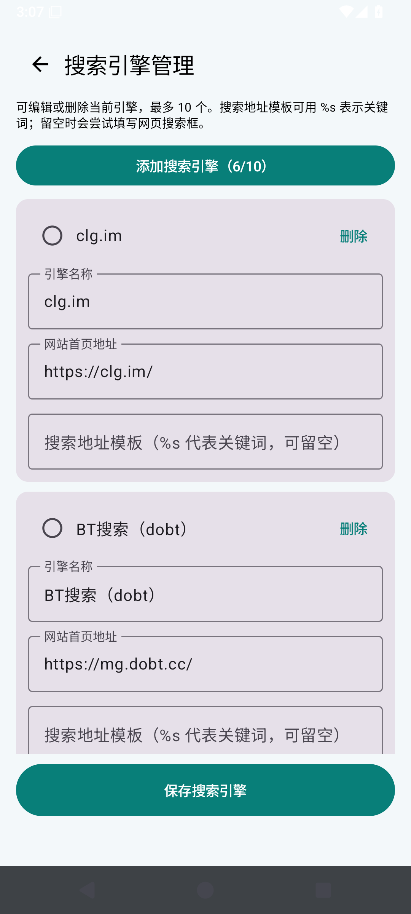
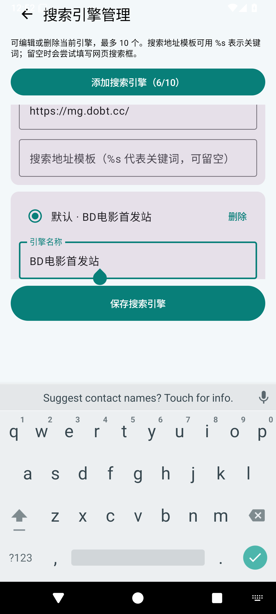
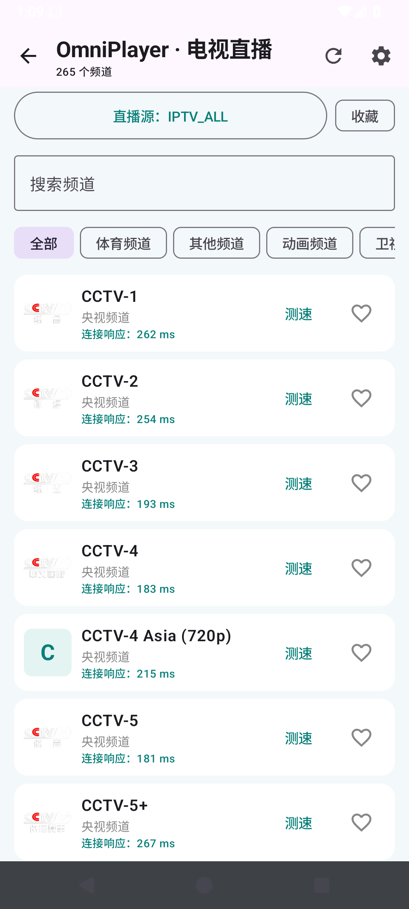
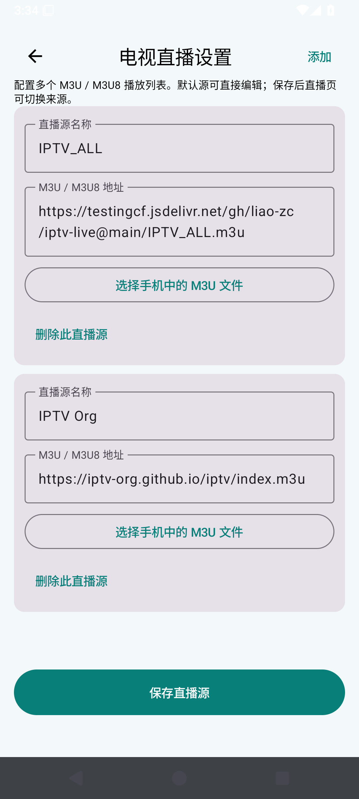
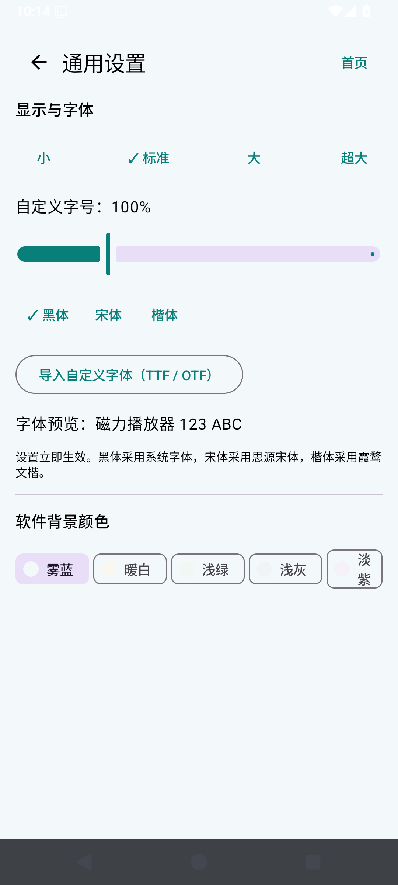
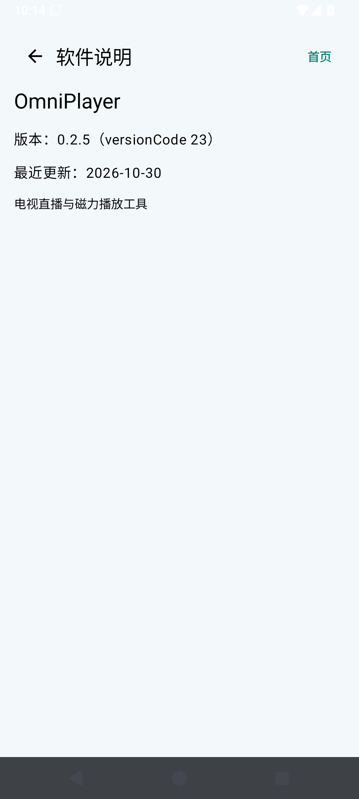

# OmniPlayer 使用说明

本说明当前安装截图来自 v0.2.6；v0.2.8 新界面截图需等待本轮模拟器验收后补充。逐项验收状态和本轮新截图见[点检报告](report.md)。报告会标明截图采集版本；历史截图不作为本轮 UI 验收证据。

## 首页

首页展示“电视直播”“磁力播放”两个功能卡片和统一设置入口。首页底栏不再重复提供磁力播放入口。电视与磁力模块各自可通过顶部返回键回到首页。

## 磁力播放

点击首页“磁力播放”卡片进入搜索、磁力解析和播放模块。模块底栏包含搜索、播放、下载、收藏列表。模块顶部的“设置”直接打开磁播设置；该页只管理磁播的存储目录、任务上限和搜索引擎。六个内置搜索源可在“编辑 / 删除搜索引擎”中修改、删除或设为默认，最多保存 10 个；首次配置默认使用 BD电影首发站，旧配置会保留。首页统一设置中的“磁播设置”打开同一页，修改结果保存在同一组本地配置中。

可在磁播设置中进入搜索引擎管理页，编辑名称、网站首页和关键词模板，删除不需要的源，或添加自定义源。最多 10 个；搜索结果页的返回键回到关键词页。无 Peer 且无有效数据持续 3 分钟时，任务和列表会保留醒目的资源节点提示，下载/缓存计数不包含该项；可显式点“重新尝试”。磁力本身不提供做种开始时间，页面显示的是搜索源提供的资源上架时间（若源有提供）。

搜索结果页只显示一个标题和一个返回入口，系统返回与工具栏返回均回到保留关键词的搜索页。分页只保留上一页/下一页图标；点击中间页码可跳到已发现的页。排序图标下可选匹配度、时间或热度。时间按天显示，来源未提供发布日期时不会从 magnet 哈希推测日期。v0.2.8 的新界面截图将在模拟器验收通过后补充。

## 电视直播

点击首页“电视直播”卡片浏览频道、按分组筛选、切换频道或管理收藏。直播页的齿轮打开电视直播设置；该页只管理 M3U/M3U8 源。首页统一设置中的“直播设置”进入同一个源管理页，列表与所选源共享同一份配置。

首次启动默认源为 `https://testingcf.jsdelivr.net/gh/liao-zc/iptv-live@main/IPTV_ALL.m3u`。`https://iptv-org.github.io/iptv/index.m3u` 作为备用源一并提供。已有安装会迁移并保留用户自定义源，同时将 IPTV_ALL 设为当前源；用户仍可编辑、添加、删除源。

## 设置

统一设置页按“直播设置”“磁播设置”“通用设置”“软件说明”分组：

- **直播设置**：仅管理直播源。
- **磁播设置**：仅管理磁播搜索引擎、下载/缓存目录及并发任务数量。
- **通用设置**：字体与背景颜色，作用于电视直播和磁力播放。
- **软件说明**：显示应用名称、版本号与更新时间。

## 安装包与测试边界

README 中的下载链接指向 GitHub Release。频道列表显示成功不代表直播源一定持续可播；磁力文件列表解析成功也不代表存在可用 Peer。请查看点检报告中的真实网络测试和未通过项，不要将旧版截图误认为新版本验收。

### v0.2.8 本轮界面调整

搜索结果只有一个分页行和一个排序入口。电视直播播放器的非全屏布局会在画面下展示按分组筛选的频道列表；频道行保留台标、名称和连接响应耗时。顶部“观看历史”入口支持多选删除；记录会保存频道 URL 与台标，即使移除原直播源也可从历史重新打开。

磁力播放器对 MKV 优先使用兼容解码器，以覆盖常见的 HEVC / Dolby Vision / E-AC-3 轨道组合。播放器信息栏会在媒体探测到时显示时长和分辨率；文件大小与缓存进度来自种子文件元数据和实际已下载字节。节点没有送来开头所需的已校验分片时，播放仍需等待数据，界面会显示任务节点状态。
### v0.2.8 新增入口说明

搜索结果使用一行上一页/下一页图标；点击页码可跳到已经发现链接的页面。排序图标下选择匹配度、时间或热度。发布日期精确显示到日；magnet 本身不含做种创建日期，来源未提供时不会推算。

电视直播播放页在非全屏时会在画面下显示分组频道列表，可直接切台。右上角观看历史入口支持多选/全选删除；历史保存频道 URL 与台标快照，移除直播源后仍能打开历史中的频道。

MKV 默认先使用设备硬件解码；8 秒没有首帧时自动切换 LibVLC 兼容解码，以保持 4K 硬件播放效率并补足 HEVC、Dolby Vision 和 E-AC-3 组合的兼容性。时长与分辨率需等待解码器读出媒体信息；资源节点尚未提供首段已校验视频数据时，画面仍不能起播。