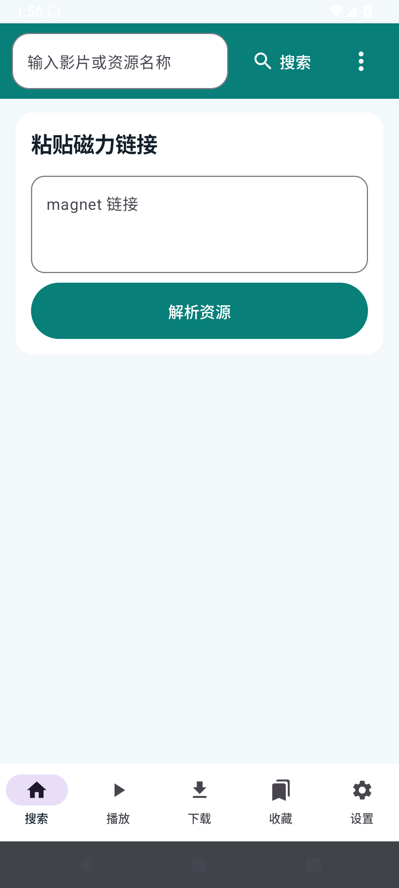
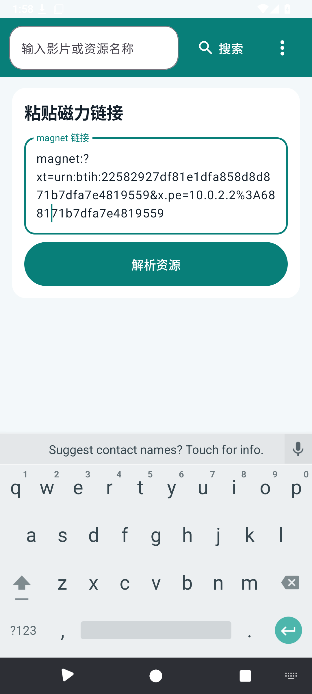
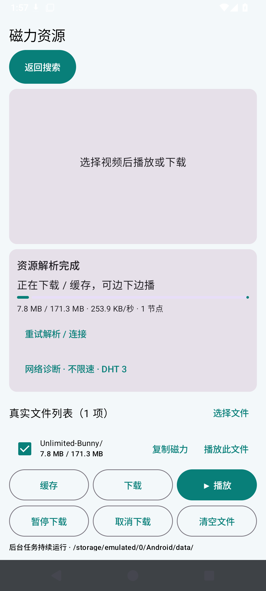
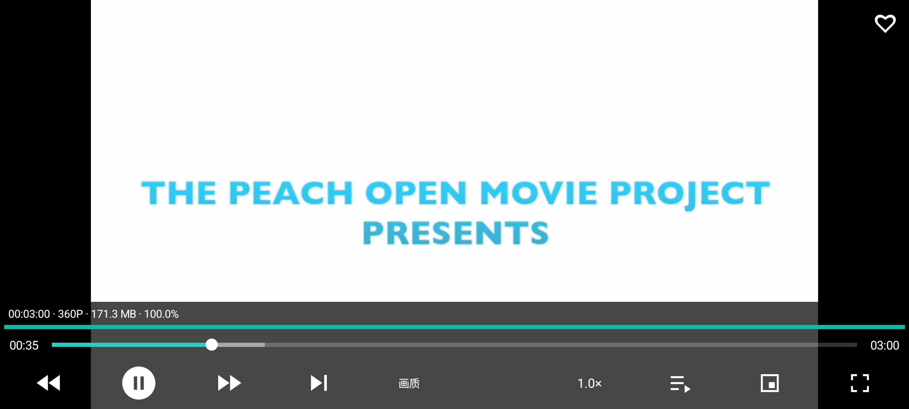
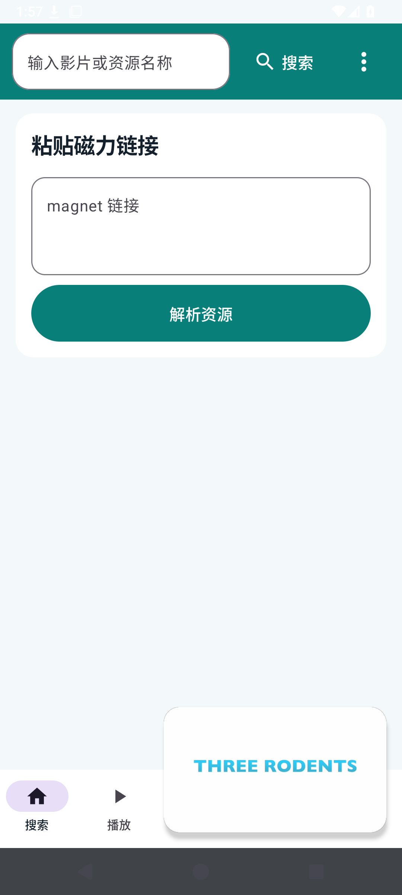
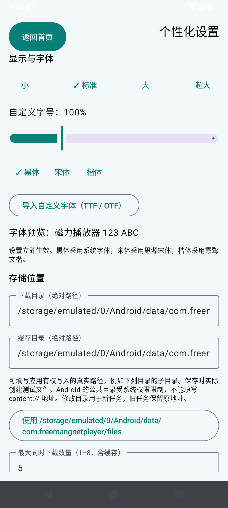

# FreeMangnetPlayer 使用说明

本页是操作入口说明。[最新优化与验收报告](report.md) 单独记录测试结果。已发布 APK 仍为 v0.1.16；新版 BT 引擎尚未发布。截图来自实际运行的 App：播放相关截图使用受控做种视频，搜索截图使用受控网页，不代表十条公网磁力已经起播。

## 1. 首页与设置

打开 App 后，使用搜索、磁力解析入口或底部播放、下载、收藏、设置入口。设置位于最下面。

## 2. 搜索与分页

输入关键词搜索。结果行提供播放、下载/缓存、收藏。上方“上一页 / 下一页”切换网站页，“前 20 条 / 后 20 条”切换该网站页内的结果；“跳页”用于输入页码。

## 3. 粘贴磁力并解析

在磁力入口粘贴完整 magnet 链接，开始解析。取得元数据后显示文件列表。取得列表仍需等待可用节点传输视频分片，不能据此认定能播放。

## 4. 播放与进度

选中视频播放。点击播放器画面显示内置控制栏，可播放/暂停、前后跳转、调倍速，并拖动时间进度条。信息栏显示已读取的时长、分辨率、大小和缓存进度。

## 5. 全屏与悬浮

点击播放器内全屏图标进入全屏；点击悬浮图标进入画中画。系统需要支持并允许画中画。

## 6. 收藏与取消收藏

播放器右上角点击空心爱心添加收藏，再次点击实心爱心取消。当前收藏仅保存在本机，没有跨设备账户同步。

## 7. 收藏批量下载

进入收藏列表，选择多个或全选后点击下载，再到下载列表查看任务。

## 8. 保留缓存与再次打开

需要保留的视频应主动点击缓存。退出后到播放列表查找已保留内容，可以在尚未完成缓存时继续打开。

## 9. 切换目录内已存视频

播放器文件列表会列出已缓存或下载的视频，包括未完成的任务。选择其他视频或使用下一集入口切换。

## 10. 删除一个或多个文件

播放/缓存列表中选择目标，使用删除操作；多个目标可批量删除。删除数据会释放对应存储空间。

## 11. 下载与存储设置

设置页可调整下载地址、缓存地址、默认搜索引擎及任务数量。下载列表查看实际任务；清理或删除前确认所选任务。

## 12. 字体设置

打开设置页“显示与字体”，选择小、标准、大、超大，或拖动自定义滑块；选择黑体、宋体、楷体或导入字体。

## 13. 历史记录

从播放入口进入历史记录。可查看搜索、播放、下载、缓存记录，选择分类清空或清空全部历史。清空历史不会自动删除下载文件和收藏。

## 14. 画质选项

播放器画质菜单只列出文件实际具有并能识别的轨道。单轨视频只有原画；降低显示分辨率不能降低原文件下载量，本版未实现实时转码。

