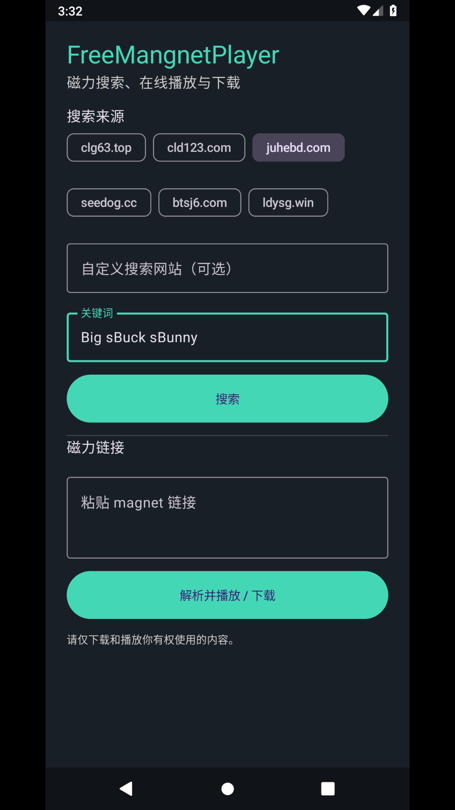
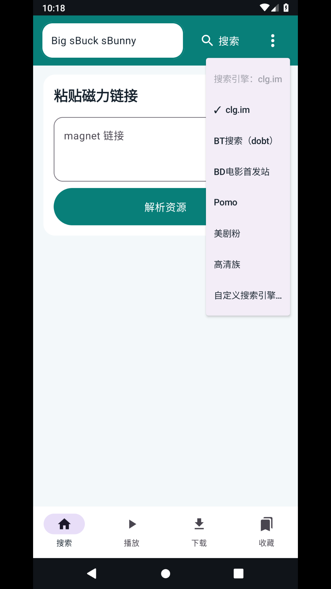
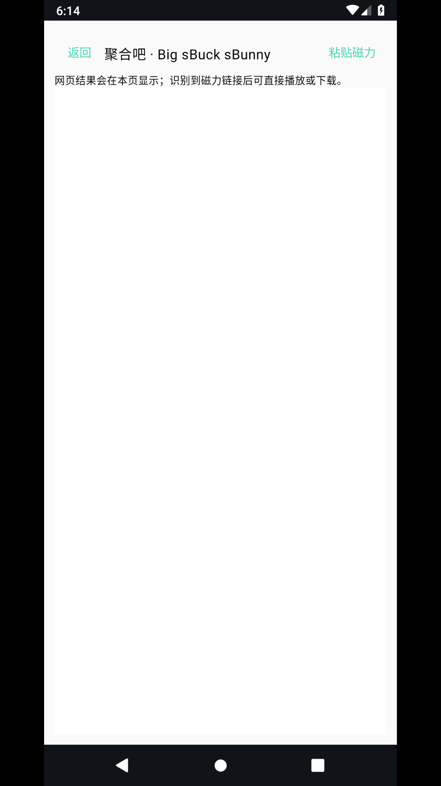
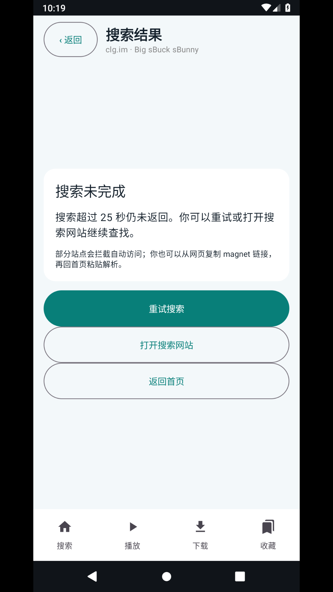
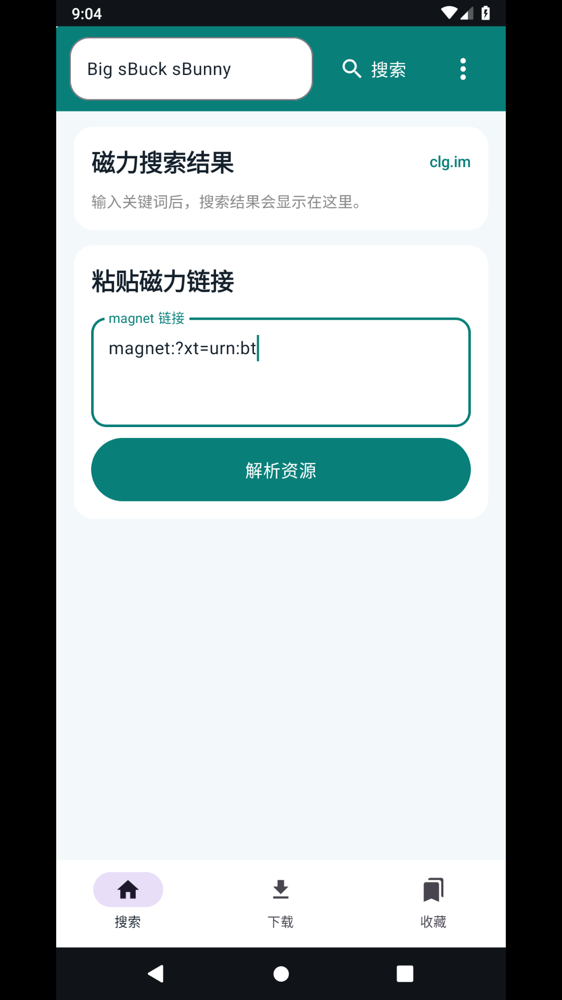
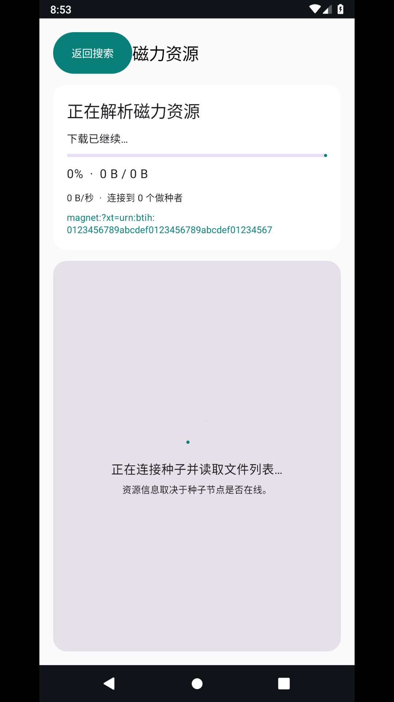
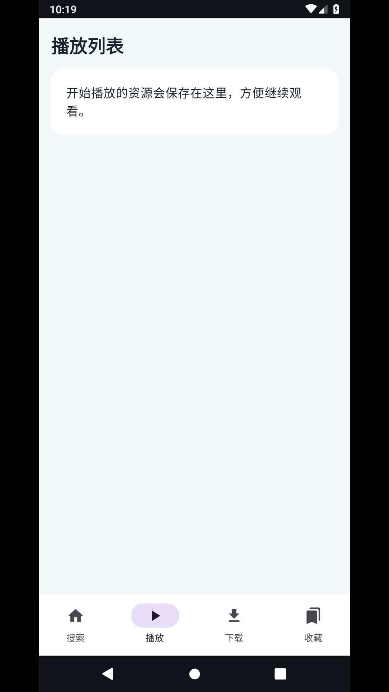
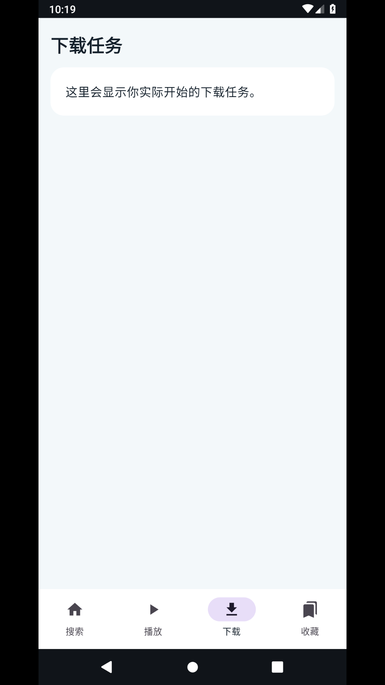
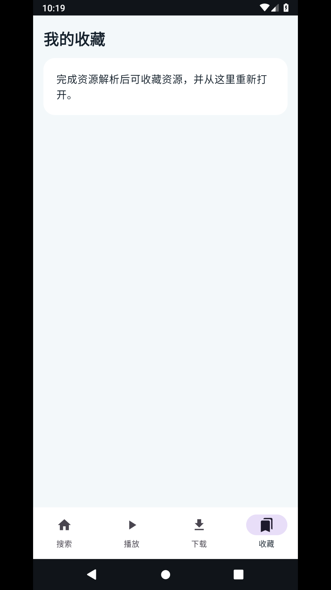

# FreeMangnetPlayer 界面使用说明与逐项验证

本说明对应当前应用的界面。PNG 截图由 GitHub Actions 在 Android 模拟器中运行应用后生成。磁力示例仅用于检验输入和解析页面，不代表该资源能连接、播放或下载。

## 1. 首页与搜索引擎

启动应用后，首页提供关键词搜索框、右上角引擎菜单、磁力链接解析入口，以及底部“搜索 / 播放 / 下载 / 收藏”四个可用页面。搜索引擎菜单只列 clg.im、mg.dobt.cc、BDFlixs、Pomo、MJf2020、HDZU 六个预设和一个“自定义搜索引擎”设置项。自定义 URL 可使用 `%s` 替换关键词；没有 `%s` 时应用尝试自动提交网页搜索表单。

## 2. 搜索结果页

输入关键词并点击“搜索”后，应用切换到独立的“搜索结果”页面。顶部“返回”按钮和 Android 系统返回键可回到首页。识别到 magnet 时，每项显示文件名及“解析 / 播放”“下载 / 缓存”按钮；没有识别到时显示原因、重试、打开网站和返回首页操作，不会停留在无出口的空白页面。

抓取器扫描当前搜索页及最多 12 个同站详情页。站点验证码、访问限制、网页结构变更、详情页没有 magnet 都会影响结果。用户可从浏览器复制链接，回首页粘贴解析。

## 3. 解析磁力链接

在首页的“粘贴磁力链接”框输入完整 `magnet:?xt=urn:btih:...` 地址，点击“解析资源”。解析页面会显示连接状态、进度、下载速度与做种者数量。取得种子元数据后可预览、下载或播放；45 秒仍没有元数据时会显示失败原因和返回按钮。

## 4. 播放、下载、收藏

取得元数据后，解析页提供“预览”“下载”“播放”操作。视频开始播放后可用播放器控制条及屏幕上的快捷键：后退 15 秒、前进 15 秒，速度依次循环 0.5×、0.75×、1×、1.25×、1.5×、2×。种子里有多个文件时当前版本选择最大文件。

解析/播放页的“收藏”会将资源保存到本机。“播放”页保存最近开始播放的资源，“下载”页记录已启动的任务，“收藏”页显示已收藏的资源；列表项可重新打开或下载。下载仍依赖应用任务页面存活，当前版本不保证退出应用后的后台续传。

## 5. 按要求逐项验证

| 检查项 | 已实现内容 | 验证状态 |
| --- | --- | --- |
| 六个指定搜索引擎加自定义设置 | 菜单中固定为六个预设加一个自定义项 | 截图自动化逐个检查菜单文案；见 `03-engine-settings.png` |
| 首页白屏 | 启动默认选中搜索首页；首次启动不创建隐藏 WebView | 截图自动化冷启动后检查首页标题、解析入口、四个底部入口；见 `01-home-keyword.png`。此前报告过白屏，需以本次 CI 新生成截图确认修复 |
| 搜索结果跳转及返回 | 独立结果页、屏幕内返回按钮、系统返回键处理 | 自动化检查结果页标题/返回控件并截屏；见 `04-in-app-results.png`、`07-search-no-result.png` |
| 解析入口 | 首页粘贴链接后检查 BTIH 并进入解析页 | 自动化使用虚构格式正确的哈希确认页面可打开；它不能证明种子在线 |
| 播放、下载和收藏列表 | 四个底部入口均有页面；播放记录、下载记录与收藏本地保存 | 自动化打开并检查三个列表标题，分别截图；空列表截图不证明条目持久化的往返测试 |
| 倍速及前进/后退 | ExoPlayer 播放控件就绪后出现 seek 与倍速按钮 | 已检查实现代码；没有在线可播放种子和设备手工操作证据，不能报告真实视频播放闭环通过 |
| 手机 / 平板 / Android TV | minSdk 24，采用响应式 Compose 布局 | 自动化目标为手机模拟器；平板与电视布局需对应设备复核 |

## 6. 验证限制与环境说明

本地环境当前没有 Java、Android SDK 或 adb，因而本地构建和设备操作尚未运行。推送到 GitHub 后，仓库 Actions 会构建 APK、在 Android 模拟器启动应用、检查关键控件并更新本目录截图；Actions 结果是本次界面校验的最终证据。

成功显示解析页只代表 APP 接受了 BTIH 格式。获取文件列表需要 DHT/tracker 网络及在线做种者；播放、下载是否成功还依赖种子内视频和可用网络。当前没有可靠在线种子实测报告，不应将示例截图理解为真实影片画面或下载完成。

兼容范围为 Android 7.0（API 24）以上手机、平板及 Android TV。应用数据和应用 Movies 私有目录缓存会在清除数据或卸载时删除。请仅使用你有权访问的资源。
