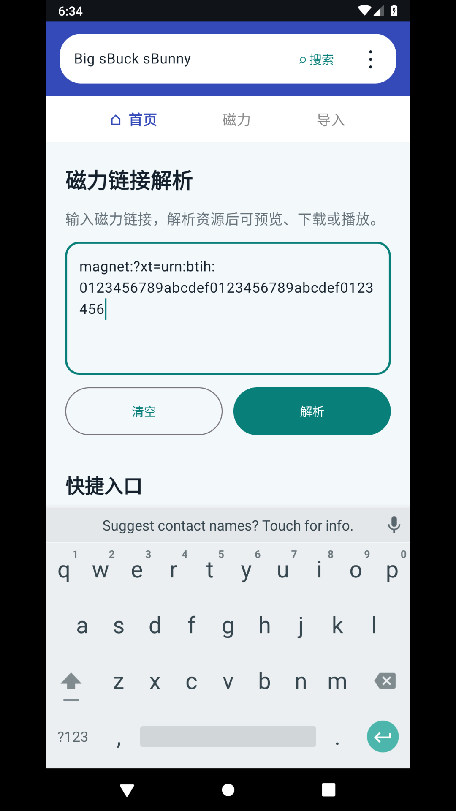

# FreeMangnetPlayer 使用说明

本说明对应当前应用界面。配图由 Android 模拟器运行应用后截取。搜索站点由用户在应用“设置”中选择；首页不显示站点地址。磁力资源截图若使用虚构链接，只说明页面操作，不代表资源可用。

## 1. 输入关键词

打开应用，在唯一的关键词输入框输入要搜索的名称，点击“搜索”。

## 2. 选择搜索来源

点击首页右上角“设置”，从预置来源中选择默认搜索引擎。这里只显示引擎名称，网址由应用配置管理。完成后返回首页继续搜索。

## 3. 在应用内查看搜索结果

搜索页面在应用内打开。页面中的普通链接继续在应用内浏览；点击或识别到 magnet 链接后，链接会加入页面上方的磁力资源列表。若站点没有暴露磁力地址，可点“粘贴磁力”手动加入 magnet 或 .torrent 地址。站点改版、验证码、网络状态和页面链接形式可能影响识别。本次云端模拟器未能加载出第三方结果页内容；没有识别到链接时，列表不会出现虚构结果。

搜索页右上角“粘贴磁力”可以手动添加 magnet 或 `.torrent` 文件地址。

## 4. 播放、下载或缓存

在磁力资源卡片上点击“播放”或“下载 / 缓存”。播放页面显示连接状态、下载进度、速率和做种者数量。视频缓冲后会尝试播放；下载模式会在当前页面继续显示进度，完成后可以点击“播放已下载文件”。

当前版本会自动选择种子中的最大文件，并保存在应用专属 Movies 目录。请保持任务页面打开；目前没有后台服务、退出后的续传或下载任务库。能否播放取决于种子做种者、网络和设备支持的视频编码。

## 5. 兼容性与注意事项

- Android 7.0（API 24）及以上；面向手机、平板和 Android TV。电视输入关键词需要系统输入法。
- 下载缓存位于应用专属存储。卸载或清除应用数据会删除文件。
- 只下载和播放你有权使用的内容。