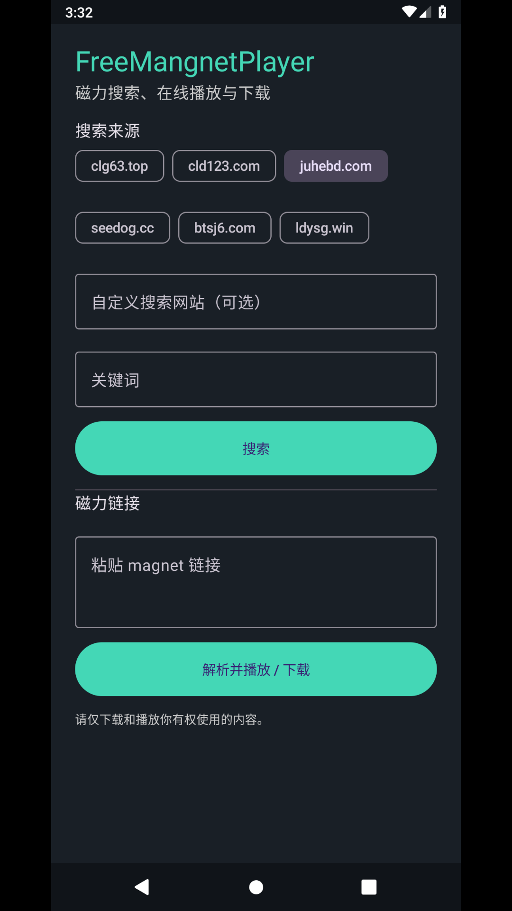
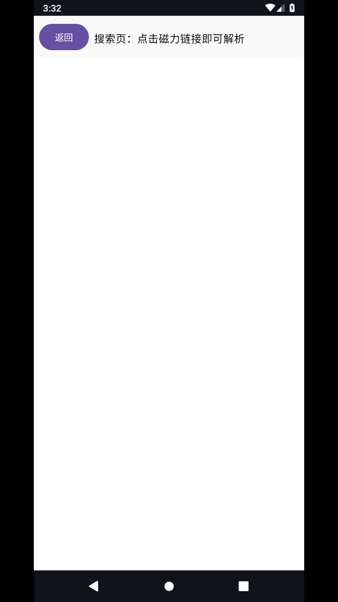
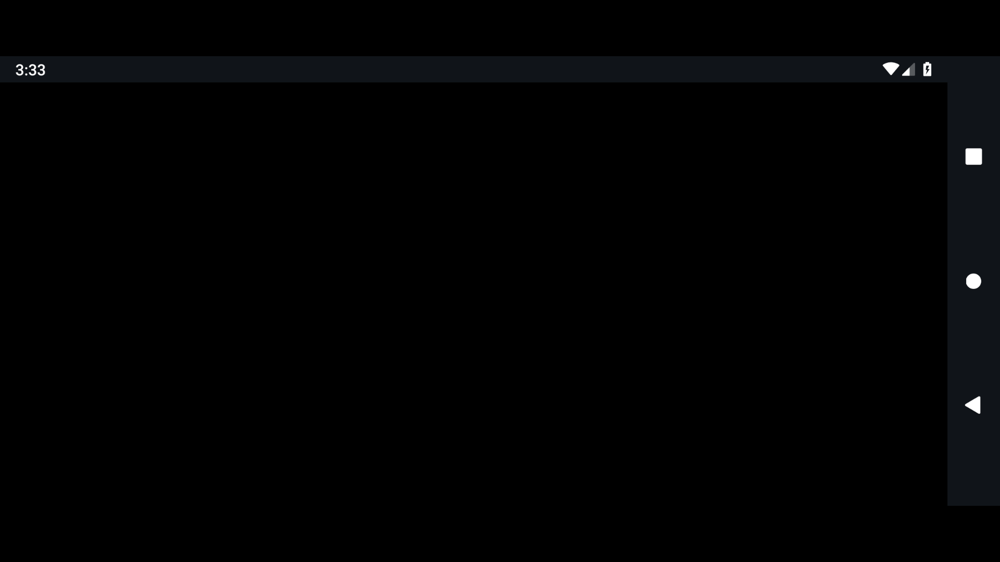

# FreeMangnetPlayer 使用说明

本说明按应用内的实际操作顺序编写。截图由 Android 35 模拟器运行 FreeMangnetPlayer 后直接截取。搜索示例使用《Big Buck Bunny》；磁力链接截图使用虚构地址，只用于展示输入位置，不会获得种子元数据或开始实际下载。

## 1. 打开应用并选择搜索来源

启动后进入首页。点击一项来源名称切换站点；默认内置 6 个来源。也可以在“自定义搜索网站”里填入其他网站首页地址。

## 2. 输入关键词

在“关键词”框输入要搜索的名称。示例使用公有领域短片标题。

## 3. 查看站内搜索页

点击“搜索”。应用会在内置浏览器打开所选网站，并尝试把关键词填入页面上的搜索框。网站表单或页面布局变化时，可能需要在网站页面中手动输入关键词。

在站点结果中点击磁力链接，应用会切换到解析和播放页面。搜索结果由第三方网站提供，请确认内容和下载权限。

## 4. 手动粘贴磁力链接

也可以返回应用首页，把 `magnet:?` 开头的完整链接粘贴到“磁力链接”输入框。

## 5. 开始解析、缓存和播放

点击“解析并播放 / 下载”后，应用启动磁力任务。获取到种子元数据并收到首批数据后，播放器尝试打开种子中的最大文件；下载内容保存在应用专属 Movies 目录。

这张截图使用的是虚构磁力链接，因此只展示播放器启动后的实际界面，不代表该演示资源可播放。当前版本没有下载进度列表、后台下载队列、种子内文件选择或续传管理；可播放性取决于资源有可连接的做种者、视频编码受设备支持，以及视频容器是否允许边下边播。

## 适配与注意事项

- 目标为 Android 7.0 及以上，支持 arm32、arm64、x86 和 x86_64 架构。
- 手机和平板使用触控；Android TV 可通过遥控器焦点操作，但文字搜索仍需使用设备输入法。
- 缓存位于应用专属存储。卸载应用或清除应用数据会移除这些文件。
- 搜索站点不是应用的一部分；站点改版、验证码或网络限制都可能影响搜索。
- 只下载和播放你有权使用的内容。
